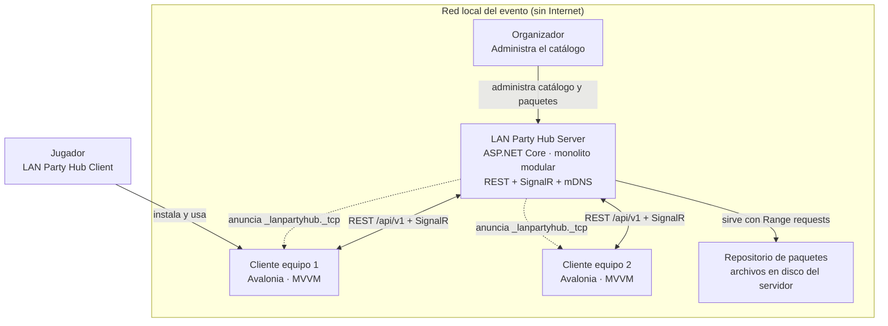
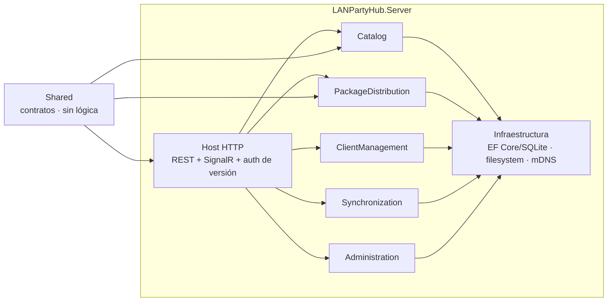
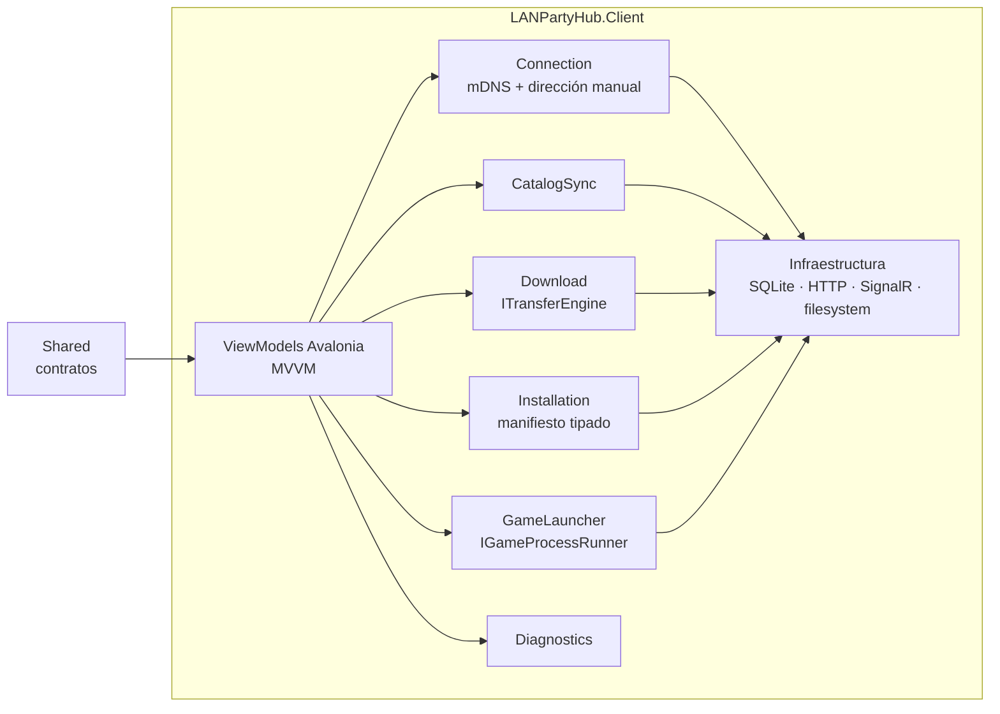
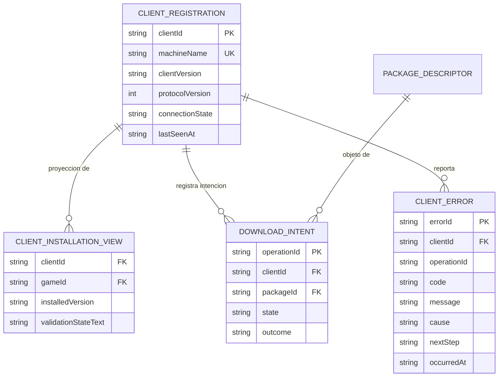
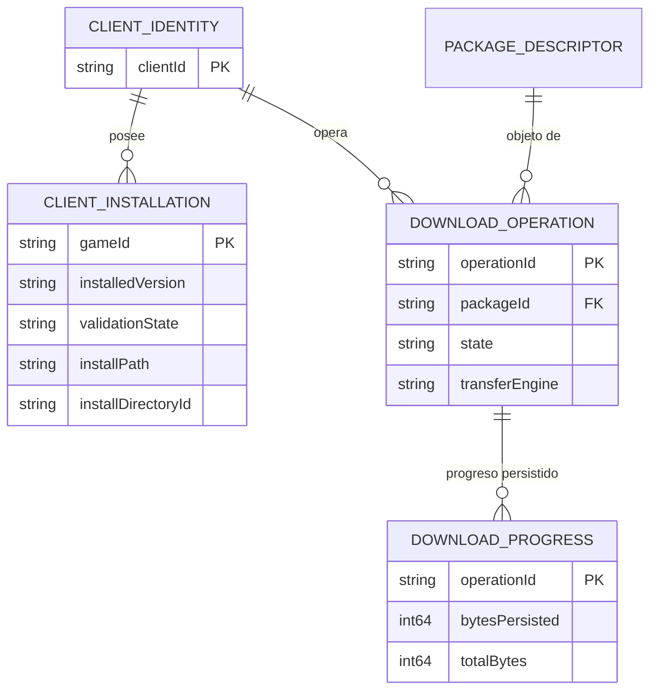
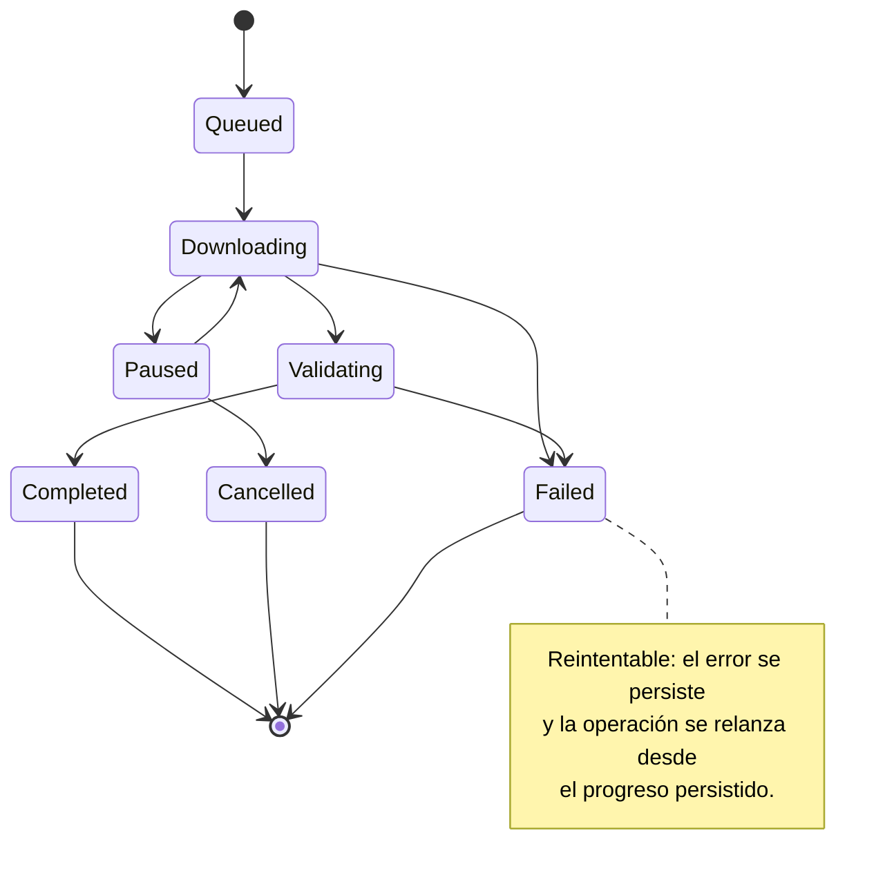
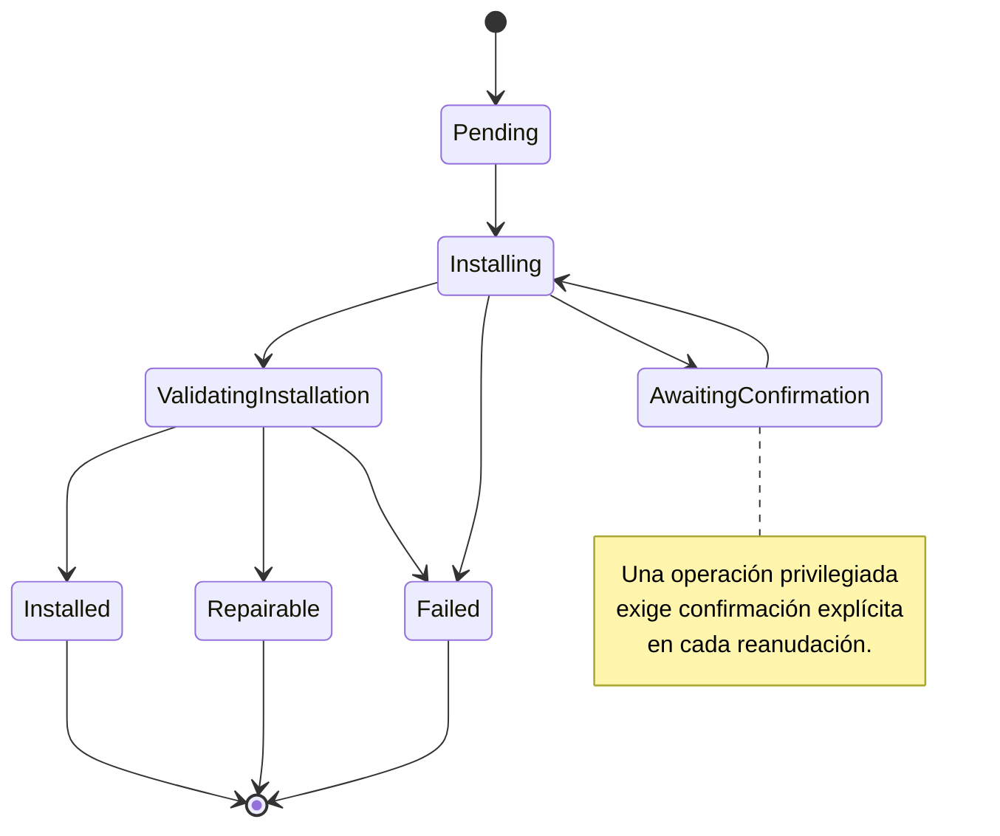
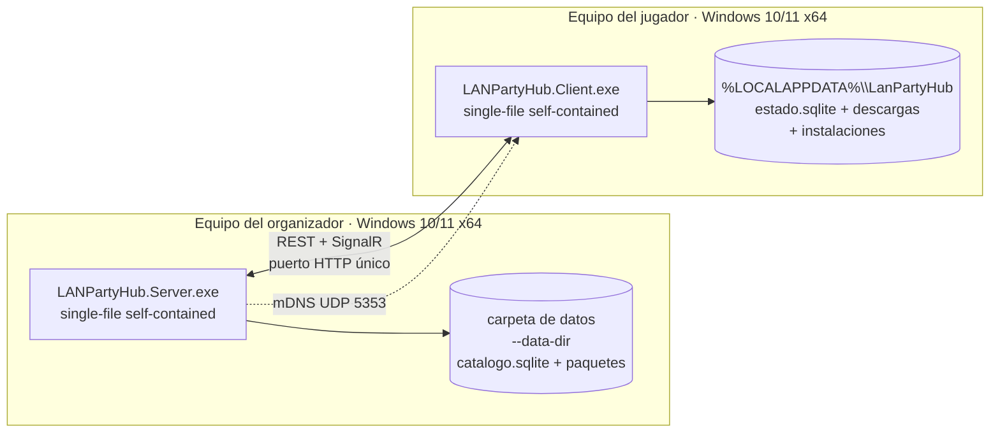

# Architecture Spine — LAN Party Hub

## Design Paradigm

**Clean Architecture / Hexagonal (ports-and-adapters), materialized as a modular monolith per deployable.**

Three concentric rings per deployable (server, client), plus a contract-only shared module:

```text
LANPartyHub/
  src/
    Server/          # deployable: event server (modular monolith)
    Client/          # deployable: desktop client (Avalonia, MVVM)
    Shared/          # contracts only: DTOs, ids, enums, events, protocol version
  tests/
    UnitTests/
    IntegrationTests/
    EndToEndTests/
  docs/
```

- **Dominio** — entidades, value objects, máquinas de estado y reglas puras. Sin dependencias de framework, sin E/S, sin UI.
- **Aplicación** — casos de uso que orquestan dominio y puertos. Define los puertos (`ITransferEngine`, `IPackageTrustVerifier`, `IGameProcessRunner`, `IServerDiscovery`, `IRepository`).
- **Infraestructura** — adaptadores que implementan los puertos (EF Core/SQLite, HTTP, SignalR, mDNS, motor de proceso, sistema de archivos).
- **Presentacion (cliente)** — ViewModels Avalonia que consumen casos de uso del cliente. No contienen reglas de negocio.

Dependencias: hacia adentro, siempre. `Infrastructure → Application → Domain`. `Shared` no depende de nadie del proyecto. Un módulo de dominio no importa jamás un adaptador ni una biblioteca de terceros.

Módulos del servidor (los **únicos** del MVP): `Catalog`, `PackageDistribution`, `ClientManagement`, `Synchronization`, `Administration`. **No existe** un módulo `Tracking`: el tracker P2P no forma parte del MVP y solo aparece si S-3 lo valida (AD-13, AD-28).
Módulos del cliente: `Connection`, `CatalogSync`, `Download`, `Installation`, `GameLauncher`, `Diagnostics`.

Los módulos se comunican por **contratos en `Shared` y casos de uso publicados**, nunca por referencia directa a la implementación interna de otro módulo. Un módulo no consulta la tabla de otro módulo.

## Invariants & Rules

### AD-1 — Paradigma: Clean Architecture en monolito modular

- **Binds:** todos los módulos, `all`
- **Prevents:** que servidor y cliente dupliquen reglas de negocio; que el dominio dependa de la biblioteca de transferencia o del framework de UI; que el proyecto crezca hacia microservicios sin causa.
- **Rule:** Ningún tipo de `Domain` importa `Infrastructure`, EF Core, Avalonia, HTTP ni MonoTorrent. Los casos de uso dependen de puertos declarados en `Application`. La comunicación entre módulos va por contratos de `Shared`; el acceso a datos de otro módulo está prohibido. El servidor es un monolito modular en un único proceso y un único artefacto desplegable.

### AD-2 — Raíz de confianza y firma de paquetes (cierra R5/OQ-1)

- **Binds:** FR-6, FR-8, NFR-5, SM-3, AD-7, AD-8, AD-12, AD-27
- **Prevents:** que un checksum se use como si probara autenticidad; que un paquete alterado o reempaquetado llegue a fase de instalación; que servidor y cliente firmen objetos distintos; que el ancla de confianza se obtenga del propio canal que debe autenticarse (bootstrap circular); que un atacante en posición de intermediario sustituya el ancla en el primer emparejamiento.
- **Rule:** La firma es **Ed25519** sobre el **manifiesto de instalación canónico** (`InstallationManifest` en su forma canónica, serialización definida en la convención de datos). El manifiesto firmado es la raíz de verificación. El sobre firmado contiene el manifiesto en JSON canónico, el campo `signature` y un `keyId`. El `sha256` del paquete verifica **integridad** y la firma verifica **autenticidad**: son comprobaciones distintas y ninguna sustituye a la otra. Un paquete que no valida contra el ancla se marca **no confiable** y no se instala.
  - **Existe una sola firma autoritativa** y la verifica el mismo ancla en servidor y cliente. El manifiesto canónico firmado incluye `packageId`, `packageVersion`, `sizeBytes` y `sha256` del paquete: la firma **autentica** los metadatos y el `sha256` **verifica** los bytes, de modo que la correspondencia entre manifiesto y paquete queda firmada, no supuesta.
  - `PackageDescriptor` **no** transporta firma: transporta `manifestRef` (referencia al manifiesto firmado) y `sha256`. `keyId` vive **solo** en el sobre firmado.
  - **El ancla de confianza NO se obtiene del canal que autentica.** La clave pública del ancla (la del servidor que firma los manifiestos) **no** se considera confiable por el hecho de llegar por el mismo canal HTTP/SignalR que transporta los manifiestos: ese canal no está autenticado (AD-12) y no puede atestiguar su propio emisor. Un ancla obtenida de ese canal es exactamente lo que un intermediario puede sustituir.
  - **El ancla se fija fuera de banda (out-of-band), antes de confiar en nada.** El fingerprint del ancla (huella criptográfica de la clave pública, en formato estable y legible) se distribuye **por un canal independiente del servidor**, y **solo** esos dos mecanismos están admitidos en el MVP:
    1. **Código QR** que el organizador muestra en la pantalla del servidor (o en un cartel impreso) y que el cliente escanea oIntroduce a mano; el contenido del QR es el fingerprint y la dirección del servidor.
    2. **Lectura directa de la pantalla del organizador**: el fingerprint se muestra en la pantalla del servidor como texto corto y el usuario lo contrasta con el que ve en su propio cliente antes de confirmarlo.
    En ambos casos la comparación la hace **la persona**, en un canal que no pasa por la red de la LAN. El fingerprint **no** se propaga por mDNS, ni por el handshake de SignalR, ni por `GET /api/v1/server/info` como valor a aceptar sin contrastar: el servidor **sí** publica su fingerprint (para que el usuario pueda contrastarlo), pero publicarlo no lo convierte en confiable.
  - **Sin fingerprint out-of-band, el cliente no fija el ancla y no opera.** El estado de conexión tiene un tercer valor además de conectado y desconectado: **ancla sin verificar**. En ese estado el cliente **no** descarga, **no** instala y **no** escribe nada en la raíz de instalación; solo puede navegar el catálogo en modo de lectura si la política lo permite. El servidor no tiene un endpoint que emita un "confía en mí" de una sola llamada.
  - **El rechazo es anterior a persistir.** Un fingerprint que **no coincide** con el ancla esperada, o una firma que **no valida** contra el ancla fijada, se **rechazan antes de persistir nada**: no se escribe manifiesto en la caché `manifests/`, no se crea archivo parcial, no se registra la operación como iniciada y no se persiste el ancla sustituta. La regla de orden de AD-8 se aplica al ancla con la misma severidad: la comprobación precede a toda escritura en disco.
  - **Un ancla fijada es inmutable.** Una vez fijada y persistida, la clave pública del ancla **no** se sustituye ni se añade otra sin una decisión explícita del organizador y la re-verificación out-of-band del fingerprint nuevo. La rotación de clave es un Deferred (ver tabla `Deferred`), no un comportamiento automático del cliente.


### AD-3 — Descubrimiento: mDNS más dirección manual como vías equivalentes (cierra R3/OQ-2)

- **Binds:** FR-3, NFR-9, R-03, AD-6
- **Prevents:** que el cliente quede sin salida cuando mDNS está bloqueado por la política de la red; que el descubrimiento se convierta en una puerta única.
- **Rule:** Dos vías de conexión **permanentes y equivalentes**, no un fallback condicional: (a) descubrimiento automático por **mDNS** del servicio `_lanpartyhub._tcp` (RFC 6762/6763), y (b) **dirección manual** introducida por el usuario. Ambas convergen en el mismo contrato `ServerEndpoint`. Prohibidos: barrido unicast de subred, SSDP, DNS-SRV de red externa. Si mDNS no devuelve nada, la UI ofrece la vía manual como acción primaria, no como excepción.

### AD-4 — Abstracción de transferencia: el dominio no conoce el mecanismo

- **Binds:** FR-5, FR-7, NFR-3, NFR-10, SM-C2, AD-13, AD-14, AD-20, AD-21, AD-24
- **Prevents:** acoplar el dominio a MonoTorrent; que la PoC P2P bloquee el MVP; que cambiar de mecanismo rompa los contratos funcionales; que dos unidades construyan dominios de configuración distintos para el puerto.
- **Rule:** El puerto `ITransferEngine` es la única puerta de entrada a la transferencia de bytes. El dominio (`DownloadOperation`, `PackageIntegrity`) no menciona HTTP, BitTorrent, trackers ni sockets.
  - **En el MVP el puerto se entrega con UNA sola implementación: `HttpRangeTransferEngine`.** `BitTorrentTransferEngine` **no existe** en el MVP: el proyecto del MVP **no referencia MonoTorrent** y el dominio de configuración **no expone** un selector de motor de transferencia, porque no hay nada que seleccionar.
  - La segunda implementación se añade **solo al cerrarse el spike S-3**, **sin cambiar la forma del puerto** `ITransferEngine` ni los contratos de dominio. Cuando exista, la configuración podrá seleccionarla; mientras tanto, **la configuración no puede seleccionar una implementación ausente**: el valor por defecto es HTTP y no hay valor alternativo.
  - El MVP se cierra sobre el camino HTTP servidor-cliente, que no depende del resultado de S-3 (AD-21).

### AD-5 — Contratos API: REST para comandos, SignalR solo para push de estado

- **Binds:** FR-2, FR-3, FR-5, FR-10, NFR-7
- **Prevents:** que dos mecanismos compitan por la misma verdad; que el estado del cliente se obtenga por polling; que el contrato HTTP crezca sin control.
- **Rule:** API REST sobre ASP.NET Core para comandos y consultas, con prefijo de ruta **`/api/v1`** (una versión de ruta por versión mayor del contrato) y campo de `schemaVersion` en el cuerpo de las mutaciones. **SignalR se usa exclusivamente para push de estado** desde el servidor al cliente (hub `/hubs/client-state`) y del cliente al servidor (eventos de estado y progreso). El cliente **no consulta el estado de otro cliente por polling**. Los DTOs de API son de `Shared` y son la forma congelada del contrato.

### AD-6 — Compatibilidad de versión de clientes, sin autenticación (FR-4)

- **Binds:** FR-4, FR-3, NFR-1, NFR-9
- **Prevents:** que dos unidades implementen la negociación de versiones de forma distinta; que se introduzca autenticación o autorización no contemplada en el modelo operativo.
- **Rule:** El cliente envía `X-Client-Version` y `X-Protocol-Version` en **toda** petición. El servidor responde **`426 Upgrade Required`** con la versión de servidor requerida y el rango mínimo soportado cuando no son compatibles. La matriz se define por **versión de protocolo con política de rango mínimo**. Un cliente incompatible no completa sincronización ni inicia descarga o instalación, y recibe un diagnóstico con **versión del cliente y versión del servidor**. No hay tokens, sesiones, ni roles: el modelo operativo es LAN administrada con ejecutable distribuido por la organización.

### AD-7 — Modelo de paquetes y manifiestos de instalación

- **Binds:** FR-1, FR-6, FR-8, FR-11, NFR-3, NFR-8, AD-2, AD-8, AD-9, AD-24
- **Prevents:** que dos unidades construyan metadatos de paquete incompatibles; que un manifiesto ejecute acciones arbitrarias; que un paquete publicado cambie bajo los pies de los clientes.
- **Rule:**
  - `PackageDescriptor` — `packageId`, `gameId`, `version`, `sizeBytes` (exacto), `chunkSizeBytes`, `sha256`, `manifestRef`. **Un paquete publicado es inmutable**: cambiar su contenido exige publicar una versión nueva. El descriptor **no** lleva firma: la firma vive en el manifiesto de instalación (AD-2).
  - `InstallationManifest` — `schemaVersion`, `packageId`, `packageVersion`, `sizeBytes`, `sha256`, `launch` (ruta, argumentos, working directory), `operations[]`. Operaciones **tipadas y cerradas**: `extract`, `createDirectory`, `copyFile`, `writeConfig`, `setLaunchConfig`, `verify`. **No existe ninguna operación de ejecución de comandos arbitrarios.**
  - `sizeBytes` se almacena en bytes exactos; la conversión a GB decimales con un decimal es una regla de **presentación** que pertenece a la UX, no al modelo.
  - `chunkSizeBytes` es **informativo y opcional** en el camino HTTP del MVP (cero o ausente) y **obligatorio y mayor que cero** solo cuando el motor de transferencia activo es BitTorrent (AD-20, AD-21).
  - El catálogo exige la información de licencia y restricciones de distribución antes de publicar (FR-1, NFR-8).

### AD-8 — Confianza de manifiestos: firma y versión de esquema obligatorias

- **Binds:** FR-8, FR-6, NFR-5, AD-2, AD-7
- **Prevents:** ejecutar instrucciones de un manifiesto manipulado; que un cliente con esquema antiguo ejecute un manifiesto que no entiende.
- **Rule:** Un `InstallationManifest` solo se ejecuta si (a) está **firmado** por la misma raíz de confianza que los paquetes y (b) su `schemaVersion` está soportada por el cliente. Sin firma, con firma inválida o con `schemaVersion` desconocida: la operación **se rechaza**, no se instala, y el error se persiste para diagnóstico. La comprobación de firma precede a cualquier escritura en disco.
  - **Orden normativo de una instalación:** (1) obtener el manifiesto firmado; (2) verificar firma y `schemaVersion`; (3) **solo entonces** crear el directorio de instalación y el archivo parcial; (4) descargar el contenido; (5) calcular el `sha256` y compararlo con el del manifiesto firmado; (6) si no coincide, **descartar** el archivo parcial y marcar la operación como fallida, no reparable por reanudación. Ningún byte se escribe en disco antes del paso 2, y `POST /api/v1/downloads` **no** inicia la escritura en disco.

### AD-9 — Confines de extracción dentro del directorio autorizado

- **Binds:** FR-8, NFR-5, AD-7
- **Prevents:** path traversal; escritura o extracción fuera del directorio de instalación configurado.
- **Rule:** Toda escritura de instalación se resuelve contra la **raíz del directorio de instalación configurado** y se verifica que la ruta resultante quede dentro. La comprobación se hace sobre la **ruta canónica resuelta** (tras resolver enlaces simbólicos) y se repite **antes de cada escritura**, no solo al inicio. El manifiesto **no admite rutas absolutas**; toda ruta es relativa a la raíz de instalación. Un destino fuera de la raíz se rechaza y se registra.
  - **Layout en disco del cliente (directorios con nombre y propósito).** Bajo `%LOCALAPPDATA%\LanPartyHub` (AD-17):
    - `install/` — **raíz de instalación** configurable por el usuario. Es el **único** directorio confinado por esta regla.
    - `downloads/` — **directorio de descargas parciales**: ruta fija, persistente y **fuera** de la raíz de instalación. Nunca se escribe dentro de `install/`.
    - `manifests/` — **caché de manifiestos** firmados descargados.
    - `state.sqlite` — **base de datos del cliente** (AD-11).
    - Los archivos parciales (`*.part`) viven **solo** en `downloads/`, nunca en `%TEMP%` ni en la raíz de instalación: el progreso persistido debe sobrevivir al reinicio (SM-2, AD-11).

### AD-10 — Estados de descarga e instalación: máquinas de estado explícitas y microcopia única

- **Binds:** FR-5, FR-8, FR-10, FR-11, NFR-7, NFR-9, SM-2, SM-3, AD-18, AD-22, AD-33
- **Prevents:** que dos unidades construyan listas de estados distintas; que la UI invente estados que el dominio no reconoce; que el servidor y el cliente discrepen sobre el estado de una operación; que cada unidad traduzca el estado a texto por su cuenta.
- **Rule:** `DownloadState` e `InstallationState` son **enumeraciones cerradas con transiciones explícitas** en el dominio, con estado terminal por operación. Los estados son los mismos en cliente y servidor. El **cliente es la única fuente de verdad** del estado local de una operación (la ejecuta); el servidor **proyecta** ese estado para la vista de organización. Toda transición inválida se rechaza.
  - **El resultado de una operación terminada es otra enumeración cerrada, y distinta.** El resultado global de una operación que termina no es un valor de `DownloadState` ni de `InstallationState`: es el valor de `OperationOutcome` (`Succeeded`, `PackageWithdrawn`, `Failed`), una enumeración **cerrada** que declara sus tres valores de forma **exhaustiva** (AD-33). `PackageWithdrawn` es un resultado **distinto del fallo**: **no** es un error, **no** se persiste como `ClientError` y **no** añade ningún valor nuevo a `DownloadState` ni a `InstallationState`, que siguen cerradas.
  - **Mapa de estados a microcopia: una sola tabla, en `Shared`.** Existe **un único** diccionario `StateDisplayMap` (en `Shared`) que traduce cada valor de `DownloadState`, de `InstallationState` y de `OperationOutcome` a su texto de interfaz. Servidor y cliente **consumen** esa tabla; **ninguno** define su propia. Un texto de estado o de resultado que no esté en la tabla **no se puede mostrar**: la tabla es exhaustiva y es la única fuente de microcopia de estado.
  - **Los estados de vista derivados de la UX no son estados de máquina.** `EXPERIENCE.md` define insignias que no son estados de dominio —`sincronizando`, `disponible`, `instalado con versión desactualizada`— y quedan **declarados como estados de vista derivados**, con su regla de derivación **fija y única**:
    - `sincronizando` — el cliente tiene un snapshot de catálogo desactualizado respecto al `catalogVersion` del servidor (o está en su primera sincronización). No es un estado de `DownloadState` ni de `InstallationState`.
    - `disponible` — el juego está publicado en el catálogo y **no** tiene instalación validada en el cliente. Se deriva de la ausencia de una `CLIENT_INSTALLATION` en estado `Installed`.
    - `instalado con versión desactualizada` — existe una instalación validada (`Installed`) cuya `installedVersion` es **anterior** a la versión publicada en el catálogo para ese `gameId`.
  - **`error` no es un estado de máquina.** La insignia `error` es la **proyección de los estados terminales de fallo** (`Failed` de descarga y de instalación), pintada con el código de color de peligro. No se añade ningún valor `Error` a ninguna enumeración de dominio.
  - La comparación de versiones que decide `instalado con versión desactualizada` usa el **orden semántico de versión declarado en el catálogo**, no la comparación lexicográfica de cadenas; la regla de orden de versiones del catálogo es única y vive en `Shared`.

### AD-11 — Persistencia local en SQLite con progreso reconciliado

- **Binds:** FR-5, FR-8, FR-11, NFR-3, NFR-9, SM-2, R-02, AD-10, AD-24
- **Prevents:** pérdida del progreso de descarga ante reinicio; que el estado de una operación viva solo en memoria.
- **Rule:** SQLite + EF Core. **Un** archivo por rol: el servidor, uno; el cliente, uno. El progreso de descarga se persiste como **registro de offset acumulado** en tabla propia y se **reconcilia contra el archivo parcial en disco al arrancar**: el progreso efectivo es la intersección de lo persistido y lo que el archivo contiene. El **mapa de fragmentos** es el formato alternativo del camino BitTorrent y **no existe en el MVP** (AD-24, AD-28). Las migraciones de EF Core son versionadas y se aplican al inicio. El esquema de cada archivo es propiedad de su rol: el del servidor no se replica en el cliente.

### AD-12 — Superficie de red mínima, sin TLS en la LAN del MVP

- **Binds:** FR-3, NFR-1, NFR-10, AD-2, AD-13, AD-27
- **Prevents:** sobreingeniería de PKI en un entorno de LAN administrada; exposición del servidor fuera de la red del evento; que la ausencia de TLS se lea como «no hace falta verificar el ancla».
- **Rule:** El servidor escucha **solo en interfaces privadas** y abre **solo** los puertos que necesita: HTTP (API + SignalR) y mDNS (UDP 5353). El tracker P2P **no** es uno de esos puertos en el MVP (AD-13, AD-28). **No se exige TLS en el MVP**: la integridad y la autenticidad las aporta la **firma** (AD-2), no el canal. No hay autenticación de servidor ni de cliente.
  - **La ausencia de TLS no elimina la verificación del ancla.** El canal no está autenticado, y por eso **precisamente** el ancla se fija **out-of-band** (AD-27): sin TLS, un fingerprint que llega por el canal se lo puede sustituir cualquiera que esté en medio. El fingerprint que el servidor publica (`GET /api/v1/server/info`) sirve **para contrastar**, no para confiar.

### AD-13 — Tracker P2P interno, con DHT y LPD deshabilitados (condicional a S-3)

- **Binds:** FR-7, NFR-10, NFR-1, AD-4, AD-14, AD-21
- **Prevents:** dependencia de trackers públicos, DHT público o servicios externos; salida de tráfico a Internet; que el módulo `Tracking` aparezca en el MVP con una forma no decidida.
- **Rule:** El módulo de servidor `Tracking` y el tracker que sirve **están AUSENTES hasta que S-3 cierre**. No existe en el MVP: ni el módulo, ni el endpoint `announce`, ni el proceso, ni el registro de swarm, ni el puerto de configuración que lo habilite. El MVP no abre ningún puerto para P2P (AD-12).
  - Si S-3 valida el enfoque, el tracker se añade como **servicio interno del servidor, en proceso**, servido por HTTP **sobre el mismo puerto** del servidor, que mantiene el registro de swarm y responde `announce` por hash de info. En la configuración de MonoTorrent se **deshabilitan explícitamente DHT y Local Peer Discovery**, de modo que ningún peer intenta salir a Internet. El tracker no es un servicio externo ni un proceso aparte: no existe un componente desplegable adicional.
  - El tracker **no** se anuncia en el catálogo de APIs ni en la topología de despliegue del MVP. Su aparición es parte del resultado de S-3, no una tarea anticipada.

### AD-14 — Seeding, prioridad de LAN y límites de concurrencia

- **Binds:** FR-5, FR-7, NFR-2, NFR-3, NFR-6, AD-13
- **Prevents:** que un peer de la LAN se quede sin ancho frente a tráfico externo; que un solo cliente agote el enlace; crecimiento no acotado del número de conexiones.
- **Rule:** Los **límites de concurrencia por cliente** (descargas simultáneas y conexiones totales) son configurables y tienen valor por defecto. En el **MVP**, donde todo el tráfico va del servidor a cada cliente, esos límites se aplican **por cliente** y el reparto del enlace es **equitativo entre los clientes** que descargan a la vez.
  - **El seeding entre clientes pertenece a la PoC P2P, no al MVP.** El modelo del seeding —el servidor como seeder inicial y el cliente que completa una descarga **pasa a ser seeder**, con prioridad de LAN por **ancho de banda por peer** y priorización de peers de la **misma subred**, sin marcas de afinidad de red— **describe el camino BitTorrent**, que solo aparece al cerrarse S-3 (AD-13, AD-28). En el MVP HTTP **no hay roles de seed ni de seeder**: el servidor es el origen del paquete y el cliente su consumidor, y el límite por cliente de esta AD es el mecanismo de reparto que sí existe.

### AD-15 — Observabilidad: logs estructurados correlacionados y catálogo de errores estable

- **Binds:** FR-10, NFR-6, NFR-7, NFR-9, AD-10, AD-18
- **Prevents:** diagnóstico por adivinanza; que un error se comunique al usuario como un código sin causa; telemetría que dependa de la nube; que servidor y cliente compilen contra tipos de error distintos.
- **Rule:** Logging estructurado **JSON** vía `Microsoft.Extensions.Logging`, con correlación por **`operationId`** y **`clientId`** propagados a través de la frontera servidor-cliente (AD-23 fija el ciclo de vida del `clientId`). Las métricas (tasa de transferencia, operaciones activas, errores por código) se exponen localmente vía el endpoint de métricas del host. **Ningún log contiene credenciales** (no hay). Los errores visibles al usuario se construyen desde un **catálogo de errores con nombre estable** y siguen el contrato de `EXPERIENCE.md`: **qué falló, por qué, qué hacer ahora**. El código de error es un identificador interno, nunca el texto principal.
  - **Existe UN SOLO tipo de error de API en todo el sistema: `ApiError`, declarado en `Shared`.** Es el **único** tipo que puede serializarse en el cuerpo de una respuesta de error de la API REST y el **único** que puede viajar en el payload del evento `ClientErrorReported`. Ni el servidor ni el cliente redeclaran un tipo de error propio; una respuesta de error que no sea `ApiError` **no es válida**.
  - Forma **obligatoria** y exhaustiva de `ApiError`: `code` (identificador estable del catálogo de errores), `message` (qué falló), `cause` (**obligatorio**, por qué falló) y `nextStep` (**obligatorio**, qué hacer ahora). `cause` y `nextStep` **no son opcionales**: si un caso de error no puede fijar un siguiente paso, es un hueco del catálogo y se rechaza el caso, no se omite el campo.
  - **El catálogo de errores es único y vive en `Shared`.** Cada entrada declara su `code` estable, su `message`, su `cause` y su `nextStep`. El servidor **traduce** la excepción de dominio al `code` del catálogo; el cliente **presenta** `message`, `cause` y `nextStep` tal cual, sin reescribirlos ni recomponerlos. Un `code` desconocido que llega al cliente se muestra con un texto genérico del catálogo, nunca con el código como texto principal.
  - La estructura de tres partes es **obligatoria** en las tres superficies que la muestran: mensaje de error de operación, `toast-error` y detalle del error registrado en Diagnóstico.

### AD-16 — Estrategia de pruebas: pirámide con E2E en LAN real

- **Binds:** FR-1..FR-11, NFR-1..NFR-10, SM-1, SM-2, SM-3, SM-4, SM-5
- **Prevents:** que el E2E en LAN real se sustituya por pruebas de single host y no detecte fallos de red, descubrimiento o concurrencia.
- **Rule:** xUnit, con tres niveles: **unitarias** (dominio, máquinas de estado, validación de manifiesto, **verificación del ancla de confianza** y **confines de ruta**, incluida la extracción fuera del directorio autorizado), **integración** (persistencia contra **SQLite real en archivo**, endpoints con `WebApplicationFactory`, motor de transferencia HTTP contra servidor de prueba) y **E2E en LAN real** con **dos o más clientes**, que es el escenario de aceptación del MVP (PRD §9). La checklist de casos de `docs/plan.md` §10 gobierna las pruebas obligatorias y se clasifica así: **unitarias/integración** — extracción fuera del directorio autorizado, manifiesto manipulado, **ancla de confianza no coincidente rechazada antes de persistir**, instalación incompleta, juego ya instalado, versión desactualizada y lanzamiento fallido; **E2E en LAN real** — descarga interrumpida y reanudación, archivo corrupto, cliente desconectado, servidor inaccesible, varios clientes simultáneos y reinicio del cliente durante una operación. La clasificación no elimina ningún caso de la checklist: fija el nivel mínimo donde puede detectarse cada fallo.
  - **La sustitución del ancla por un intermediario tiene prueba obligatoria.** Además del caso «ancla de confianza no coincidente rechazada antes de persistir», la checklist de `docs/plan.md` §10 incorpora un caso derivado de AD-27: **el cliente rechaza una clave de ancla sustituida por un intermediario y no persiste nada** —ni ancla, ni manifiesto en la caché `manifests/`, ni archivo parcial, ni operación registrada. Es el caso (e) del spike S-2 y es **unitario o de integración**, nunca de E2E de LAN real: no hace falta una LAN para demostrar que la comprobación precede a la escritura.
  - **El caso «cliente compartiendo fragmentos con otros» de `docs/plan.md` §10 NO es un caso del MVP**: presupone el intercambio de fragmentos entre peers, que **no existe en el MVP** (AD-28). Es un caso de la **PoC P2P (S-3)** y su cobertura queda **condicionada al resultado de S-3**, no al cierre del MVP. Ningún otro caso de la checklist presupone P2P.

### AD-17 — Despliegue: artefactos self-contained por rol, sin instalador ni servicio

- **Binds:** NFR-1, NFR-10, AD-11, AD-12
- **Prevents:** dependencia de un servicio de Windows, de un instalador o de infraestructura cloud; pérdida de datos por ubicación implícita del estado.
- **Rule:** Publicación **self-contained single-file** por rol (servidor, cliente) para **Windows x64**, más un paquete portable `zip` equivalente. El servidor guarda su estado en una **carpeta de datos configurable** (`--data-dir`); el cliente, en `%LOCALAPPDATA%\LanPartyHub`. **Sin instalador, sin registro, sin servicio de Windows, sin cloud.** Cada artefacto incluye su carpeta de datos portable, de modo que el estado sobrevive al reemplazo del binario.

### AD-18 — `Shared` contiene contratos, nunca lógica

- **Binds:** `all`
- **Prevents:** que `Shared` se convierta en un cajón de sastre con lógica duplicada; que servidor y cliente diverjan en la forma de un dato; que un contrato compartido se declare por duplicado en un lado.
- **Rule:** `LANPartyHub.Shared` contiene **solo** contratos: DTOs de API, identificadores, enumeraciones, eventos de SignalR y la versión de protocolo. **Ninguna lógica de negocio, ninguna dependencia de EF Core, Avalonia ni de la red**, y `Shared` no referencia ningún otro proyecto del repositorio. `Server` y `Client` referencian `Shared`.
- **Contenido de `Shared` (enumeración exhaustiva; un concepto, un tipo, un lugar):**

  | Contrato | Forma / contenido | Nota |
  | --- | --- | --- |
  | `ApiError` | `code`, `message`, `cause`, `nextStep` | **Único** tipo de error de API del sistema (AD-15) |
  | `ErrorCatalog` | Entradas `code` → `message`, `cause`, `nextStep` | Catálogo de errores estable, único (AD-15) |
  | `DownloadState` | Enumeración cerrada de estados de descarga | Estados de máquina, no de vista (AD-10) |
  | `InstallationState` | Enumeración cerrada de estados de instalación | Estados de máquina, no de vista (AD-10) |
  | `OperationOutcome` | Enumeración **cerrada** de resultados de operación: `Succeeded`, `PackageWithdrawn`, `Failed` | Resultado de una operación terminada; `PackageWithdrawn` es un resultado **distinto del fallo**, no un error (AD-33) |
  | `StateDisplayMap` | Estado → texto de interfaz | **Única** tabla de microcopia de estado y de resultado de operación (AD-10, AD-33) |
  | `CatalogViewState` | Estados de vista derivados (`sincronizando`, `disponible`, `instalado con versión desactualizada`) | Derivados, no de máquina (AD-10). El literal del estado desactualizado es **«instalado con versión desactualizada»**, el mismo que usa la insignia `status-badge` de `EXPERIENCE.md` |
  | `ClientStateChanged` | `clientId`, `connectionState`, `installedGames[]` (`gameId`, `installedVersion`, `validationState`), `activeOperations[]` (`operationId`, `operationType`, `state`) | Forma **exacta**, no «contenido mínimo» (AD-22) |
  | `DownloadProgressUpdated` | `clientId`, `operationId`, `bytesTransferred`, `totalBytes`, `state` (`DownloadState`) | Push de estado (AD-5) |
  | `InstallationProgressUpdated` | `clientId`, `operationId`, `state` (`InstallationState`), `phase` | Push de estado (AD-5) |
  | `ClientErrorReported` | `clientId`, `operationId`, `error: ApiError` | `error` es la **única** forma de error del sistema; `error.code` pertenece a `ErrorCatalog` (AD-15) |
  | `CatalogChanged` | `catalogVersion` | Disparo de resincronización; **único** evento servidor → cliente del catálogo |
  | `ClientRegistrationView` | `clientId`, `machineName`, `clientVersion`, `protocolVersion`, `connectionState`, `lastSeenAt` | Forma **exacta** de la vista de clientes; la consume `GET /api/v1/clients` (AD-29). `machineName` es la etiqueta humana **única** que el servidor expone (AD-30). **No** existe el evento `ClientsSnapshotChanged` |
  | `TrustAnchor` | Clave pública Ed25519 del ancla + su `fingerprint` | Ancla fijada out-of-band y persistida por el cliente (AD-27) |
  | `PackageDescriptor` | `packageId`, `gameId`, `version`, `sizeBytes`, `chunkSizeBytes`, `sha256`, `manifestRef` | **Sin** firma (AD-2, AD-7) |
  | `GameDescriptor` | `gameId`, `name`, `description`, `categories[]`, `tags[]`, `coverImage`, `images[]`, `version`, `sizeBytes`, `minPlayers`, `maxPlayers`, `operatingSystem`, `distributionType`, `installationType`, `launchConfiguration`, `dependencies[]`, `license`, `distributionRestrictions` | Contrato de metadatos de videojuego, con **forma exacta** y **orden fijo** de campos (AD-34) |
  | `InstallationManifest` + sobre firmado | Manifiesto canónico + `signature` + `keyId` | **Único** objeto firmado (AD-2) |
  | `VersionInfo` | Versión de cliente, de servidor y de protocolo | Origen de las cabeceras de versión (AD-6) |

  Una enumeración compartida es la **única** definición de su concepto: el estado de descarga, el estado de instalación, el **resultado de una operación terminada** (`OperationOutcome`), la microcopia de estado, el catálogo de errores, la versión de protocolo y la forma del error de API se definen **una sola vez**. Ningún tipo de este listado puede declararse también en `Server` o `Client`; una duplicación es un defecto de implementación, no una variante admitida.

### AD-19 — Lanzador de juegos aislado tras un puerto

- **Binds:** FR-9, NFR-7, AD-18
- **Prevents:** que el módulo de lanzamiento dependa de una plataforma concreta de launcher en el MVP; que la conexión directa a servidores de juego se implemente antes de tiempo.
- **Rule:** `GameLauncher` es un módulo del cliente con la interfaz `IGameProcessRunner`. Lanza el ejecutable con el **working directory** y los **argumentos** definidos en el catálogo, valida la instalación antes de lanzar y expone si el proceso **está en ejecución**. La **conexión directa a servidores de juego** queda como extensión con el puerto preparado y **no implementada**. Los launchers externos (Steam y similares) están fuera del MVP.

### AD-20 — Distribución de artefactos: Range requests HTTP y manifiesto aparte y firmado

- **Binds:** FR-5, FR-6, FR-8, NFR-3, AD-2, AD-4
- **Prevents:** complejidad innecesaria en la ruta HTTP del MVP; que el manifiesto viaje sin firma o incrustado en el binario del paquete.
- **Rule:** El servidor sirve el paquete por **HTTP con Range requests** (una sola conexión, sin chunking multipart en el MVP) y sirve el **manifiesto de instalación como artefacto aparte, firmado**. El troceado interno en trozos no es necesario para HTTP porque Range basta; el troceado **sí** es requisito del camino BitTorrent. La reanudación HTTP se implementa con `Range` sobre el offset persistido (AD-11).

### AD-21 — Los spikes son condición de cierre de decisión, no de implementación

- **Binds:** FR-5, FR-6, FR-7, FR-8, NFR-3, NFR-5, NFR-10, SM-2, SM-3, SM-C2, R3, R5, P2P, R-01, R-02, R-03, AD-3, AD-4, AD-8, AD-13, AD-14, AD-16, AD-20, AD-24, AD-27, AD-28
- **Prevents:** que la PoC P2P se declare capacidad del MVP sin evidencia; que el dominio se acople a una biblioteca no validada; que se prometan cifras de rendimiento sin benchmark; que un spike no bloqueante se lea como dependencia de cierre del MVP; que un spike bloqueante se lea como opcional.
- **Rule:** Las decisiones que dependen de evidencia técnica se cierran con **spikes con criterios de éxito explícitos**, no con suposiciones. Cada spike tiene: objetivo, alcance mínimo, **criterios de éxito observables**, resultado esperado y **qué decisión cierra**.
  - **Un spike tiene un carácter declarado: bloqueante o no bloqueante.** El carácter va en la columna «Bloquea MVP» de la tabla `Spikes` y es **normativo**, no descriptivo: un spike **bloqueante** es condición de cierre del MVP (su resultado negativo impide cerrar el MVP), y un spike **no bloqueante** es un experimento cuyo resultado **no** cambia el MVP. Un spike no bloqueante puede **no ejecutarse**, ejecutarse tarde o **fracasar** sin que ningún artefacto del MVP cambie.
  - **La regla del carácter bloqueante se deriva de la dependencia, no del tema.** Un spike es **bloqueante** si y solo si su resultado es un **pre requisite de una capacidad del MVP**: si el MVP no puede construirse o cerrarse sin él. Un spike es **no bloqueante** si su resultado solo **amplía** el alcance hacia una fase posterior. Aplicado a los spikes de esta espina:
    - **S-2 (raíz de confianza) es BLOQUEANTE.** Su resultado es un **pre requisite de FR-6 y SM-3**: sin una cadena de confianza verificable no hay autenticidad de paquetes ni instalación confiable, y la implementación del MVP depende de un ancla y un formato de firma concretos. La espina **fija el diseño** de esa cadena (AD-2, AD-8, AD-27); S-2 lo **valida**, y su resultado es el criterio de aceptación del mecanismo, no un requisito de diseño adicional.
    - **S-3 (PoC P2P) es NO BLOQUEANTE.** Su resultado es una **decisión de fase posterior**: el MVP ya tiene su camino de descarga (HTTP servidor-cliente, AD-4, AD-28) y este spike no añade ni quita ninguna capacidad del MVP, solo decide si existirá una segunda implementación de `ITransferEngine` más adelante. Ningún requisito, caso de prueba, ruta de API, puerto o artefacto de despliegue del MVP depende de él (AD-28).
    - **S-1, S-4 y S-5 son NO BLOQUEANTES**, por la misma razón: S-1 valida el mecanismo de descubrimiento sin el cual la vía manual basta (AD-3); S-4 produce las cifras que AD-14 deja configurables; S-5 valida AD-11, cuyo mecanismo ya está fijado.
  - **El intercambio P2P no se expone como capacidad del MVP** hasta que su spike valide seed, descubrimiento de peers, transferencia por fragmentos, integridad y recuperación. El MVP se cierra sobre el camino servidor-cliente (HTTP), que no depende del resultado del spike P2P.
  - **Un spike bloqueante no bloquea el diseño, solo el cierre.** La espina **anticipa** la forma de lo que el spike valida (el mecanismo de firma y la orden de rechazo en AD-2, AD-8 y AD-27; la forma del puerto en AD-4), de modo que el constructor del MVP no tiene que esperar al spike para empezar. Lo que el spike bloqueante condiciona es el **cierre** del MVP, no su **construcción**.
  - **Un spike no bloqueante no se propaga por edición.** Su resultado se incorpora con su **propia AD** y su **propio traceability** en la fase que lo ejecute, como fase posterior (AD-28). Editar este documento para introducir P2P como si hubiera sido parte del MVP está prohibido.
  - **La regla es general y exigible:** para cada spike está declarado si su resultado es **pre requisite** de alguna capacidad del MVP o **decisión de fase posterior**. Un spike sin ese carácter declarado es un hueco y se rechaza el spike (AD-16, AD-28).

### AD-22 — Cada entidad persistida tiene un dueño inequívoco, y la proyección del servidor es una entidad distinta

- **Binds:** FR-8, FR-10, FR-11, NFR-3, NFR-7, AD-10, AD-11, AD-18, AD-23
- **Prevents:** que dos unidades declaren la misma entidad en archivos de datos distintos; que el servidor sea dueño de un estado de máquina del cliente; que una ruta local del cliente se persista en el servidor; que la forma del evento de estado quede como «contenido mínimo».
- **Rule:** El esquema de cada archivo de datos es **propiedad de su rol** (AD-11) y **cada entidad tiene exactamente un dueño**. Una entidad nunca se persiste en los dos roles, y la proyección del servidor **no comparte nombre** con la entidad de origen.

  | Entidad | Dueño | Contenido | Nota |
  | --- | --- | --- | --- |
  | `Game` | **servidor** | Ficha del videojuego | Catálogo, `Server/Catalog` |
  | `PackageDescriptor` | **servidor** | Metadatos inmutables del paquete | `Server/PackageDistribution` |
  | `InstallationManifest` (+ sobre firmado) | **servidor** | Manifiesto canónico y firma | Servido como artefacto aparte (AD-2, AD-20) |
  | `DownloadOperation` (servidor) | **servidor** | Intención de descarga registrada por el cliente | Solo reflejo de la intención; **no** es el estado de la operación (AD-10) |
  | `ClientRegistration` | **servidor** | `clientId`, `machineName`, `clientVersion`, `protocolVersion`, `connectionState`, `lastSeenAt` | Vista de organización (FR-10). La **clave** es `clientId`; `machineName` es la **etiqueta humana, única y validada por el servidor** (AD-30) |
  | `ClientInstallationView` | **servidor** | **Proyección** de solo lectura: `clientId`, `gameId`, `installedVersion`, `validationStateText` | Proyección **derivada**, alimentada por SignalR. **No** es `CLIENT_INSTALLATION` |
  | `ClientError` (servidor) | **servidor** | `errorId`, `clientId`, `operationId`, `code`, `message`, `cause`, `nextStep`, `occurredAt` | Registro para la vista de organización; conserva la forma de `ApiError` |
  | `ClientInstallation` | **cliente** | `gameId`, `installedVersion`, `validationState` (`InstallationState`), `installPath`, `installDirectoryId` | **Estado local real**. Dueño: el cliente (AD-10). `installDirectoryId` es el **identificador del directorio raíz de instalación elegido por el cliente**; `installPath` es su ruta local y **nunca sale del cliente** |
  | `DownloadOperation` (cliente) | **cliente** | `operationId`, `packageId`, `state` (`DownloadState`), `transferEngine` | Estado local real (AD-10) |
  | `DownloadProgress` | **cliente** | `operationId`, `bytesPersisted`, `totalBytes` | Offset acumulado del camino HTTP (único formato del MVP). **Sin `chunkMap`**: ese mapa no existe en el MVP (AD-24, AD-28) |
  | `ClientIdentity` | **cliente** | `clientId` emitido y persistido | AD-23 |

  - **Regla de no-colisión con el estado del cliente:** el servidor **no** persiste el `InstallationState` ni el `DownloadState` de otro cliente. Cuando el servidor necesita mostrarlos, los guarda como **`validationStateText`**, una **cadena de presentación** copiada del `StateDisplayMap` de `Shared` (AD-10), **nunca** como el enum. Si el servidor reinterpreta el texto, no está leyendo un estado de dominio.
  - **`installPath` es una ruta del cliente y no sale del cliente.** El servidor no la persiste; la vista de organización muestra la **versión instalada** y la **existencia** de la instalación, no su ruta.
  - **`installDirectoryId` es el identificador del directorio raíz de instalación elegido por el cliente, y `installPath` nunca sale del cliente.** `installDirectoryId` identifica **la raíz de instalación configurada** (AD-9) mediante un identificador opaco, de modo que el cliente puede referirse a ella sin exponer su ruta. `installPath` es la **ruta local** de esa raíz: se persiste en el SQLite del cliente y **no** se persiste en el servidor, **no** viaja por ningún contrato de API ni por SignalR, y **no** aparece en la vista de organización. El servidor **no** deriva la ruta a partir del identificador.
  - **La forma del evento `ClientStateChanged` es exacta y está en `Shared`** (AD-18): `clientId`, `connectionState`, `installedGames[]` (con `gameId`, `installedVersion`, `validationState`) y `activeOperations[]` (con `operationId`, `operationType`, `state`). No es un «contenido mínimo»: un servidor no puede esperar un campo que el contrato no declara.
  - **Todos los payloads SignalR tienen forma exacta en `Shared`.** `DownloadProgressUpdated` lleva `clientId`, `operationId`, `bytesTransferred`, `totalBytes` y `state` (`DownloadState`); `InstallationProgressUpdated` lleva `clientId`, `operationId`, `state` (`InstallationState`) y `phase`; `ClientErrorReported` lleva `clientId`, `operationId` y `error` (`ApiError`); `CatalogChanged` lleva `catalogVersion`. **No existe el payload `ClientsSnapshotChanged`**: la vista de clientes no viaja por SignalR, se obtiene por REST (AD-29). Ningún payload admite campos opcionales fuera de esta lista.

### AD-23 — Identidad del cliente: `clientId` emitido una vez y persistido

- **Binds:** FR-10, NFR-7, NFR-9, AD-15, AD-22, AD-30
- **Prevents:** que el servidor muestre el mismo equipo varias veces con identificadores distintos; que la correlación de logs se rompa entre arranques; que la identidad técnica y la etiqueta humana se confundan y una se use como clave de la otra.
- **Rule:** El `clientId` es un **identificador opaco UUID v7** que el **cliente emite una sola vez** y **persiste** en su base de datos local (`ClientIdentity`, AD-22), en la fila de configuración de su propio archivo SQLite.
  - El `clientId` **no se regenera** en cada arranque, **no se regenera** al reinstalar el binario mientras el archivo de datos sobreviva, y **no se regenera** al cambiar la versión del cliente. Sobrevive a reinicios.
  - **`clientId` es la clave técnica; `machineName` es la etiqueta humana y su unicidad la valida el servidor (AD-30).** El servidor **no deduplica ni agrupa por `machineName`**: la identidad de una fila de `ClientRegistration` la fija el `clientId`, nunca el nombre. Lo que el servidor **sí** exige es que **el `machineName` propuesto sea único** entre los clientes ya registrados: esa es una **regla de unicidad de una etiqueta**, no una deduplicación por nombre (AD-30).
  - Un `clientId` desconocido se trata como **un cliente nuevo con ese `clientId**`: el servidor crea su `ClientRegistration` y lo muestra.
  - Si el usuario borra la carpeta de datos del cliente, ese equipo aparece como un cliente nuevo: es el comportamiento correcto de un identificador persistente, y el servidor **no** intenta reconstruir la identidad por nombre de máquina.
  - El `clientId` viaja en todas las peticiones y eventos como campo obligatorio (AD-15, AD-18) y es la clave de correlación de los logs en el servidor.

### AD-24 — Granularidad del progreso persistido: offset en HTTP, mapa de fragmentos solo en BitTorrent

- **Binds:** FR-5, FR-7, NFR-3, NFR-9, SM-2, R-02, AD-4, AD-7, AD-11, AD-20, AD-21
- **Prevents:** que un cliente divida por cero al leer `chunkSizeBytes = 0`; que dos clientes persistan mapas de fragmentos con granularidades distintas; que la reanudación HTTP dependa de un troceado que no existe.
- **Rule:** El formato del progreso persistido depende del **motor de transferencia activo**, y cada motor tiene **un** formato:
  - **Camino HTTP (el MVP, único motor activo — AD-4):** el progreso persistido es un **offset acumulado**, con la columna `bytesPersisted` (bytes válidos contiguos desde el inicio del archivo parcial). **No hay mapa de fragmentos.** La reanudación se implementa con `Range` sobre `bytesPersisted` (AD-20). En este camino, `chunkSizeBytes` en `PackageDescriptor` es **informativo y opcional** (cero o ausente) y el cliente **no lo usa** para calcular rangos ni Fragmentos.
  - **Camino BitTorrent (no existe hasta que S-3 cierre — AD-4, AD-21):** el progreso persistido es un **mapa de fragmentos** (`chunkMap`), y `chunkSizeBytes` es **obligatorio y mayor que cero**. El **formato del mapa de fragmentos no se fija aquí**: lo fija el resultado de S-3, con su granularidad, su serialización y su reconciliación. Hasta entonces, ningún esquema lo persiste.
  - **Un motor, un formato.** Una operación persistida declara su `transferEngine` y **el formato de su progreso se deduce de ese valor**, no de un parámetro configurable. Un registro persistido cuyo `transferEngine` no exista en la versión activa se rechaza en el arranque, en lugar de reinterpretarse.

### AD-25 — La microcopia de estado y el catálogo de errores son tablas únicas y exhaustivas

- **Binds:** FR-5, FR-8, FR-10, NFR-7, AD-10, AD-15, AD-18
- **Prevents:** que servidor y cliente traduzcan estado a texto por su cuenta; que exista un error de API con una forma propia en cada lado; que una insignia de UI quede sin fuente de verdad.
- **Rule:** Las dos tablas que conectan el dominio con lo que el usuario ve están **en `Shared`** y son **únicas y exhaustivas**:
  - **`StateDisplayMap`** — estado de máquina → texto de interfaz. La cubre AD-10.
  - **`ErrorCatalog`** — `code` estable → `message`, `cause`, `nextStep`. La cubre AD-15.
  - Ambas son **datos, no código**: no contienen lógica de presentación ni lógica de negocio. Un texto que no está en la tabla **no existe**; una regla de UI que necesite un texto nuevo **obliga a añadir su entrada** a la tabla y a decidir su `code` si es un error, en lugar de inventar la cadena en la vista.

### AD-26 — Consistencia del catálogo frente a operaciones en curso

- **Binds:** FR-2, FR-5, FR-8, FR-11, NFR-9, AD-5, AD-10, AD-11, AD-33
- **Prevents:** que un cliente cancele una descarga en curso porque el catálogo retiró el paquete y otro la deje terminar; que una resincronización del catálogo destruya una instalación existente; que el servidor y el cliente discrepen sobre el resultado de una operación retirada.
- **Rule:** El catálogo se sincroniza por **snapshot completo** (`GET /api/v1/catalog` con `catalogVersion`); el delta queda en `Deferred`. La aplicación de un snapshot nuevo sigue reglas fijas:
  - **Un snapshot nuevo NO cancela operaciones en curso.** Una descarga o instalación en curso **termina**; no se aborta por un cambio de catálogo.
  - Una operación en curso cuyo paquete o juego **ha sido retirado** del catálogo **no falla por ello**: completa su curso y su resultado se marca explícitamente como **`Paquete retirado del catálogo`**, que es el valor `PackageWithdrawn` de `OperationOutcome` (AD-33). Ese resultado es **distinto del fallo** y no invalida la instalación ejecutada: **no** es un error, **no** se persiste como `ClientError` y **no** añade ningún estado nuevo a las enumeraciones de máquina. La prevalencia es del catálogo, salvo que el propio paquete sea inválido, en cuyo caso manda la validación de integridad (AD-2, AD-8).
  - **Una instalación existente no se borra** porque el juego se retiró del catálogo. El cliente la conserva, la sigue mostrando en su biblioteca y la marca con el estado de vista correspondiente (`instalado con versión desactualizada` u otro derivado de AD-10); la retirada del catálogo no altera la validez de lo ya instalado.
  - **El servidor tampoco borra** la `ClientInstallationView` de un cliente cuyo juego se retiró del catálogo: la proyección refleja lo que el cliente réellement tiene instalado, no lo que el catálogo publica.
  - El `catalogVersion` del servidor es **monótono creciente**; el cliente solo aplica un snapshot con versión **mayor** que la que tiene, y descarta uno igual o anterior.

### AD-27 — Bootstrap de la confianza: el ancla se fija out-of-band y el rechazo precede a persistir

- **Binds:** FR-6, FR-8, NFR-5, SM-3, AD-2, AD-6, AD-8, AD-12
- **Prevents:** que el ancla de confianza se obtenga del mismo canal que debe autenticar (bootstrap circular); que un intermediario en la LAN sustituya el ancla en el primer emparejamiento y firme manifiestos con su propia clave; que el cliente persista un ancla o un manifiesto no verificado; que dos unidades implementen un handshake de confianza distinto.
- **Rule:** El **ancla de confianza** (clave pública Ed25519 del servidor) **se fija fuera de banda**, por un canal independiente del servidor, **antes** de que el cliente acepte cualquier manifiesto. La regla completa de qué es el ancla y de qué se firma vive en AD-2; esta AD fija **el mecanismo de bootstrap y el orden de rechazo**.
  - **El fingerprint es el dato transportado, no el ancla.** El fingerprint (huella criptográfica de la clave pública del ancla, en formato estable y legible, con longitud fija) es lo que la persona transporta del servidor al cliente por un canal fuera de banda. El cliente **deriva** la clave pública del ancla a partir de la clave que el servidor presenta y **compara su fingerprint** con el esperado; si no coinciden, **no** fija el ancla.
  - **Vías out-of-band admitidas en el MVP (y solo estas dos):**
    1. **QR del organizador.** El servidor muestra un código QR que contiene el fingerprint del ancla y la dirección del servidor. El cliente lo escanea (o el usuario teclea el fingerprint que el QR codifica) y el usuario **contrasta** el valor con lo que ve en la pantalla del organizador antes de confirmarlo.
    2. **Contraste visual en la pantalla del organizador.** El servidor muestra el fingerprint como texto corto y grouped por bloques de 4 caracteres; el cliente lo muestra junto al que recibió del servidor y el usuario confirma la coincidencia. Ambas pantallas son del mismo servidor, pero **el canal de confianza es la vista humana**, no la red.
    - Ninguna otra vía es admisible: **ni** mDNS, **ni** el handshake de SignalR, **ni** `GET /api/v1/server/info`, **ni** un DNS de la LAN, **ni** un archivo compartido. Un valor que llega por la LAN **no** puede convertirse en ancla por sí mismo.
  - **El servidor publica su fingerprint; eso no lo hace confiable.** `GET /api/v1/server/info` expone el fingerprint del ancla **para contrastarlo**, no para aceptarlo. El cliente puede **mostrar** el valor recibido y el esperado juntos, pero **solo** persiste el ancla cuando el usuario confirma que **coinciden**. La confirmación del usuario es la **verificación**; la pantalla es el **canal**.
  - **Orden normativo de la fijación del ancla (cada paso precede al siguiente; el rechazo en cualquier paso detiene la secuencia):**
    1. El cliente obtiene el fingerprint esperado **out-of-band** (QR o contraste en la pantalla del organizador).
    2. El cliente obtiene del servidor la clave pública del ancla y **calcula** su fingerprint.
    3. El cliente **compara** fingerprint calculado y fingerprint esperado. **Si no coinciden: rechaza.**
    4. El cliente **persiste** el ancla fijada junto con el fingerprint esperado, de modo que las conexiones posteriores se validan contra un valor ya persistido y no contra un valor recién recibido.
    5. Solo a partir de aquí el cliente puede validar manifiestos firmados (AD-2, AD-8).
  - **El rechazo es anterior a persistir, y en tres niveles.** Antes de **cualquier** escritura en disco (caché `manifests/`, archivo parcial, `state.sqlite`):
    - **Sustitución de ancla (MITM):** si el fingerprint calculado no coincide con el esperado, el cliente **no persiste el ancla**, **no** fija nada, **no** descarga, **no** instala, y registra un error de diagnóstico con el `code` del catálogo (`ErrorCatalog`) que distingue «fingerprint de ancla no coincide» de «firma inválida». La operación se **rechaza**; no es un aviso ni un reintento automático.
    - **Manifiesto con firma inválida:** si la firma no valida contra el ancla **ya fijada**, el manifiesto **no se persiste en la caché `manifests/`**, el archivo parcial **no se crea** y la operación **no se registra** como iniciada (AD-8).
    - **Paquete con `sha256` divergente:** la divergencia de integridad **no** invalida el ancla ni el manifiesto firmado; se descarta el archivo parcial y la operación se marca como fallida y **no reparable por reanudación** (AD-8).
    - La distinción es obligatoria: «el ancla no es la esperada» es un **ataque o suplantación**; «la firma no valida contra el ancla correcta» es un **manifiesto inválido**. Un constructor que colapsa ambos en un solo código de error pierde la información que distingue un ataque de un archivo corrupto (AD-15, AD-25).
  - **Un ancla fijada es inmutable durante el evento.** Una vez persistida, el cliente **no** sustituye el ancla ni acepta otra clave ante una discrepancia posterior: la rechaza y exige un nuevo emparejamiento out-of-band explícito. La **rotación** de la clave del ancla es una operación del organizador con re-verificación out-of-band del fingerprint nuevo, y su automatismo está en `Deferred` (tabla `Deferred`).
  - **Estado de conexión con ancla sin verificar.** La conexión del cliente tiene tres estados: `AnchorVerified`, `AnchorUnverified` y `Disconnected`. En `AnchorUnverified` el cliente **no** descarga ni instala nada y la UI lo dice de forma explícita (la definición de los textos vive en `Shared`; AD-10, AD-25). Este estado **no** es un error de red: es un estado de seguridad, y el cliente no lo degrada a «conectado» por haber descargado antes el catálogo.
  - **La distribución del ancla por la organización es un requisito de operación, no un detalle de UX.** El ejecutable del servidor del evento **incluye su fingerprint en la pantalla de arranque** y puede **imprimirlo o exportarlo como QR**, para que la organización lo entregue a los jugadores por el canal que ya usa para distribuir el ejecutable (mesa de registro, cartel, chat del evento). El canal de entrega del *ejecutable* y el canal de entrega del *fingerprint* son **independientes** en el modelo: si la organización reparte el ejecutable y el fingerprint por el mismo mensaje sin verificar, el fingerprint **no** es out-of-band y el cliente debe rechazar la conexión.

### AD-28 — MVP-HTTP y PoC-P2P son dos caminos separados; ningún requisito P2P es obligatorio del MVP

- **Binds:** FR-5, FR-7, NFR-3, NFR-10, SM-C2, R3, R5, P2P, AD-3, AD-4, AD-11, AD-13, AD-14, AD-20, AD-21, AD-24
- **Prevents:** que un requisito, un caso de prueba, una ruta de API, un puerto de configuración o un artefacto de despliegue del MVP dependa de la PoC P2P; que el cierre del MVP quede condicionado al resultado de S-3; que dos unidades construyan el MVP con y sin P2P y produzcan binarios incompatibles; que el vocabulario de peer se filtre al modelo de dominio del MVP.
- **Rule:** El MVP tiene **exactamente un** camino de descarga: **HTTP servidor-cliente** (`HttpRangeTransferEngine`, AD-4). La PoC P2P es un **experimento de arquitectura** (S-3) que **no forma parte del MVP** y cuyo resultado **no** es condición de cierre del MVP (AD-21).
  - **Inventario de lo que es P2P y lo que NO lo es.** Lo siguiente **no existe en el MVP**, y su ausencia en el MVP no es un hueco pendiente sino el estado correcto: la implementación `BitTorrentTransferEngine`; el módulo de servidor `Tracking` y su endpoint `announce`; el registro de swarm; el seeding entre clientes (AD-14); el mapa de fragmentos `chunkMap` —**incluida su columna en el esquema del cliente**— y el `chunkSizeBytes` obligatorio (AD-24); el intercambio de fragmentos entre peers (AD-20); el tracker y su puerto (AD-12, AD-13); y la arista entre clientes en el diagrama de contexto.
  - **Ninguna regla del MVP remite a P2P como requisito.** Concretamente: (a) la **tabla REST del MVP** no expone ningún endpoint de P2P ni de tracker; (b) la **configuración del MVP** no expone ningún flag, selector ni puerto de P2P; (c) la **topología de despliegue del MVP** no incluye ningún proceso, servicio o puerto de P2P; (d) el **proyecto del MVP** no referencia MonoTorrent; (e) el **modelo de dominio del MVP** no menciona peers, swarms ni fragmentos.
  - **El vocabulario del MVP es «servidor y cliente», no «peer».** En el camino HTTP, el servidor es el **origen** del paquete y el cliente es el **consumidor**; no hay roles de seed ni de seeder, y el reparto de ancho de banda del MVP es por **cliente**. AD-14 describe el reparto entre clientes y su regla de concurrencia **no** presupone la existencia de un segundo motor: sus límites por cliente (descargas simultáneas, conexiones totales) se aplican **igual** en el MVP HTTP.
  - **Un caso de prueba P2P no es un caso de prueba del MVP.** El caso «cliente compartiendo fragmentos con otros» de `docs/plan.md` §10 pertenece a la **PoC P2P (S-3)**, no al conjunto de pruebas obligatorias del MVP: en el MVP no existen fragmentos, así que el caso **no** tiene a qué aplicarse. La clasificación de AD-16 lo marca como **caso de la PoC**, y su cobertura queda **condicionada al resultado de S-3**, no al cierre del MVP. La regla es general: **ningún caso de la checklist del MVP presupone la existencia de P2P**; los casos que sí lo presuponen se reetiquetan como caso de la PoC y salen del conjunto obligatorio del MVP.
  - **Condiciones de la PoC P2P (S-3), todas explícitas y ninguna obligatoria para el MVP:** (a) valida el mecanismo de seed, descubrimiento de peers, transferencia por fragmentos, integridad y recuperación; (b) decide la **forma** de la segunda implementación de `ITransferEngine` sin cambiar la forma del puerto ni los contratos de dominio; (c) decide el formato del mapa de fragmentos, que hasta entonces ningún esquema persiste (AD-24); (d) verifica que ningún peer sale a Internet (DHT y LPD deshabilitados); (e) puede **fracasar** sin bloquear el MVP. Si S-3 fracasa, el resultado es «el MVP sigue por HTTP» y **ningún** artefacto del MVP cambia.
  - **El resultado de S-3 no reescribe el MVP.** Una decisión posterior que introduzca P2P es una **decisión de fase posterior** con su propio AD y su propio traceability; no se propaga por edición de este documento como si hubiera sido parte del MVP.

### AD-29 — El evento `ClientsSnapshotChanged` no existe: la vista de clientes se obtiene por REST

- **Binds:** FR-10, NFR-7, NFR-9, AD-5, AD-6, AD-12, AD-15, AD-18, AD-22, AD-23, AD-27
- **Prevents:** que un evento sin receptor declarado se construya de dos maneras incompatibles; que el registro completo de clientes (nombres de equipo, versiones, estado de conexión) se empuje a clientes que no lo necesitan; que el servidor tenga un canal de push que no tiene consumidor; que dos unidades usen el evento o el REST con formas de datos distintas.
- **Rule:** **El evento `ClientsSnapshotChanged` no existe y se elimina del contrato.** La vista de organización de clientes (FR-10) se obtiene **exclusivamente** por REST: `GET /api/v1/clients`, que devuelve la instantánea de `ClientRegistrationView[]` con forma exacta (`clientId`, `machineName`, `clientVersion`, `protocolVersion`, `connectionState`, `lastSeenAt`).
  - **Por qué no puede ser un evento.** Un evento de SignalR necesita un **receptor declarado** y una **visibilidad** inequívoca. `ClientsSnapshotChanged` se declaraba como «servidor → servidor (vista admin)», que no es un emisor ni un receptor: no existe un segundo proceso servidor, y la «vista admin» es una **UI del propio servidor**, no un suscriptor de un hub. Su forma en el diagrama de secuencia lo entregaba además **al cliente**, lo que habría publicado el registro completo de la organización a cada equipo de la LAN. Y no puede protegerse por suscripción, porque el modelo **no tiene autenticación ni autorización de clientes** (AD-6, AD-12): un evento discriminado por identidad de suscriptor no es construible aquí sin inventar autenticación, que está prohibida.
  - **El consumidor es la UI del servidor.** La tabla de clientes del organizador (UX: `data-table-row`, «Tabla de clientes del servidor») es una vista del propio servidor: la consume la aplicación del servidor, que ya **posee** el `ClientRegistration` persistido (AD-22). No hay ningún cliente legítimo de esa instantánea, y por tanto **no hay un push que valga la pena** ni una forma de protegerlo que no sea autenticación.
  - **Una sola forma del dato.** `ClientRegistrationView` es un contrato de `Shared` **único** (AD-18), con la forma exacta ya fijada; lo consumen la tabla REST `GET /api/v1/clients` y la proyección `ClientInstallationView` del servidor (AD-22). No se declara un segundo tipo para el mismo concepto.
  - **La actualización de la vista no se pierde.** La tabla de clientes se **refresca** por REST cuando la UI lo pide y en el momento en que el servidor detecta un cambio de conexión o de versión (la transición de `connectionState` de un `ClientRegistration` es un evento **interno del servidor**, no un evento de hub). El requisito de FR-10 es «el servidor refleja la conexión y desconexión de un cliente compatible», y el servidor lo cumple por su propia persistencia y su propio refresco de vista: no necesita un bus de eventos para observarse a sí mismo.
  - **Lo que sí viaja por SignalR hacia el cliente** queda como está y no se amplía: `CatalogChanged` (disparo de resincronización) y los eventos que el **cliente** emite (`ClientStateChanged`, `DownloadProgressUpdated`, `InstallationProgressUpdated`, `ClientErrorReported`). Ningún evento **servidor → cliente** transporta datos de otros clientes.

### AD-30 — `machineName` es la etiqueta humana del equipo, única y validada por el servidor; `clientId` sigue siendo la clave

- **Binds:** FR-10, NFR-7, NFR-9, AD-6, AD-12, AD-15, AD-18, AD-22, AD-23, AD-25
- **Prevents:** que dos equipos de la LAN compartan nombre y el organizador no pueda saber a quién corresponde cada fila de la tabla de clientes; que el servidor acepte un nombre vacío, con espacios indecibles o con caracteres de control; que la unicidad del nombre se confunda con una credencial y se construya un mecanismo de autenticación o de autorización; que la identidad técnica (`clientId`) y la etiqueta humana (`machineName`) se usen interchangeably.
- **Rule:** El servidor **valida y hace único el `machineName`** de cada cliente registrado. Es la **etiqueta humana** con la que el organizador identifica un equipo en la tabla de clientes (FR-10); el `clientId` (UUID v7 opaco, emitido una vez y persistido) sigue siendo la **clave técnica**, la clave de correlación de logs y la identidad de la fila.
  - **Dos responsabilidades, no dos claves.** `clientId` identifica **la instancia de cliente** de forma estable e inmutable; `machineName` nombra **al equipo** de forma única dentro de la LAN del evento. La fila de `ClientRegistration` se persiste y se deduplica **siempre por `clientId`**. La unicidad de `machineName` es una **restricción de una columna**, no un mecanismo de deduplicación: el servidor **no** agrupa, no fusiona ni reasigna filas por nombre (AD-23).
  - **El servidor es el validador, no el cliente.** El cliente **propone** un `machineName`; el servidor lo **valida** y lo **resuelve** en el momento del registro. El cliente no decide por su cuenta que su nombre está libre.
  - **Reglas de validación del `machineName` (normativas):**
    1. **Presente y no vacío** tras recortar espacios: un nombre vacío no identifica a nadie.
    2. **Longitud acotada**: entre 1 y 64 caracteres una vez recortado. La longitud se mide en **puntos de código Unicode** (`System.Text.Rune`), no en unidades de código UTF-16 ni en bytes: un nombre con emoji, con caracteres CJK o con un emoji de varias unidades UTF-16 se cuenta por sus puntos de código, de modo que el límite de 64 describe la misma cantidad de **caracteres visibles** que el usuario ve en la tabla.
    3. **Sin caracteres de control** ni saltos de línea: el nombre se muestra en una tabla densa y en logs JSON, y un control inyectado los corrompe.
    4. **Sin espacios iniciales ni finales**, y **sin espacios interiores consecutivos**: el nombre se muestra en una columna de ancho fijo y el doble espacio produce identificadores visualmente indistinguibles.
    5. **Comparación por forma canónica**: la comparación de unicidad es **case-insensitive** y **sin distinguir acentos ni signos**, de modo que `EQ-PC`, `eq-pc` y `eq-pc` (guion largo `U+2011`) se consideran el mismo nombre. El nombre **almacenado** es el que el cliente propuso, con su capitalización original; lo que se compara es su forma canónica. La forma canónica se computa en tres pasos deterministas y en este orden: (a) **Unicode NFKC** (normalización de compatibilidad), (b) **eliminación de los signos diacríticos** (marcas de categoría `Mn`/`Mc`/`Me`), (c) **minúsculas Unicode invariantes** (`System.Globalization.ToLowerInvariant`). El orden importa: NFKC primero colapsa las variantes de compatibilidad (guion largo, ligaduras, superíndices) y **evita que dos cadenas visualmente idénticas tengan formas canónicas distintas**; la eliminación de diacríticos después; las minúsculas al final.
    6. **Set de caracteres admitido**: letras, dígitos, `.`, `-`, `_` y espacio interior simple. Cualquier otro carácter se rechaza, lo que excluye por construcción nombres con `\`, `/`, `:` y `;`, que romperían la lectura de logs y de rutas.
  - **Registro y validación (orden normativo).** En el momento del registro del cliente ante el servidor:
    1. El cliente envía su `clientId` (UUID v7) y su `machineName` propuesto.
    2. El servidor valida el `machineName` contra las seis reglas anteriores. Si **falla una regla de forma**, el registro se **rechaza** con un `ApiError` del `ErrorCatalog`, con `code` propio y `cause`/`nextStep` obligatorios (AD-15, AD-25). El cliente **no** queda registrado y **no** puede operar.
    3. El servidor busca una `ClientRegistration` existente cuya forma canónica de `machineName` coincida. Si **existe** y su `clientId` es **distinto** del que se registra, hay **colisión** (paso 4). Si **existe** y su `clientId` es **el mismo**, es el **mismo cliente** reconectándose: no hay colisión, se actualiza la fila (paso 5).
    4. **Colisión: el servidor resuelve el conflicto con un nombre único derivado.** El servidor **no** rechaza al segundo cliente ni lo deja invisible: le asigna un `machineName` único derivado del nombre propuesto y lo **persiste**. El `clientId` del cliente **no cambia**: la identidad técnica es intocable (AD-23). El servidor **notifica** el nombre efectivo al cliente, y el cliente **adopta** ese nombre como el suyo para el resto del evento.
       - **Derivación determinista garantizada (algoritmo normativo, AD-31).** El nombre efectivo derivado se construye así, y en ningún caso puede exceder los 64 puntos de código de la regla 2:
         1. Se toma el **nombre propuesto ya recortado** (el `stem`), que es la base de la derivación. El `stem` conserva los signos y la capitalización originales.
         2. Se calcula el **sufijo** a partir del **`clientId`**: el sufijo es `"-"` seguido de los **32 dígitos hexadecimales en minúsculas** de la **forma canónica del `clientId`** —la representación UUID sin guiones (`Guid.ToString("N")`), en minúsculas, sin prefijo ni corchetes—. Es un sufijo **de longitud fija** (33 puntos de código) y **sin búsqueda**.
         3. Se **trunca el `stem`** para que `stem + sufijo` quepa en 64 puntos de código: el `stem` se recorta a, como máximo, **31 puntos de código**. La truncación es **por puntos de código Unicode**, cortando por el final, y **nunca parte un punto de código por la mitad**: el corte cae siempre en un límite de punto de código. El `stem` truncado **no** puede quedar vacío; si lo estuviera, se recurre al nombre **`equipo`** como `stem` de reserva.
         4. Se compone el **nombre efectivo** = `stem_truncado + sufijo`.
         5. **No hay bucle.** El nombre efectivo así compuesto **es** el nombre definitivo: el servidor **no** lo vuelve a derivar, **no** lo busca, **no** incrementa ningún contador y **no** lo recorta de nuevo. La **unicidad está garantizada por construcción** (AD-31), no por búsqueda: el servidor **persiste** ese nombre tal cual y lo **notifica** al cliente.
       - **El límite es una cota dura, no un objetivo.** El nombre efectivo derivado **siempre** cumple la regla 2 (≤ 64 puntos de código) y la regla 6 (set de caracteres admitido), porque el `stem` se recorta para dejar sitio al sufijo y el sufijo solo añade `-` y dígitos hexadecimales, ambos admitidos. **El nombre efectivo derivado nunca necesita volver a ser derivado**: la derivación es **estable**, **única** y **sin búsqueda**.
       - **Casos límite que el algoritmo resuelve por construcción** (son la razón de existir de esta regla):
         - **`stem` de 64 puntos de código** (el máximo admitido): el `stem` se recorta a **31** puntos de código y el nombre efectivo queda en **64** puntos de código (31 + 33), exactamente en la cota. El sufijo **nunca** empuja el nombre efectivo por encima de 64.
         - **Sufijo de longitud fija**: el sufijo tiene **siempre 33 puntos de código**, con independencia del `clientId`. No hay sufijo de ancho variable, luego no hay ningún caso en que el número de dígitos obligue a un recorte adicional.
         - **`stem` de 1 punto de código**: el nombre efectivo es `x-<32 hex>` (34 puntos de código). El `stem` **no** se consume entero: siempre queda **al menos 1 punto de código** visible del `stem`, porque el espacio se recorta **del `stem`** y no del revés.
         - **`stem` no latino** (CJK, emoji, cirílico): la longitud se mide en **puntos de código**, no en bytes ni en unidades UTF-16, así que un `stem` de 64 ideogramas CJK se recorta a **31** ideogramas y no a 21. La truncación por puntos de código **no parte surrogate pairs ni combina secuencias de emoji**: el resultado es siempre texto UTF-8 válido.
         - **`stem` que termina en un carácter combinante** (por ejemplo `e` + `´`): la truncación puede dejar un `stem` cuya última marca combinante queda huérfana. Esto es **cosmético y admisible**: la forma canónica elimina los diacríticos de todas formas, y la longitud sigue contando puntos de código. No se introduce una regla de composición de graphemes, que es más cara y no aporta nada al objetivo de desambiguar la vista.
         - **`stem` que ya contiene el `clientId` en forma hexadecimal**: no hay ambigüedad, porque el sufijo es de **longitud fija** y siempre ocupa las **últimas 33 posiciones** del nombre efectivo: el `stem` nunca puede desplazar ni invadir esa cola.
         - **`stem` de reserva `equipo`**: solo se usa cuando la truncación dejaría el `stem` vacío, y es también un `stem` admisible por las reglas 2 y 6, de modo que el nombre efectivo sigue siendo válido.
    5. **Reanudación.** El cliente que se registra de nuevo con su `clientId` y su `machineName` canónicos conserva su fila: el servidor actualiza `connectionState`, `lastSeenAt` y `clientVersion`, y **no** le asigna un nombre nuevo.
  - **La unicidad del `machineName` no es un mecanismo de acceso.** Esta decisión **no introduce credenciales, autenticación ni autorización** (AD-6, AD-12): el modelo sigue siendo una **LAN confiada sin autenticación**, y el único control de acceso al protocolo sigue siendo la **compatibilidad de versión**. La unicidad del nombre es una **regla de nombres de la vista de organización** (FR-10): sirve para que el organizador distinga a quién pertenece cada fila, no para decidir quién puede entrar. En consecuencia:
    - **No hay contraseña, token, sesión ni rol** asociados al `machineName`, y el `machineName` **no viaja como credencial** ni se usa para autenticar ninguna petición.
    - **Un cliente que conoce un `machineName` ajeno puede proposinglo**: el servidor no lo rechaza por eso, sino por la regla de unicidad, y le asigna un nombre derivado. La regla **impide la ambigüedad de la vista**, no el acceso.
    - **La consecuencia de un `machineName` no válido es el rechazo del registro**, no el denegamiento de una operación de juego ya en curso: el error es de **identificación**, no de **permiso**, y su `nextStep` dice qué hacer (elegir otro nombre o aceptar el propuesto).
  - **Renombrado por el organizador.** El servidor **no** ofrece en el MVP una operación de renombrado de otro cliente: el renombrado es una **consecuencia de la colisión** (paso 4) y del **cambio de nombre del equipo** en el cliente. Si el usuario renombra su equipo, el cliente propone el nuevo nombre en su siguiente registro y el servidor aplica la misma regla: si el nuevo nombre está libre, se adopta; si colisiona, se le asigna el nombre derivado y se le notifica. El `clientId` **no cambia** en ningún caso.
  - **Contrato.** `ClientRegistration` y `ClientRegistrationView` conservan la forma exacta ya fijada (AD-18, AD-29): `clientId`, `machineName`, `clientVersion`, `protocolVersion`, `connectionState`, `lastSeenAt`. **No** se añade ningún campo de credencial, hash de contraseña, rol ni permiso. El `machineName` que el servidor expone en la vista es **siempre el nombre efectivo** —el único bajo el que esa fila está registrada—, nunca el nombre propuesto que colisionó.
  - **Diagnóstico.** El rechazo por nombre inválido y la colisión se comunican con la **forma única** `ApiError` (`code`, `message`, `cause`, `nextStep`), con `code` **distintos** entre sí y distintos del de «firma inválida» y del de «fingerprint de ancla no coincide» (AD-15, AD-25, AD-27). La UI muestra el `message`, la `cause` y el `nextStep` tal cual, sin inventar el texto fuera de la tabla (AD-25). Los `code` concretos y su texto exacto son los de `ErrorCatalog`, y el **contrato del endpoint** que los emite queda fijado en AD-32.
  - **Alcance.** Esta decisión **no amplía el MVP**: no añade endpoints de administración, ni tabla de nombres, ni cuentas de usuario, ni ningún artefacto fuera de los ya previstos en la tabla REST (la validación ocurre en el mismo registro que ya existe) y no cambia la forma de `ClientRegistrationView` (AD-29). La derivación determinista del nombre efectivo (AD-31) y el contrato del endpoint de registro (AD-32) **precisan** este mismo alcance: no añaden superficie nueva.

### AD-31 — Derivación determinista y garantizada del nombre efectivo del equipo

- **Binds:** FR-10, AD-22, AD-23, AD-25, AD-30
- **Prevents:** que el nombre derivado se alargue sin cota y violara la regla de longitud de AD-30; que dos unidades construyan algoritmos de derivación distintos y produzcan tablas de clientes incompatibles; que la truncación parta un punto de código por la mitad y corrompa el texto; que la resolución de una colisión **dependa de una búsqueda que pueda agotarse** o **no termine**; que el servidor **rechace** a un cliente por no encontrar un nombre libre; que un nombre derivado no vuelva a ser derivable.
- **Rule:** El nombre efectivo que el servidor asigna ante una colisión se deriva con un **algoritmo determinista, acotado y sin búsqueda**, de modo que el resultado **siempre** cumple las reglas de forma de AD-30 y **siempre** es único para el `clientId` que lo origina.
  - **Entrada.** El `stem` es el **nombre propuesto ya recortado** (el mismo texto que pasó la regla 1 y la regla 4 de AD-30). El `stem` conserva los signos y la capitalización originales: la derivación **no** normaliza, **no** minúscula y **no** quita diacríticos; solo los recorta. La **identidad del cliente** (`clientId`, UUID v7 emitido una vez y persistido, AD-23) es la **segunda entrada** del algoritmo y es la que garantiza la unicidad.
  - **Salida.** El nombre efectivo es `stem_truncado + sufijo`, donde el sufijo es `"-"` seguido de los **32 dígitos hexadecimales en minúsculas** de la **forma canónica del `clientId`**: la representación UUID **sin guiones** (`Guid.ToString("N")`), en minúsculas, sin prefijo `urn:uuid:`, sin corchetes y sin mayúsculas. Ejemplo: `EQ-PC` con `clientId` `0193f2a1-b2c3-4d4e-5f60-718293a4b5c6` da `EQ-PC-0193f2a1b2c34d4e5f60718293a4b5c6`.
  - **Cota de longitud.** `stem_truncado + sufijo` **nunca excede 64 puntos de código Unicode**. El sufijo tiene **longitud fija de 33 puntos de código**, de modo que el `stem` se recorta a **como máximo 31 puntos de código**. La truncación del `stem` es **por puntos de código**, cortando **por el final**, y el corte cae **siempre en un límite de punto de código**: nunca se parte un punto de código por la mitad, de modo que el resultado es texto UTF-8 válido y ningún emoji queda partido. El `stem` truncado **no puede quedar vacío**: si lo estuviera, se recurre al `stem` de reserva **`equipo`** (5 puntos de código, con lo que el nombre efectivo queda en 38).
  - **Sin búsqueda y sin agotamiento.** El nombre efectivo **se compone y se persiste tal cual**. El servidor **no** ejecuta ninguna búsqueda de un nombre libre, **no** incrementa ningún contador, **no** prueba candidatos sucesivos y **no** puede agotar un espacio de nombres: el resultado es una **función pura** de (`stem`, `clientId`). La **unicidad no se busca, se construye**.
  - **Garantía de unicidad (la prueba que cierra la decisión).** La unicidad del nombre efectivo derivado está garantida por construcción, y no por una heurística de nombres libres:
    1. **La forma canónica es la identidad sobre la cola hexadecimal.** La forma canónica de AD-30 (regla 5) computa NFKC → eliminación de marcas `Mn`/`Mc`/`Me` → minúsculas Unicode invariantes. Sobre los caracteres `-` y de dígitos hexadecimales en minúsculas `0-9a-f`, **las tres operaciones son la identidad**: NFKC no altera esos caracteres ASCII, ninguno pertenece a una categoría de marca diacrítica y la minúscula invariante solo puede afectar a letras mayúsculas. Por tanto, la forma canónica del nombre efectivo derivado **conserva intacta** su cola de 33 puntos de código.
    2. **La cola es de longitud fija y ocupa las últimas posiciones.** El sufijo tiene **siempre** 33 puntos de código y se compone **al final**, así que el nombre efectivo derivado **siempre** termina en `-` seguido de 32 dígitos hexadecimales. Ningún `stem` puede desplazar esa cola, porque el `stem` se recorta a 31 puntos de código y el sufijo se añade después.
    3. **Dos nombres derivados iguales implican el mismo `clientId`.** Si dos nombres efectivos derivados fueran iguales en forma canónica, por (1) y (2) sus colas de 32 dígitos hexadecimales serían idénticas; como la forma canónica del `clientId` es una **función inyectiva** (cada `clientId` produce una cola distinta) y el `clientId` es único por cliente (AD-23), ambos nombres corresponden al **mismo cliente**, que es el **mismo cliente reconectándose**, no una colisión. Por tanto, **dos clientes distintos nunca reciben el mismo nombre efectivo derivado**: el servidor **no** puede agotar el espacio de nombres ni quedarse sin nombres libres.
    4. **Consecuencia operativa.** La colisión se resuelve **siempre**, en **una sola operación**, sin reintentos, sin carrera entre registros simultáneos y sin dependencia del número de clientes ya registrados. Dos clientes que se registran a la vez con el mismo nombre propuesto reciben **cada uno** su nombre efectivo derivado, y ambos quedan **registrados y visibles**.
  - **Propiedades que el algoritmo garantiza por construcción:**
    1. **Cota dura.** El nombre efectivo cumple siempre la regla 2 de AD-30 (≤ 64 puntos de código) y la regla 6 (set de caracteres admitido): el `stem` se recorta a 31 puntos de código para dejar sitio al sufijo, y el sufijo solo añade `-` y dígitos hexadecimales en minúsculas, ambos admitidos.
    2. **Estabilidad.** El nombre efectivo **nunca necesita volver a ser derivado**: la derivación no tiene candidatos sucesivos, luego no existe un nombre derivado que haya que derivar otra vez. Un cliente que se registra con su `clientId` y su nombre efectivo **obtiene el mismo nombre efectivo**, porque la derivación es una función pura de (`stem`, `clientId`).
    3. **Idempotencia por cliente.** El algoritmo no altera el `clientId`, no fusiona filas y no reasigna la fila de otro cliente: el servidor sigue **deduplicando por `clientId`** (AD-23).
    4. **Coste constante.** La derivación es **O(1)** en el número de clientes registrados: no consulta ni recorre el conjunto de nombres existentes para elegir un candidato, solo para **comprobar** la colisión del nombre **propuesto** (un único índice único sobre la forma canónica).
  - **Casos límite que el algoritmo resuelve por construcción:**
    - **`stem` de 64 puntos de código** (el máximo admitido): el `stem` se recorta a **31** puntos de código y el nombre efectivo queda en **64** puntos de código (31 + 33), exactamente en la cota. El sufijo **nunca** empuja el nombre por encima de 64.
    - **Sufijo de longitud fija**: el sufijo tiene **siempre 33 puntos de código**, con independencia del `clientId`. No existe el caso del sufijo multidígito variable, porque el sufijo no es un contador sino la representación completa del `clientId`.
    - **`stem` de 1 punto de código**: el nombre efectivo es `x-<32 hex>` (34 puntos de código). El `stem` **no** se consume entero: siempre queda **al menos 1 punto de código** visible del `stem`, porque el espacio se recorta **del `stem`** y no del revés.
    - **`stem` no latino** (CJK, emoji, cirílico): la longitud se mide en **puntos de código**, no en bytes ni en unidades UTF-16, así que un `stem` de 64 ideogramas CJK se recorta a **31** ideogramas y no a 21. La truncación **no** parte surrogate pairs ni combina secuencias de emoji.
    - **`stem` que termina en un carácter combinante** (por ejemplo `e` + `´`): la truncación puede dejar una marca combinante huérfana al final. Esto es **cosmético y admisible**: la forma canónica elimina los diacríticos de todas formas y la longitud sigue contando puntos de código. **No** se introduce una regla de composición de graphemes: es más cara y no aporta nada al objetivo de desambiguar la vista.
    - **`stem` que ya contiene cola hexadecimal**: no hay ambigüedad, porque el sufijo es de **longitud fija** y siempre ocupa las **últimas 33 posiciones**; el `stem` nunca puede desplazar ni invadir esa cola.
    - **`stem` de reserva `equipo`**: solo se usa cuando la truncación dejaría el `stem` vacío, y es también un `stem` admisible por las reglas 2 y 6, de modo que el nombre efectivo sigue siendo válido.
    - **Colisión con un nombre ya derivado por otro cliente**: es **imposible** por la garantía de unicidad (punto 3 de la prueba). Un nombre efectivo derivado nunca coincide con otro nombre efectivo derivado de otro `clientId`.

### AD-32 — Contrato REST del registro, la reconexión y el renombrado del nombre del equipo

- **Binds:** FR-10, NFR-7, NFR-9, AD-5, AD-6, AD-12, AD-15, AD-18, AD-22, AD-23, AD-25, AD-29, AD-30, AD-31
- **Prevents:** que el registro del cliente se construya de dos maneras incompatibles (una que rechace la colisión y otra que la resuelva, o dos formas distintas del cuerpo o de la respuesta); que el cliente aprenda el nombre efectivo por un canal distinto del que lo asigna; que el renombrado se materialice como un endpoint de administración en el MVP; que el contrato del registro amplíe la superficie REST más allá de lo que ya existe.
- **Rule:** El registro del cliente, su reconexión y el renombrado de su nombre de equipo **ocurren en el mismo endpoint que ya existe**, y su contrato queda **fijado** para que dos unidades lo construyan igual.
  - **Endpoint único.** `POST /api/v1/clients` es el **único** punto de entrada del cliente al servidor: sirve para el **alta**, para la **reconexión** y para el **renombrado**. El servidor **no expone** ningún endpoint adicional de registro, de renombrado ni de administración de nombres en el MVP (AD-30).
  - **Cuerpo de la petición** (`RegisterClientRequest`, forma exacta): `{ clientId, machineName, clientVersion, protocolVersion }`. `clientId` es el UUID v7 emitido por el cliente (AD-23); `machineName` es el **nombre propuesto** (AD-30); `clientVersion` y `protocolVersion` viajan **también** en el cuerpo, y son los **mismos valores** que las cabeceras `X-Client-Version` y `X-Protocol-Version` (AD-6): el cuerpo no introduce una segunda versión ni una segunda fuente de verdad. El cuerpo **no** lleva `schemaVersion`: el registro es la única mutación exenta, y su forma está fijada aquí; ninguna otra mutación puede usar esta exención (AD-5 exige `schemaVersion` en el cuerpo de toda mutación, y el registro es la excepción **nominal y acotada**, no una puerta abierta).
  - **Respuesta** (`RegisterClientResponse`, forma exacta): `{ clientId, machineName, connectionState, lastSeenAt, renamed }`. `machineName` es **siempre el nombre efectivo** bajo el que la fila queda registrada: el propuesto si estaba libre, el derivado si hubo colisión (AD-31). `renamed` es un **booleano** que vale `true` **únicamente** cuando el servidor resolvió una colisión y el `machineName` devuelto **difiere** del propuesto; vale `false` en el alta simple, en la reconexión y cuando el nombre propuesto se adoptó tal cual. `clientId` viaja de vuelta **para que el cliente confirme** que la identidad técnica que le asignó el servidor es la suya, y **no** para que el servidor pueda cambiarla: el servidor **nunca** reasigna un `clientId` (AD-23).
  - **Renombrado.** El renombrado **no** tiene endpoint propio: el cliente que cambia el nombre de su equipo **vuelve a llamar** `POST /api/v1/clients` con el `clientId` **actual** y el `machineName` **nuevo**. El servidor aplica la misma regla que en el alta: si el nombre nuevo está libre, lo adopta; si colisiona, aplica la derivación determinista (AD-31) y lo notifica en la misma respuesta. El `clientId` **no cambia** en ningún caso (AD-23, AD-30).
  - **Reconexión.** El cliente que se reconecta **vuelve a llamar** `POST /api/v1/clients` con su `clientId` y el **nombre efectivo** que ya tiene. El servidor **reconoce la fila por `clientId`**, actualiza `connectionState`, `lastSeenAt` y `clientVersion`, **no** le asigna un nombre nuevo y **no** dispara la derivación: un cliente que se reconecta con su nombre efectivo **nunca** colisiona consigo mismo (AD-30, paso 5).
  - **Errores.** El rechazo por nombre mal formado responde con la **forma única** `ApiError` (`code`, `message`, `cause`, `nextStep`, AD-15, AD-25) y un `code` **propio**, **distinto** del de «firma inválida» y del de «fingerprint de ancla no coincide» (AD-27). La **colisión** no es un error: el registro **tiene éxito** con `renamed: true` y el nombre efectivo en la respuesta. El servidor **registra en el log estructurado** tanto el rechazo como la colisión, con `code` **distintos** entre sí y con `clientId` y `operationId` de correlación (AD-15).
  - **Estado HTTP.** El registro exitoso responde **`200 OK`**, no `201 Created`: la fila de `ClientRegistration` es **actualizable** (reconexión y renombrado pasan por la misma ruta), de modo que un `201` afirmaría una creación que no siempre ocurre. El rechazo por nombre responde **`422 Unprocessable Content`**, porque el cuerpo es sintácticamente válido pero viola una regla de negocio; los errores de versión siguen respondiendo **`426 Upgrade Required`** con la versión de servidor requerida y el rango mínimo soportado (AD-6), y **antes** de cualquier validación de nombre, porque un cliente incompatible no debe alcanzar la capa de registro.
  - **Alcance.** Este contrato **no amplía la superficie REST** del MVP: reutiliza el registro que ya existía, no añade endpoints de administración ni de renombrado, no introduce campos de credencial, rol ni permiso, y **no cambia** la forma de `ClientRegistrationView` ni de la tabla `GET /api/v1/clients` (AD-29, AD-30).

### AD-33 — Resultado de operación: `OperationOutcome` distingue el retiro del catálogo del fallo

- **Binds:** FR-5, FR-8, FR-10, FR-11, NFR-7, NFR-9, AD-10, AD-15, AD-18, AD-22, AD-25, AD-26
- **Prevents:** que «paquete retirado del catálogo» se presente como un fallo o como un error persistido; que una enumeración de estados de máquina crezca con un valor que no es un estado; que la microcopia de ese resultado se defina fuera de la tabla que le corresponde; que dos unidades construyan el resultado de una operación terminada de forma distinta.
- **Rule:** `Shared` incorpora una enumeración **cerrada** `OperationOutcome` con **exactamente tres** valores: **`Succeeded`**, **`PackageWithdrawn`** y **`Failed`**. El resultado global de una operación terminada es el valor de esta enumeración, y **solo** de esta enumeración.
  - **`PackageWithdrawn` es un resultado distinto del fallo, no un error.** «Paquete retirado del catálogo» es el valor `PackageWithdrawn`: **no** es un error, **no** produce `ApiError`, **no** se persiste como `ClientError` y **no** se registra en el `ErrorCatalog`. Es el resultado de una operación que **terminó correctamente** cuyo paquete dejó de estar en el catálogo (AD-26).
  - **No se añade ningún estado nuevo a las enumeraciones de máquina.** `DownloadState` e `InstallationState` **siguen cerradas** y **no** incorporan un valor para el retiro del catálogo: el retiro del catálogo no es un estado por el que pase la operación, sino el **resultado** con el que termina (AD-10).
  - **La microcopia vive en la tabla que ya la cubre.** `StateDisplayMap` mapea **cada** valor de `OperationOutcome` a su texto de usuario, y ese es el **sitio exacto** al que se refiere la «tabla asignada» del backlog: el texto de «Paquete retirado del catálogo» **no** se define en la vista, **no** se escribe en el `ErrorCatalog` y **no** se compone en el cliente. `StateDisplayMap` es **exhaustiva**: un valor de `OperationOutcome` sin entrada en la tabla **no se puede mostrar** (AD-10, AD-25).
  - **El registro de operación incorpora la columna `outcome`.** El registro de operación del servidor (`DOWNLOAD_INTENT` del ERD) incorpora una columna **`outcome`** que guarda el valor de `OperationOutcome` con el que terminó la operación. `outcome` **no** sustituye a `state`: `state` sigue siendo el estado de la máquina (AD-10) y `outcome` es el resultado terminal. `Failed` es el único valor de `outcome` que **admite** un `ClientError` asociado; `Succeeded` y `PackageWithdrawn` **no** producen ninguno.
  - **Alcance.** Esta decisión **no amplía el MVP**: no añade endpoints, ni campos de credencial, ni estados nuevos, ni una superficie de error nueva. Solo fija el nombre de la enumeración, sus tres valores, su tabla de microcopia y la columna que la persiste.

### AD-34 — Contrato de metadatos de videojuego: `GameDescriptor`

- **Binds:** FR-1, FR-2, FR-8, FR-11, NFR-3, NFR-8, AD-7, AD-18, AD-22
- **Prevents:** que dos unidades construyan el DTO de videojuego con campos distintos o en distinto orden; que el formulario del catálogo, la API y el ERD persistan metadatos que no coinciden; que el metadato viva en el servidor y en el cliente con dos formas; que el contrato de la ficha de videojuego quede por definir.
- **Rule:** `Shared` incorpora el DTO **`GameDescriptor`** con **exactamente** estos campos, en **este orden**: `gameId`, `name`, `description`, `categories[]`, `tags[]`, `coverImage`, `images[]`, `version`, `sizeBytes`, `minPlayers`, `maxPlayers`, `operatingSystem`, `distributionType`, `installationType`, `launchConfiguration`, `dependencies[]`, `license`, `distributionRestrictions`. El orden es **fijo** y la lista es **exacta**: no hay campos opcionales ni campos condicionales.
  - **El ERD `GAME` se extiende para coincidir con esos mismos campos.** La entidad `GAME` del esquema del servidor (`catalog.sqlite`) persiste **exactamente** los mismos campos, con el **mismo** nombre y en el **mismo** orden, de modo que el DTO y la tabla no puedan divergir. `sizeBytes` se almacena en bytes exactos (AD-7) y `launchConfiguration` recoge la configuración de lanzamiento (ruta, argumentos y directorio de trabajo) que el manifiesto firmado materializa (AD-2, AD-7).
  - **Un solo concepto, un tipo, un lugar.** `GameDescriptor` es el **único** contrato de metadatos de videojuego del sistema: lo consumen el catálogo, la ficha del videojuego y el alta y la modificación en el servidor. Ningún tipo equivalente puede declararse también en `Server` o `Client` (AD-18).
  - **Alcance.** Esta decisión **no amplía el MVP**: no añade endpoints ni requisitos nuevos; **materializa el contrato que la historia 2.1 necesita** (FR-1) y da a la ficha del videojuego una forma de datos única en lugar de un «contenido mínimo».

## Consistency Conventions

| Concern | Convention |
| --- | --- |
| Naming | PascalCase para tipos y miembros; `camelCase` para parámetros y variables locales; un solo nombre por concepto en todo el repositorio (`GameId`, `PackageId`, `DownloadOperationId`); sufijos `...Id` para identificadores, `...State` para máquinas de estado, `...Descriptor` para metadatos inmutables, `I...` para puertos. Código, contratos y nombres de tipo en **inglés**; documentación y mensajes de UI en **español**. |
| Data & formats | JSON canónico (sin espacios superfluos, claves ordenadas) para todo lo que se firma (AD-2). Fechas en UTC ISO-8601. `sizeBytes` siempre en bytes exactos; la conversión a GB decimales es de presentación (AD-7). Identificadores opacos tipo UUID v7; las versiones de juego son cadenas opacas del editor, no números. Toda respuesta de error usa la **misma** forma y el **mismo** tipo: `ApiError` de `Shared` = `{ code, message, cause, nextStep }`, con `code` estable del `ErrorCatalog` y `cause`/`nextStep` **obligatorios** (AD-15, AD-18, AD-25). **El progreso persistido del MVP es `bytesPersisted`** (offset acumulado del camino HTTP, único formato y única columna de progreso del esquema del cliente): `chunkMap` **no existe en el MVP** —ni como columna, ni como tipo, ni como valor opcional— y solo aparece si S-3 valida la PoC P2P, con el formato que fije ese spike (AD-24, AD-28). La regla es **un motor, un formato**: el formato se deduce de `transferEngine`, no de un parámetro configurable. |
| Contratos API | Prefijo `/api/v1`; `schemaVersion` en el cuerpo de toda mutación; DTOs en `Shared`; los nombres de evento de SignalR son `PascalCase` en pasado (`CatalogChanged`, `DownloadProgressUpdated`, `ClientStateChanged`). La vista de clientes se obtiene por REST, no por evento (AD-29). |
| State & cross-cutting | Las transiciones de estado solo ocurren por el dominio; ni la UI ni los adaptadores escriben estado directamente. La mutación de datos persistidos ocurre **solo** en `Infrastructure` a través de un puerto de repositorio; la UI nunca toca EF Core. Cada entidad persistida tiene **un** dueño; la proyección del servidor (`ClientInstallationView`) es una entidad **distinta** de la del cliente (`ClientInstallation`) y no comparte nombre (AD-22). El texto de UI de cada estado sale **solo** de `StateDisplayMap`; «sincronizando», «disponible» e «instalado con versión desactualizada» son estados de vista derivados y «error» es la proyección de los estados terminales de fallo, no un estado de máquina (AD-10, AD-25). Configuración por archivo + variables de entorno + flags de línea de comandos, con precedencia `flags > env > archivo`. Logging JSON con correlación `operationId`/`clientId` obligatoria en toda operación (AD-15, AD-23). El `clientId` es la clave técnica y el `machineName` la etiqueta humana única validada por el servidor: la unicidad del nombre es una regla de nombres, **no** un control de acceso (AD-30). |
| Errores | Excepciones de dominio tipadas en `Domain`; adaptador que las traduce a la forma de error de API. Ningún mensaje al usuario contiene una excepción sin traducir ni un código interno como texto principal. |
| Concurrencia | Cada operación de larga duración (descarga, instalación) es una unidad de trabajo con su propio `operationId` y su registro de estado persistido. Las operaciones que tocan el mismo recurso se serializan por recurso, no globalmente. |
| Configuración y red | El servidor se configura por `--data-dir` y `--http-port`; el cliente, por `serverAddress`, `installDirectory` y `theme`. Ninguna de las dos aplicaciones contacta un servicio en Internet. No existe flag ni selector de motor P2P en el MVP: `BitTorrentTransferEngine` y el módulo `Tracking` aparecen solo tras cerrar S-3 (AD-4, AD-13). |

## Stack

Verificado en la web el **2026-10-26**.

| Name | Version |
| --- | --- |
| C# / .NET (SDK y runtime) | 10.0.13 LTS (soporte hasta 2028-11-14) |
| ASP.NET Core (Web API + SignalR) | 10.0.13 |
| EF Core | 10.0.x |
| Microsoft.Data.Sqlite | 10.0.13 |
| SQLite | **embebido 3.x**, incluido por `Microsoft.Data.Sqlite` 10.0.13; no se fija ni se selecciona una versión SQLite independiente |
| Ed25519 | API estable de `System.Security.Cryptography` en .NET 10; sin dependencia criptográfica externa |
| Avalonia | 12.1.4 (12.0.0 publicado 2026-04-07, con cambios incompatibles respecto a 11.x) |
| xUnit | 3.x |
| MonoTorrent | **sin fijar** — estable 3.0.2 (2024-08); hay alphas 3.9.x en desarrollo. La versión se fija solo si el spike P2P valida la biblioteca (AD-21) |
| Windows | 10 / 11, x64 |

## Structural Seed

### Contexto y contenedores



**El contexto del MVP no contiene ninguna arista P2P.** Los dos clientes no se hablan entre sí: el servidor es el **origen** del paquete y cada cliente su **consumidor**. No hay intercambio de fragmentos, ni roles de seed o seeder, ni tracker en la topología del MVP (AD-28, AD-14).

### Módulos del servidor y dirección de dependencias



El diagrama de módulos **no contiene** `Tracking`: el módulo de tracker no forma parte del MVP, y su ausencia es el estado correcto, no un hueco pendiente (AD-13, AD-28). Si S-3 lo valida, aparece como un AD propio de la fase posterior, no como un nodo provisional de este diagrama.

Regla de este diagrama: las flechas apuntan **hacia** `Shared` y **hacia** `Infraestructura`. Ninguna flecha cruza de un módulo de negocio a otro módulo de negocio.

### Módulos del cliente



### Contrato de API y eventos

```mermaid
sequenceDiagram
    participant C as Cliente
    participant S as Servidor
    participant H as Hub SignalR

    Note over C,S: Fijación out-of-band del ancla (AD-27) — el fingerprint llega por QR o por la pantalla del organizador, NO por este canal
    C->>S: GET /api/v1/server/info (X-Client-Version, X-Protocol-Version)
    S-->>C: 200 { name, versions, anchorPublicKey, anchorFingerprint }
    C->>C: Calcular fingerprint del ancla y compararlo con el esperado (out-of-band)
    Note over C: Si no coincide: RECHAZO, no se persiste nada (AD-27)
    C->>S: GET /api/v1/catalog (X-Client-Version, X-Protocol-Version)
    S-->>C: 200 catálogo | 426 Upgrade Required
    C->>S: POST /api/v1/clients { clientId, machineName, clientVersion, protocolVersion }
    S-->>C: 200 { clientId, machineName, connectionState, lastSeenAt, renamed }
    Note over C,S: Alta, reconexión y renombrado por la MISMA ruta (AD-32).<br/>machineName devuelto = nombre EFECTIVO; renamed=true solo hubo colisión
    C->>S: POST /api/v1/downloads { packageId, schemaVersion }
    S-->>C: 201 { operationId }
    C->>S: GET /api/v1/packages/{id}/manifest (firmado)
    S-->>C: 200 { manifest, signature, keyId }
    C->>C: Verificar firma contra el ancla fijada + schemaVersion
    C->>S: GET /api/v1/packages/{id}/content (Range)
    C->>H: Connect + handshake de versión
    C->>H: DownloadProgressUpdated / InstallationProgressUpdated / ClientStateChanged / ClientErrorReported
    H-->>C: CatalogChanged
```

**Operaciones REST (superficie mínima del MVP):**

| Método y ruta | Propósito | Módulo |
| --- | --- | --- |
| `GET /api/v1/server/info` | Nombre, versión del servidor, versión de protocolo, clave pública del ancla y su `fingerprint` (**para contrastar**, no para confiar: AD-27) | Administration |
| `GET /api/v1/catalog` | Snapshot completo con metadatos y `catalogVersion` | Catalog / Synchronization |
| `GET /api/v1/games/{gameId}` | Ficha completa de un videojuego | Catalog |
| `GET /api/v1/packages/{packageId}` | Descriptor del paquete (tamaño, hash, manifiesto) | PackageDistribution |
| `GET /api/v1/packages/{packageId}/manifest` | Manifiesto de instalación **firmado**: `{ manifest, signature, keyId }` | PackageDistribution |
| `GET /api/v1/packages/{packageId}/content` | Bytes del paquete con soporte de `Range`; `416` cuando el rango no es satisfacible | PackageDistribution |
| `POST /api/v1/downloads` | Registra intención de descarga; devuelve `operationId` | ClientManagement |
| `POST /api/v1/installations` | Registra intención de instalación | ClientManagement |
| `GET /api/v1/clients` | Vista de organización del estado de los clientes (`ClientRegistrationView[]`): **única** vía de esa vista, en lugar de un evento (AD-29) | ClientManagement |
| `POST /api/v1/clients` | **Único** punto de entrada del cliente: alta, **reconexión** y **renombrado** del nombre del equipo. Cuerpo `RegisterClientRequest` `{ clientId, machineName, clientVersion, protocolVersion }`; respuesta `RegisterClientResponse` `{ clientId, machineName, connectionState, lastSeenAt, renamed }` con el **nombre efectivo**. `200 OK` en el éxito (la fila es actualizable), `422` ante nombre mal formado, `426` ante versión incompatible (AD-32) | ClientManagement |
| `POST /api/v1/admin/games` | Alta y modificación de videojuegos | Catalog / Administration |

**Eventos de SignalR:**

| Evento | Dirección | Forma exacta |
| --- | --- | --- |
| `CatalogChanged` | servidor → cliente | `catalogVersion` |
| `ClientStateChanged` | cliente → servidor | `clientId`, `connectionState`, `installedGames[]` (`gameId`, `installedVersion`, `validationState`), `activeOperations[]` (`operationId`, `operationType`, `state`) |
| `DownloadProgressUpdated` | cliente → servidor | `clientId`, `operationId`, `bytesTransferred`, `totalBytes`, `state` (`DownloadState`) |
| `InstallationProgressUpdated` | cliente → servidor | `clientId`, `operationId`, `state` (`InstallationState`), `phase` |
| `ClientErrorReported` | cliente → servidor | `clientId`, `operationId`, `error` (`ApiError`: `code`, `message`, `cause`, `nextStep`) |

**La vista de clientes NO viaja por SignalR.** No existe el evento `ClientsSnapshotChanged`: no tenía receptor declarado ni visibilidad inequívoca, y el modelo no admite autenticación de suscriptores (AD-29). Se obtiene por `GET /api/v1/clients`, que devuelve `ClientRegistrationView[]` con la forma exacta de `Shared` (AD-18). Ningún evento **servidor → cliente** transporta datos de otros clientes.

### Modelo de dominio (entidades y relaciones)

El diagrama separa explícitamente **dueño** por archivo de datos: las entidades del **servidor** viven en el SQLite del servidor; las del **cliente**, en el SQLite del cliente (AD-22, AD-11).

```mermaid
erDiagram
    GAME ||--o{ PACKAGE_DESCRIPTOR : "versiones"
    GAME ||--|| INSTALLATION_MANIFEST : "manifiesto vigente"
    PACKAGE_DESCRIPTOR ||--|| INSTALLATION_MANIFEST : "referencia"
    CLIENT_REGISTRATION ||--o{ CLIENT_INSTALLATION_VIEW : "proyeccion de"
    CLIENT_REGISTRATION ||--o{ DOWNLOAD_INTENT : "registra intencion"
    CLIENT_REGISTRATION ||--o{ CLIENT_ERROR : "reporta"
    PACKAGE_DESCRIPTOR ||--o{ DOWNLOAD_INTENT : "objeto de"

    GAME {
        string gameId PK
        string name
        string description
        string categories
        string tags
        string coverImage
        string images
        string version
        int64 sizeBytes
        int minPlayers
        int maxPlayers
        string operatingSystem
        string distributionType
        string installationType
        string launchConfiguration
        string dependencies
        string license
        string distributionRestrictions
    }
    PACKAGE_DESCRIPTOR {
        string packageId PK
        string gameId FK
        string version
        int64 sizeBytes
        int64 chunkSizeBytes optional
        string sha256
        string manifestRef
    }
    INSTALLATION_MANIFEST {
        string manifestId PK
        string packageId FK
        int schemaVersion
        string signature
        string keyId
    }
```

**Archivo del servidor — `catalog.sqlite`:** dueño del catálogo y de la vista de organización. `CLIENT_INSTALLATION_VIEW` es una **proyección de solo lectura**; su `validationStateText` es una **cadena de presentación**, nunca el enum de `Shared` (AD-22).

- `GAME` persiste **exactamente** los mismos campos del DTO `GameDescriptor`, con el **mismo** nombre y en el **mismo** orden: `gameId`, `name`, `description`, `categories[]`, `tags[]`, `coverImage`, `images[]`, `version`, `sizeBytes`, `minPlayers`, `maxPlayers`, `operatingSystem`, `distributionType`, `installationType`, `launchConfiguration`, `dependencies[]`, `license`, `distributionRestrictions`. La tabla y el DTO **no pueden divergir** (AD-34). `sizeBytes` se almacena en bytes exactos (AD-7).
- `PACKAGE_DESCRIPTOR.chunkSizeBytes` es **opcional e informativo** en el MVP: el camino HTTP no lo usa para calcular rangos (AD-20, AD-24). Es el **único** campo del modelo del MVP que nombra un concepto de troceado, y existe **solo** porque el camino BitTorrent lo necesita si S-3 lo valida; el cliente **no** lo lee en el MVP.



**Archivo del cliente — `state.sqlite`:** dueño del estado local real (AD-10, AD-22). `ClientIdentity` es la fila de configuración que fija el `clientId` (AD-23).



- `CLIENT_INSTALLATION.validationState` es el enum `InstallationState` de `Shared`; `CLIENT_INSTALLATION_VIEW.validationStateText` es **texto** (AD-22).
- `DOWNLOAD_PROGRESS` tiene **exactamente** dos columnas de progreso: `bytesPersisted` (offset acumulado del camino HTTP) y `totalBytes`. **No hay columna `chunkMap`**: el mapa de fragmentos no pertenece al esquema del MVP y lo fija el resultado de S-3, si S-3 se valida (AD-24, AD-28).
- `PACKAGE_DESCRIPTOR` **no** lleva `signature` ni `keyId`: la firma vive **solo** en el sobre firmado del `InstallationManifest` (AD-2, AD-7).
- `CLIENT_ERROR.code` es el `code` estable de `ErrorCatalog` y `message`/`cause`/`nextStep` conservan la forma de `ApiError` (AD-15, AD-22, AD-25).
- `DOWNLOAD_INTENT` (servidor) registra la **intención**; no es el estado de la operación, que es del cliente (AD-10).
- `CLIENT_REGISTRATION.machineName` tiene **unicidad** por **forma canónica** (case-insensitive y sin distinguir acentos ni signos): es la **etiqueta humana** del equipo, validada por el servidor (AD-30). La **clave** de la fila es `clientId`. La unicidad es una **restricción de columna**, no una deduplicación por nombre: el servidor nunca fusiona ni reasigna filas por `machineName` (AD-23).

### Estados de descarga e instalación





### Topología de despliegue



Sin cloud, sin servicio de Windows, sin base de datos externa: **un** proceso de servidor por evento y **un** proceso de cliente por equipo.

**La topología del MVP no contiene ningún componente P2P**: ni tracker, ni proceso de tracker, ni puerto de tracker, ni arista entre clientes. El módulo `Tracking` está ausente hasta que S-3 cierre (AD-13, AD-28). Cuando exista, será un servicio **en proceso** del mismo binario del servidor, servido por HTTP **sobre el mismo puerto**, sin proceso ni puerto adicionales.

## Capability → Architecture Map

| Capability / Area | Lives in | Governed by |
| --- | --- | --- |
| Catálogo y administración (FR-1) | `Server/Catalog` + `Server/Administration` | AD-1, AD-7, AD-22, convención de datos |
| Sincronización, búsqueda y filtrado (FR-2) | `Server/Synchronization` + `Client/CatalogSync` | AD-5, AD-10, AD-26 |
| Descubrimiento y conexión (FR-3) | `Client/Connection` (mDNS + manual) | AD-3, AD-12, AD-6 |
| Compatibilidad de versión de clientes (FR-4) | `Server/Host` (middleware) + `Client/Connection` | AD-6, AD-12 |
| Descarga desde el servidor (FR-5) | `Client/Download` + `Server/PackageDistribution`; **solo** camino HTTP en el MVP: progreso persistido = `bytesPersisted`, **sin `chunkMap`** | AD-4, AD-10, AD-11, AD-20, AD-24, AD-26, AD-28 |
| Integridad y autenticidad de paquetes (FR-6) | `Domain/PackageIntegrity` + `Infrastructure/Trust`; ancla fijada out-of-band | AD-2, AD-8, AD-9, AD-27 |
| Abstracción multi-mecanismo y PoC P2P (FR-7) | `Client/Download` (`ITransferEngine`); **PoC P2P fuera del MVP** (S-3) | AD-4, AD-13, AD-14, AD-21, AD-24, AD-28 |
| Instalación portable (FR-8) | `Client/Installation` + `Domain/InstallationManifest` | AD-7, AD-8, AD-9, AD-10, AD-22, AD-27 |
| Ejecución de videojuegos (FR-9) | `Client/GameLauncher` | AD-19, AD-10 |
| Panel de estado de clientes (FR-10) | `Server/ClientManagement` + **vista por REST** (`GET /api/v1/clients`); **no** por evento; **alta, reconexión y renombrado** por `POST /api/v1/clients` | AD-5, AD-10, AD-15, AD-22, AD-23, AD-25, AD-29, AD-30, AD-31, AD-32 |
| Detección y distribución de versiones completas (FR-11) | `Client/CatalogSync` + `Client/Installation` | AD-7, AD-10, AD-11, AD-22, AD-26 |
| Red local autónoma (NFR-1) | Todo el sistema | AD-12, AD-13 |
| Paquetes de varios GB (NFR-3) | `Client/Download` + `Infrastructure/Persistence`; **sin mapa de fragmentos en el MVP** | AD-11, AD-20, AD-24, AD-28 |
| Seguridad de contenido (NFR-5) | `Domain/PackageIntegrity` + `Client/Installation`; rechazo **antes de persistir** | AD-2, AD-8, AD-9, AD-27 |
| Diagnóstico (NFR-7) | `Infrastructure/Logging` + `Client/Diagnostics` | AD-15, AD-25, AD-27 |
| Licencias (NFR-8) | `Server/Catalog` | AD-7, AD-22 |
| Resiliencia operativa (NFR-9) | `Client/Download` + `Client/Installation` | AD-10, AD-11, AD-24, AD-26 |
| Sin cloud obligatorio (NFR-10) | Todo el sistema | AD-12, AD-13 |
| Despliegue y empaquetado | `src/Server`, `src/Client` | AD-17 |
| Observabilidad | `Infrastructure/Logging` | AD-15, AD-23 |
| Estrategia de pruebas | `tests/*` | AD-16, AD-21 |

## Spikes

Cada spike cierra una decisión con evidencia. No son implementación de producto: son experimentos acotados, con resultado publicable.

| Spike | Objetivo | Alcance mínimo | Criterios de éxito observables | Decisión que cierra | Bloquea MVP |
| --- | --- | --- | --- | --- | --- |
| **S-1 · Descubrimiento** | Validar que mDNS funciona en la LAN del evento y convive con la dirección manual | Servidor que anuncia `_lanpartyhub._tcp`; cliente que descubre y compara con la dirección manual | (a) El cliente descubre el servidor **sin** introducir la dirección en la LAN de prueba; (b) la dirección manual conecta en la misma red; (c) el comportamiento queda registrado en al menos dos redes con políticas distintas (con y sin multicast) | R3 / OQ-2 | **No** — la vía manual basta para el MVP (AD-3) |
| **S-2 · Raíz de confianza** | Validar la cadena firma → manifiesto → paquete **con bootstrap out-of-band** y con rechazo **antes de persistir** | Fijar el ancla por fingerprint out-of-band (QR o contraste en la pantalla del organizador); firmar un manifiesto con Ed25519; verificar; comprobar rechazo de manifiesto alterado; **simular un intermediario que sustituye la clave del ancla** | (a) Un manifiesto alterado **se rechaza** y no se ejecuta; (b) un manifiesto firmado por otra clave **se rechaza**; (c) un paquete cuyo `sha256` no coincide **se rechaza**; (d) el fingerprint se muestra y se confirma en la UI **antes** de fijar el ancla; (e) **prueba MITM de sustitución**: un cliente al que se le presenta una clave de ancla distinta de la esperada **rechaza la conexión**, **no persiste el ancla sustituta** y **no escribe nada** (ni manifiesto en `manifests/`, ni archivo parcial, ni operación registrada); (f) **prueba de rechazo previo a persistir**: con la firma inválida contra el ancla ya fijada, no queda ninguna escritura en disco ni operación iniciada | R5 / OQ-1 | **Sí** — sin confianza verificable no hay FR-6 ni SM-3 |
| **S-3 · P2P (PoC, **fuera del MVP**)** | Decidir si BitTorrent con tracker local es viable como mecanismo real | Tracker interno en proceso; 3 peers; seed desde el servidor; intercambio por fragmentos | (a) El servidor hace seed y un cliente completa; (b) un segundo cliente recibe **fragmentos de un peer**, no solo del servidor; (c) se verifican integridad y hash final; (d) se reanuda tras interrupción; (e) **ningún peer sale a Internet** (DHT/LPD verificados como deshabilitados) | P2P / OQ-3 | **No** — el MVP va por HTTP y **no** depende de este spike (AD-21, AD-28). **Condicional**: si S-3 no se ejecuta, no se ejecuta, o fracasa, el MVP **no cambia**; ningún artefacto del MVP depende de su resultado |
| **S-4 · Rendimiento y recursos** | Fijar cifras medibles en lugar de suposiciones | Descarga de un paquete de varios GB con 2, 5, 10 y 20 clientes simultáneos; medición de CPU, memoria y enlace | (a) Se mide la tasa de transferencia agregada por número de clientes; (b) se mide el consumo de CPU y memoria del servidor y del cliente en cada escenario; (c) se registra el tiempo de reanudación tras interrupción; (d) se emite un informe con los números y la configuración | R-01 / OQ-4 / NFR-2 / NFR-6 | **No** — pero condiciona los umbrales de AD-14 |
| **S-5 · Reanudación de paquetes grandes** | Cerrar el punto más frágil del MVP (R-02) | Descarga de 7+ GB interrumpida y reanudada varias veces, con reinicio del proceso del cliente | (a) La reanudación parte del **offset persistido**, no de cero; (b) el archivo parcial y el registro de progreso se reconcilian sin divergencia tras el reinicio; (c) el hash final coincide tras N interrupciones | R-02 / SM-2 | **No** — pero valida AD-11 |

## Deferred

| Decisión | Por qué puede esperar | Condición de revisiting |
| --- | --- | --- |
| Umbrales numéricos de rendimiento y recursos | Sin benchmark no hay cifra honesta; fijarla ahora sería inventar (OQ-4) | Al cerrar S-4 |
| Tabla concreta de versiones de protocolo y política de rango mínimo | El mecanismo queda fijado (AD-6); los valores dependen de las versiones realmente publicadas | Al implementar FR-4 |
| Comportamiento detallado en redes segmentadas | Depende del comportamiento real de mDNS observado | Al cerrar S-1 |
| Versión exacta de MonoTorrent | La biblioteca no se usa hasta que S-3 valide el enfoque | Al cerrar S-3 |
| Versión del **SQLite embebido** (independiente de `Microsoft.Data.Sqlite`) | La versión embebida que entra con `Microsoft.Data.Sqlite` 10.0.13 no es necesariamente la última (dotnet/efcore#38257); no se fija ni se selecciona de forma independiente mientras no haya impacto en la LAN | Si el informe de dependencias de una fase posterior señala una CVE con impacto en la LAN, se evalúa actualizar el runtime o fijar `SQLitePCLRaw` por separado |
| Versión de schema del `InstallationManifest` | El mecanismo de versionado y el rechazo por `schemaVersion` desconocida ya están fijados (AD-8) | Al implementar el primer manifiesto real |
| Modos de instalación **Installer** y **External** | Fuera del MVP por decisión de producto (Brief, PRD §6) | Fase posterior al MVP |
| **Gestión centralizada de sesiones** (modo gestionado, RF-08 del plan maestro) | Fuera del MVP; el MVP es solo modo autónomo | Fase posterior al MVP |
| Actualizaciones **diferenciales** | Fuera del MVP; el MVP resuelve versiones completas | Fase posterior al MVP |
| TLS en la LAN | La autenticidad la aporta la firma, no el canal (AD-2, AD-12); un despliegue real con clientes no confiables lo exigiría | Si el modelo operativo deja de ser "LAN administrada" |
| **Rotación de la clave del ancla de confianza** | El MVP no necesita rotar: el ancla se fija una vez por evento y el cliente la trata como inmutable (AD-2, AD-27). El mecanismo de rotación (procedimiento, periodicidad, formato de la clave nueva y re-verificación out-of-band del fingerprint) **no está fijado**: fijarlo ahora sería inventar un procedimiento que ningún requisito del MVP ejecuta. La rotación **no es automática**: es una operación explícita del organizador con re-verificación out-of-band del fingerprint nuevo | Si el mismo ancla debe servir para varios eventos consecutivos, o si el fingerprint del ancla se filtra y hay que reemplazarla. **Condición:** el procedimiento llega con su propia AD y su propio traceability; hasta entonces, el comportamiento del cliente es el de AD-27 (ancla fijada inmutable; una discrepancia se rechaza y exige un emparejamiento out-of-band nuevo) |
| Soporte multiplataforma más allá de Windows 10/11 | Fuera del MVP (NFR-4) | Fase posterior al MVP |
| Conexión directa del juego a servidores de juego | Fuera del MVP; el puerto queda preparado (AD-19) | Fase posterior al MVP |
| Multi-tenancy, roles y permisos de administración | El modelo operativo es un servidor por evento con un administrador | Si aparecen varios administradores con responsabilidades distintas |
| Sincronización del catálogo por delta en vez de snapshot completo | El catálogo del MVP es pequeño (decenas de juegos) | Si el catálogo crece a cientos o miles de entradas |
| Chunking multipart en la ruta HTTP | Range basta para el MVP (AD-20) | Si se necesita streaming de múltiples rangos simultáneos |

## Trazabilidad

| Decisión | Requisitos que gobierna | Fuente |
| --- | --- | --- |
| AD-1 | FR-1..FR-11, NFR-1..NFR-10 | PRD §4, §5; `docs/plan.md` §6 |
| AD-2 | FR-6, FR-8, NFR-5, SM-3 | PRD FR-6, R5/OQ-1; Brief R5 |
| AD-3 | FR-3, NFR-9, R-03 | PRD FR-3, R3/OQ-2; Brief R3; UX *Flujo 1* |
| AD-4 | FR-5, FR-7, NFR-10, SM-C2 | PRD FR-7, P2P/OQ-3 |
| AD-5 | FR-2, FR-10, NFR-7 | PRD FR-2, FR-10; `docs/plan.md` §6 |
| AD-6 | FR-4, NFR-9 | PRD FR-4, R4; Brief R4 |
| AD-7 | FR-1, FR-6, FR-8, FR-11, NFR-3, NFR-8 | PRD FR-1, FR-8 |
| AD-8 | FR-8, NFR-5 | PRD FR-8 |
| AD-9 | FR-8, NFR-5 | PRD FR-8; `docs/plan.md` §10 |
| AD-10 | FR-5, FR-8, FR-10, FR-11, NFR-7, NFR-9 | PRD FR-5, FR-8, FR-10; UX *Estados de instalación* |
| AD-11 | FR-5, FR-11, NFR-3, NFR-9, SM-2 | PRD FR-5, NFR-3; Brief R-02 |
| AD-12 | FR-3, NFR-1, NFR-10 | PRD FR-4 (sin auth), NFR-10 |
| AD-13 | FR-7, NFR-10 | PRD FR-7, NFR-10 |
| AD-14 | FR-5, FR-7, NFR-2, NFR-3 | PRD FR-7, NFR-2 |
| AD-15 | FR-10, NFR-7, NFR-9 | PRD NFR-7; UX *Voz y tono* |
| AD-16 | FR-1..FR-11, SM-1..SM-5 | PRD §8, §9; `docs/plan.md` §10 |
| AD-17 | NFR-1, NFR-10 | PRD NFR-10; `docs/plan.md` §6 |
| AD-18 | `all` | `docs/plan.md` §6 |
| AD-19 | FR-9 | PRD FR-9 |
| AD-20 | FR-5, FR-6, FR-8, NFR-3 | PRD FR-5, FR-6 |
| AD-21 | FR-7, R3, R5, P2P, R-01, R-02, R-03 | Brief *Preguntas abiertas*; PRD §10, §12 |
| AD-22 | FR-8, FR-10, FR-11, NFR-3, NFR-7 | PRD FR-10; Brief R-02 |
| AD-23 | FR-10, NFR-7, NFR-9 | PRD FR-10, NFR-7 |
| AD-24 | FR-5, FR-7, NFR-3, NFR-9, SM-2, R-02 | PRD FR-5, NFR-3; Brief R-02 |
| AD-25 | FR-5, FR-8, FR-10, NFR-7 | PRD FR-10, NFR-7; UX *Voz y tono* |
| AD-26 | FR-2, FR-5, FR-8, FR-11, NFR-9 | PRD FR-2, FR-5, FR-11 |
| AD-27 | FR-6, FR-8, NFR-5, SM-3, R5, OQ-1 | PRD FR-6, FR-8, NFR-5; Brief R5; PRD §12 OQ-1 |
| AD-28 | FR-5, FR-7, NFR-3, NFR-10, SM-C2, R3, R5, P2P, OQ-3 | PRD FR-7, NFR-10, SM-C2; Brief P2P; PRD §12 OQ-3 |
| AD-29 | FR-10, NFR-7, NFR-9, R-05 | PRD FR-10, NFR-7; UX *Tabla de clientes del servidor* |
| AD-30 | FR-10, NFR-7, NFR-9 | PRD FR-10, NFR-7; UX *Tabla de clientes del servidor*; decisión de producto del usuario (2026-10-26) |
| AD-31 | FR-10, NFR-7, NFR-9 | PRD FR-10, NFR-7; UX *Nombre del equipo: propuesta, validación y adopción*; epics Story 9.1 |
| AD-32 | FR-10, NFR-7, NFR-9 | PRD FR-10, NFR-7; UX *Nombre del equipo: propuesta, validación y adopción*; epics Story 9.1 |

### Restricciones abiertas del PRD resueltas por esta espina

| Restricción | Decisión que la resuelve | Estado |
| --- | --- | --- |
| R3 / OQ-2 — mecanismo de descubrimiento | AD-3 (mDNS + dirección manual como vías equivalentes) | **Resuelta en diseño**, pendiente de validación técnica con S-1 |
| R5 / OQ-1 — raíz de confianza y firma | AD-2, AD-8, AD-27 (Ed25519 sobre manifiesto canónico; ancla fijada out-of-band; rechazo antes de persistir) | **Resuelta en diseño**, pendiente de validación técnica con S-2 (spike **bloqueante**) |
| R2 / R-02 — reanudación de descargas de paquetes grandes | AD-11, AD-24 (offset HTTP persistido y reconciliado) | **Resuelta en diseño**, pendiente de validación técnica con S-5 |
| Forma de errores y catálogo único | AD-15, AD-18, AD-25 (`ApiError`: `code`, `message`, `cause`, `nextStep`) | **Resuelta** |
| Forma exacta de eventos SignalR | AD-18, AD-22 | **Resuelta** |
| Propietario de datos persistidos y proyección del servidor | AD-22 | **Resuelta** |
| Identidad estable del cliente | AD-23 (`clientId` UUID v7 emitido una vez y persistido, clave de la fila) | **Resuelta** |
| Unicidad y validación del nombre del equipo | AD-30 (`machineName` como etiqueta humana única, validada por el servidor; el servidor es el validador y resuelve la colisión con un nombre derivado) | **Resuelta** |
| Algoritmo de derivación del nombre efectivo (determinista, acotado y sin búsqueda) | AD-31 (derivación por sufijo fijo `-` + 32 dígitos hexadecimales del `clientId` en forma `Guid.ToString("N")`, con truncación del `stem` por puntos de código Unicode a 31 puntos de código; el nombre efectivo nunca excede 64 puntos de código y la unicidad está garantizada por construcción, sin búsqueda) | **Resuelta** |
| Contrato REST del registro, la reconexión y el renombrado | AD-32 (`POST /api/v1/clients` como único punto de entrada; `RegisterClientRequest` / `RegisterClientResponse`; `200` en el éxito, `422` ante nombre mal formado, `426` ante versión incompatible) | **Resuelta** |
| Granularidad del progreso persistido | AD-24 | **Resuelta** |
| Consistencia del catálogo con operaciones en curso | AD-26 | **Resuelta** |
| Forma del ancla de confianza y su distribución | AD-27 (fingerprint out-of-band por QR o contraste en la pantalla del organizador; ancla inmutable durante el evento) | **Resuelta en diseño**; la rotación del ancla queda en `Deferred` |
| Forma de la vista de clientes (REST frente a evento) | AD-29 (`GET /api/v1/clients`; **no** existe el evento `ClientsSnapshotChanged`) | **Resuelta** |
| Separación MVP-HTTP frente a PoC-P2P | AD-28 (el MVP tiene **un** camino de descarga; ningún requisito P2P es obligatorio del MVP) | **Resuelta** |
| P2P / OQ-3 — alcance de la PoC y carácter bloqueante | AD-4, AD-13, AD-21, AD-28 (abstracción + tracker interno; PoC **no** bloqueante) | **Resuelta en diseño**, pendiente de validación técnica con S-3 (spike **no bloqueante**: si S-3 no se ejecuta o fracasa, el MVP no cambia) |
| OQ-4 / R-01 — objetivos medibles de rendimiento | S-4 con criterios de éxito; AD-14 deja los límites configurables | **Abierta por diseño** — la cifra la produce el benchmark, no la inventa la arquitectura |

### R5 y P2P: dos preguntas abiertas, dos remarquen distintos

R5 (raíz de confianza) y P2P (alcance de la PoC) se responden en la misma espina pero **no se mezclan**: una gobierna la seguridad del MVP y es **bloqueante**; la otra gobierna la frontera de alcance y es **no bloqueante**. Esta tabla fija la separación para que ninguna de las dos arrastre a la otra.

| Eje | R5 / OQ-1 — raíz de confianza y firma | P2P / OQ-3 — alcance de la PoC |
| --- | --- | --- |
| **Qué pregunta** | ¿Cuál es la raíz de confianza, cómo se distribuye y se verifica, y qué formato de firma la autentica? | ¿Qué debe demostrar exactamente la PoC y es bloqueante para el MVP? |
| **Decisiones que la resuelven** | **AD-2** (qué se firma: Ed25519 sobre el manifiesto canónico), **AD-8** (orden de rechazo antes de persistir), **AD-27** (bootstrap out-of-band del ancla y rechazo previo a persistir) | **AD-4** (una sola implementación del puerto en el MVP), **AD-13** (módulo `Tracking` ausente hasta S-3), **AD-21** (carácter bloqueante declarado por spike), **AD-28** (separación MVP-HTTP / PoC-P2P) |
| **Spike que la valida** | **S-2** — Raíz de confianza | **S-3** — P2P (PoC) |
| **Carácter del spike** | **BLOQUEANTE**: su resultado es un pre requisite de FR-6 y SM-3. Condiciona el **cierre** del MVP, no su construcción (AD-21) | **NO BLOQUEANTE**: su resultado es una decisión de fase posterior. El MVP puede cerrarse sin él, y sin ningún artefacto del MVP depende de él (AD-21, AD-28) |
| **Si el spike no se ejecuta o fracasa** | El MVP **no se puede cerrar**: no hay autenticidad verificable. El diseño de la cadena (AD-2, AD-8, AD-27) está fijado, de modo que S-2 valida un mecanismo existente, no una decisión pendiente | El MVP **se cierra igual, por HTTP**. «El MVP sigue por HTTP» es un resultado **válido** de S-3, no un fracaso del MVP |
| **Efecto sobre el MVP si el spike tiene éxito** | Ninguno en el alcance: valida el mecanismo ya fijado | **Ninguno**: introducir P2P es una decisión de fase posterior, con su propia AD y su propio traceability. No se propaga por edición de esta espina (AD-28) |
| **Requisito del MVP que depende de ella** | **FR-6** (integridad y autenticidad), **FR-8** (instalación portable), **NFR-5** (seguridad de contenido), **SM-3** | **Ninguno**: FR-7 (abstracción multi-mecanismo) se satisface en el MVP con `HttpRangeTransferEngine`; SM-C2 exige precisamente que la cobertura P2P **no** bloquee el flujo servidor-cliente |
| **Riesgo de confusión que la tabla previene** | Leer «sin TLS en la LAN» como «no hace falta verificar el ancla» (AD-12, AD-27) | Leer «S-3 es un spike» como «el MVP depende de S-3», o extender el vocabulario de peer al modelo de dominio del MVP (AD-28) |

### Fuera de alcance (pertenece a Fase E y F)

Esta espina **no** produce y no anticipa: épicos, historias, backlog, tickets, desglose de tareas, scaffold del proyecto, código de producción ni configuración de CI. El diseño deja preparado lo que esas fases van a necesitar —puertos, contratos, estados, spikes con criterios de éxito— pero no los decide.
