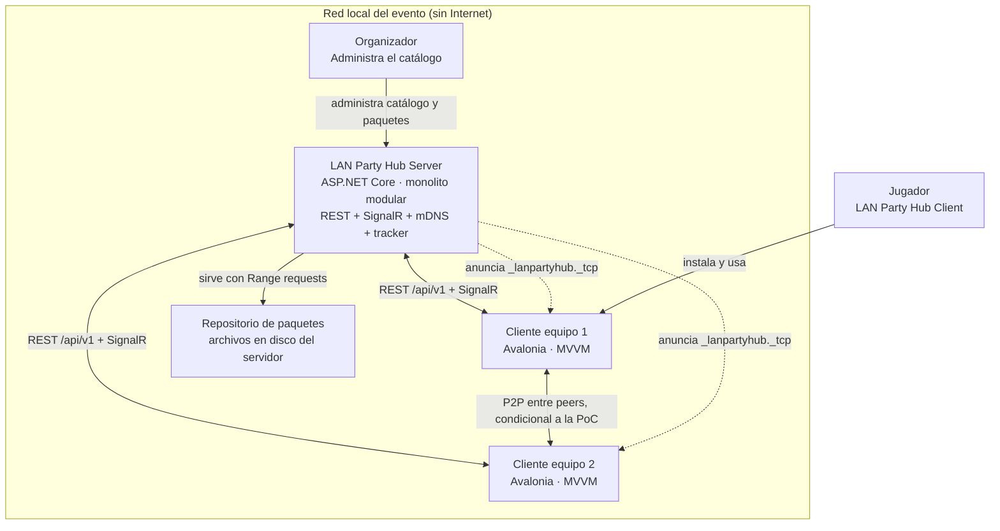
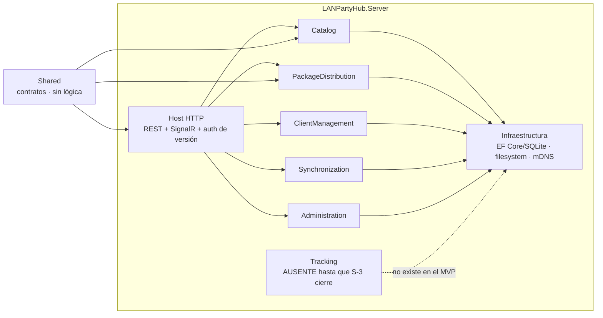
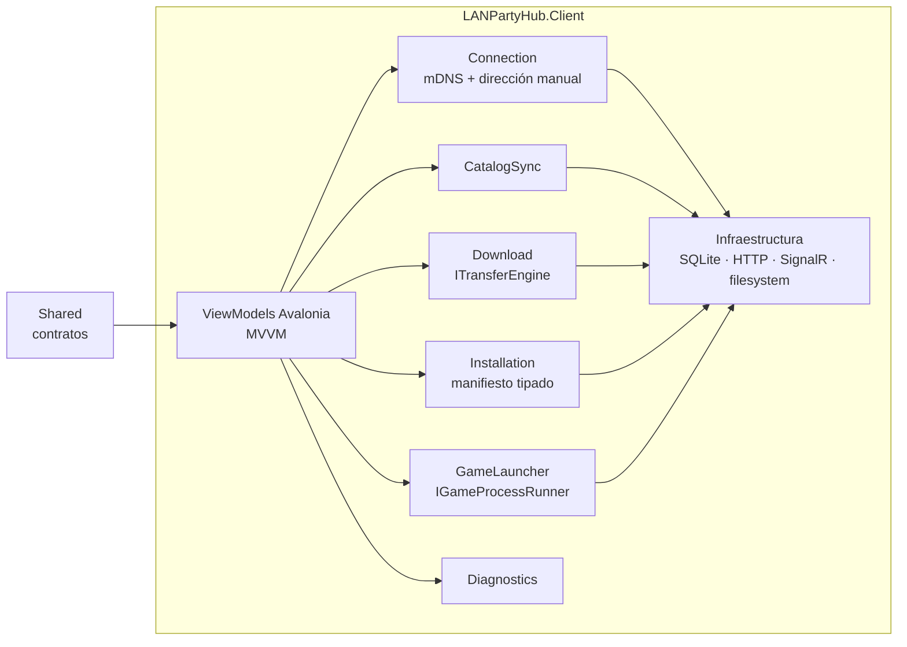
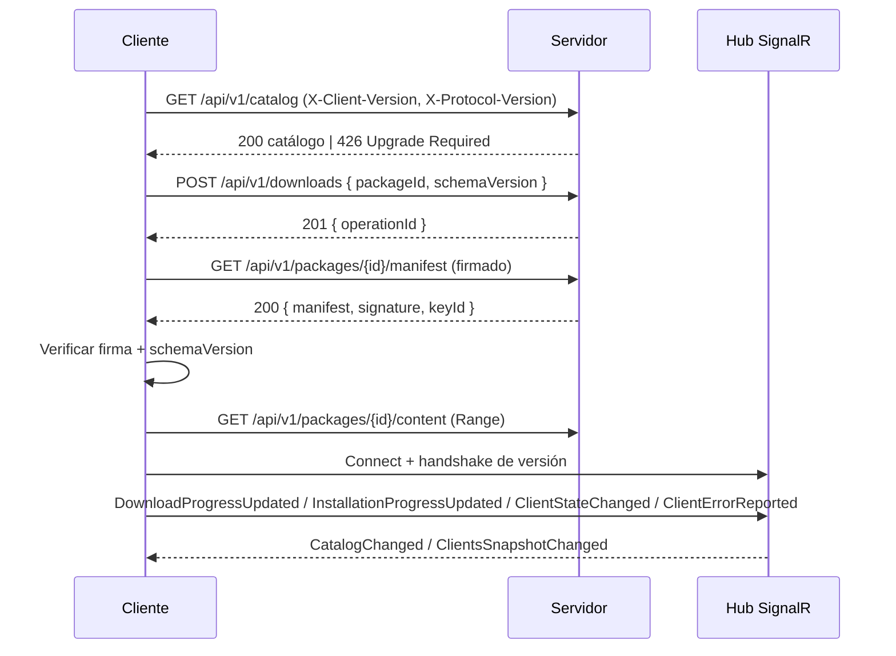
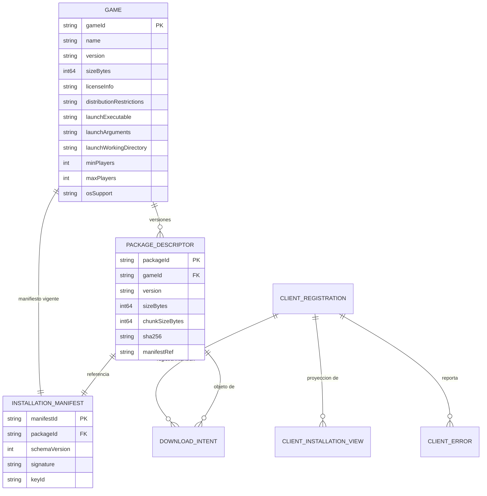
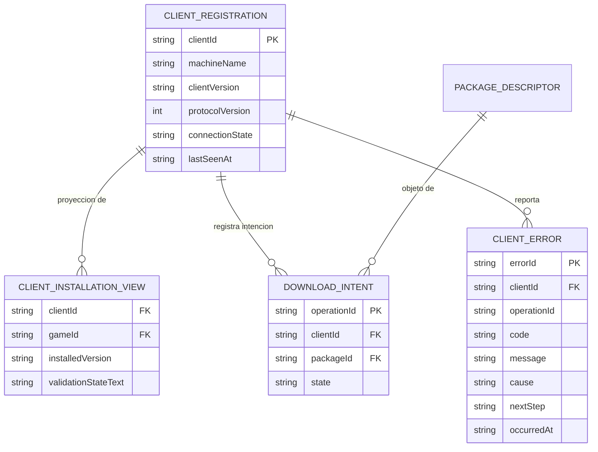
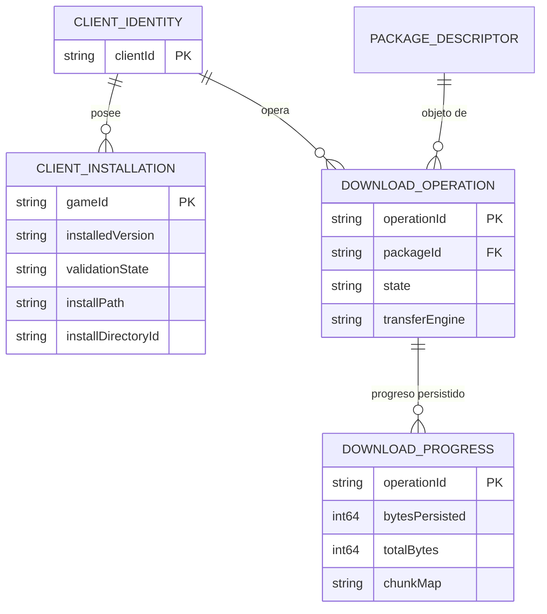
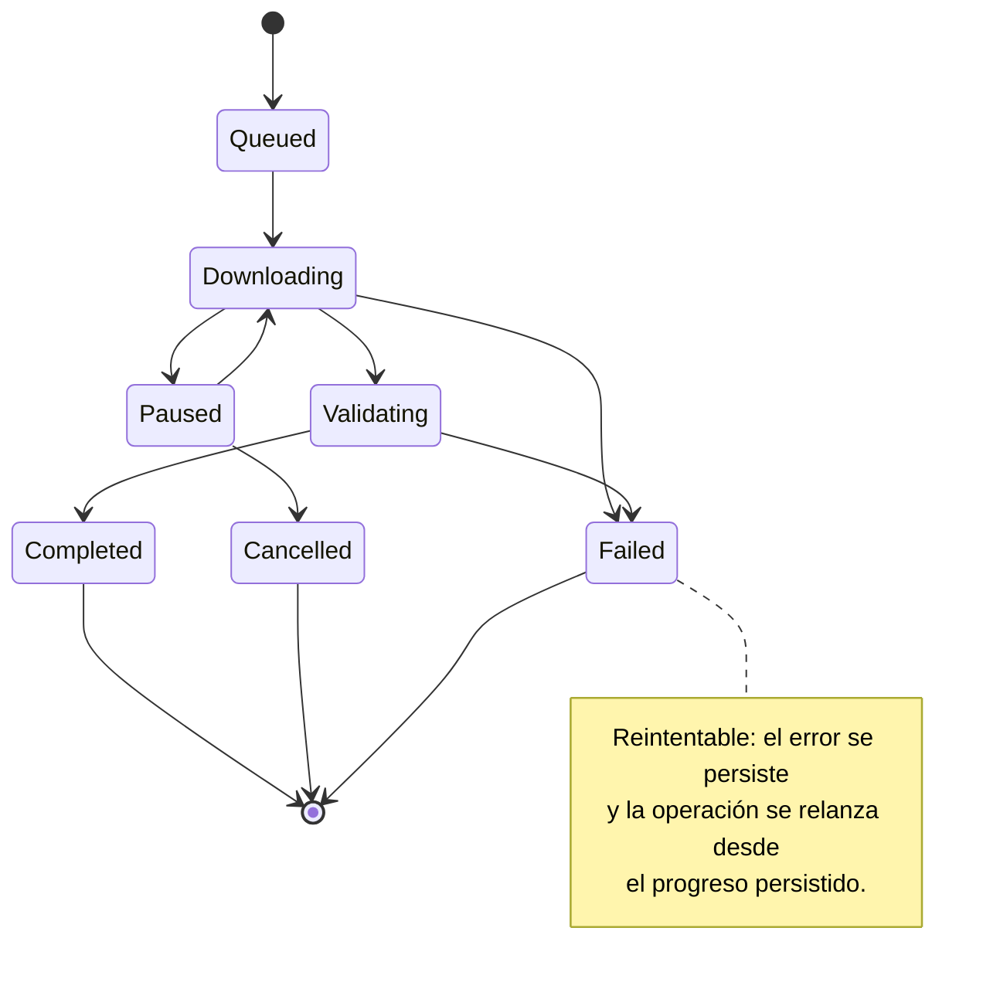
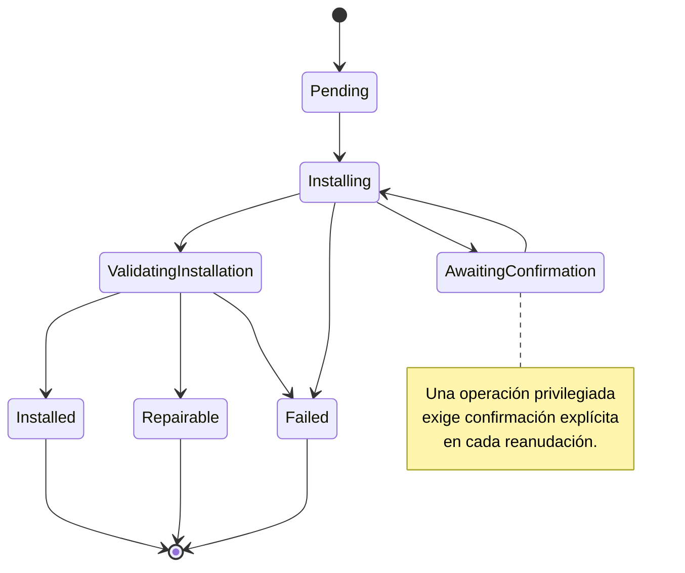
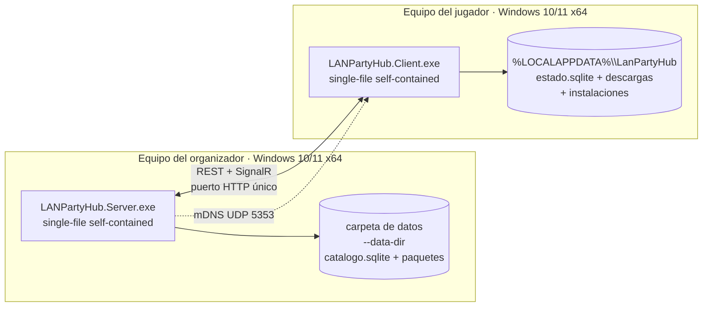

# Architecture Spine — LAN Party Hub

## Design Paradigm

**Clean Architecture / Hexagonal (ports-and-adapters), materialized as a modular monolith per deployable.**

Three concentric rings per deployable (server, client), plus a contract-only shared module:

```text
LANPartyHub/
  src/
    Server/          # deployable: event server (modular monolith)
    Client/          # deployable: desktop client (Avalonia, MVVM)
    Shared/          # contracts only: DTOs, ids, enums, events, protocol version
  tests/
    UnitTests/
    IntegrationTests/
    EndToEndTests/
  docs/
```

- **Dominio** — entidades, value objects, máquinas de estado y reglas puras. Sin dependencias de framework, sin E/S, sin UI.
- **Aplicación** — casos de uso que orquestan dominio y puertos. Define los puertos (`ITransferEngine`, `IPackageTrustVerifier`, `IGameProcessRunner`, `IServerDiscovery`, `IRepository`).
- **Infraestructura** — adaptadores que implementan los puertos (EF Core/SQLite, HTTP, SignalR, mDNS, motor de proceso, sistema de archivos).
- **Presentacion (cliente)** — ViewModels Avalonia que consumen casos de uso del cliente. No contienen reglas de negocio.

Dependencias: hacia adentro, siempre. `Infrastructure → Application → Domain`. `Shared` no depende de nadie del proyecto. Un módulo de dominio no importa jamás un adaptador ni una biblioteca de terceros.

Módulos del servidor: `Catalog`, `PackageDistribution`, `ClientManagement`, `Synchronization`, `Administration`, `Tracking` (P2P, condicional a la PoC).
Módulos del cliente: `Connection`, `CatalogSync`, `Download`, `Installation`, `GameLauncher`, `Diagnostics`.

Los módulos se comunican por **contratos en `Shared` y casos de uso publicados**, nunca por referencia directa a la implementación interna de otro módulo. Un módulo no consulta la tabla de otro módulo.

## Invariants & Rules

### AD-1 — Paradigma: Clean Architecture en monolito modular

- **Binds:** todos los módulos, `all`
- **Prevents:** que servidor y cliente dupliquen reglas de negocio; que el dominio dependa de la biblioteca de transferencia o del framework de UI; que el proyecto crezca hacia microservicios sin causa.
- **Rule:** Ningún tipo de `Domain` importa `Infrastructure`, EF Core, Avalonia, HTTP ni MonoTorrent. Los casos de uso dependen de puertos declarados en `Application`. La comunicación entre módulos va por contratos de `Shared`; el acceso a datos de otro módulo está prohibido. El servidor es un monolito modular en un único proceso y un único artefacto desplegable.

### AD-2 — Raíz de confianza y firma de paquetes (cierra R5/OQ-1)

- **Binds:** FR-6, FR-8, NFR-5, SM-3, AD-7, AD-8
- **Prevents:** que un checksum se use como si probara autenticidad; que un paquete alterado o reempaquetado llegue a fase de instalación; que servidor y cliente firmen objetos distintos.
- **Rule:** La firma es **Ed25519** sobre el **manifiesto de instalación canónico** (`InstallationManifest` en su forma canónica, serialización definida en la convención de datos). El manifiesto firmado es la raíz de verificación. El sobre firmado contiene el manifiesto en JSON canónico, el campo `signature` y un `keyId`. La clave pública del servidor es el **ancla de confianza**; se distribuye dentro de la LAN por el canal del propio servidor y el cliente la fija por **fingerprint** en el primer emparejamiento, que la UI muestra y el usuario confirma. El `sha256` del paquete verifica **integridad** y la firma verifica **autenticidad**: son comprobaciones distintas y ninguna sustituye a la otra. Un paquete que no valida contra el ancla se marca **no confiable** y no se instala.
  - **Existe una sola firma autoritativa** y la verifica el mismo ancla en servidor y cliente. El manifiesto canónico firmado incluye `packageId`, `packageVersion`, `sizeBytes` y `sha256` del paquete: la firma **autentica** los metadatos y el `sha256` **verifica** los bytes, de modo que la correspondencia entre manifiesto y paquete queda firmada, no supuesta.
  - `PackageDescriptor` **no** transporta firma: transporta `manifestRef` (referencia al manifiesto firmado) y `sha256`. `keyId` vive **solo** en el sobre firmado.


### AD-3 — Descubrimiento: mDNS más dirección manual como vías equivalentes (cierra R3/OQ-2)

- **Binds:** FR-3, NFR-9, R-03, AD-6
- **Prevents:** que el cliente quede sin salida cuando mDNS está bloqueado por la política de la red; que el descubrimiento se convierta en una puerta única.
- **Rule:** Dos vías de conexión **permanentes y equivalentes**, no un fallback condicional: (a) descubrimiento automático por **mDNS** del servicio `_lanpartyhub._tcp` (RFC 6762/6763), y (b) **dirección manual** introducida por el usuario. Ambas convergen en el mismo contrato `ServerEndpoint`. Prohibidos: barrido unicast de subred, SSDP, DNS-SRV de red externa. Si mDNS no devuelve nada, la UI ofrece la vía manual como acción primaria, no como excepción.

### AD-4 — Abstracción de transferencia: el dominio no conoce el mecanismo

- **Binds:** FR-5, FR-7, NFR-3, NFR-10, SM-C2, AD-13, AD-14, AD-20, AD-21, AD-24
- **Prevents:** acoplar el dominio a MonoTorrent; que la PoC P2P bloquee el MVP; que cambiar de mecanismo rompa los contratos funcionales; que dos unidades construyan dominios de configuración distintos para el puerto.
- **Rule:** El puerto `ITransferEngine` es la única puerta de entrada a la transferencia de bytes. El dominio (`DownloadOperation`, `PackageIntegrity`) no menciona HTTP, BitTorrent, trackers ni sockets.
  - **En el MVP el puerto se entrega con UNA sola implementación: `HttpRangeTransferEngine`.** `BitTorrentTransferEngine` **no existe** en el MVP: el proyecto del MVP **no referencia MonoTorrent** y el dominio de configuración **no expone** un selector de motor de transferencia, porque no hay nada que seleccionar.
  - La segunda implementación se añade **solo al cerrarse el spike S-3**, **sin cambiar la forma del puerto** `ITransferEngine` ni los contratos de dominio. Cuando exista, la configuración podrá seleccionarla; mientras tanto, **la configuración no puede seleccionar una implementación ausente**: el valor por defecto es HTTP y no hay valor alternativo.
  - El MVP se cierra sobre el camino HTTP servidor-cliente, que no depende del resultado de S-3 (AD-21).

### AD-5 — Contratos API: REST para comandos, SignalR solo para push de estado

- **Binds:** FR-2, FR-3, FR-5, FR-10, NFR-7
- **Prevents:** que dos mecanismos compitan por la misma verdad; que el estado del cliente se obtenga por polling; que el contrato HTTP crezca sin control.
- **Rule:** API REST sobre ASP.NET Core para comandos y consultas, con prefijo de ruta **`/api/v1`** (una versión de ruta por versión mayor del contrato) y campo de `schemaVersion` en el cuerpo de las mutaciones. **SignalR se usa exclusivamente para push de estado** desde el servidor al cliente (hub `/hubs/client-state`) y del cliente al servidor (eventos de estado y progreso). El cliente **no consulta el estado de otro cliente por polling**. Los DTOs de API son de `Shared` y son la forma congelada del contrato.

### AD-6 — Compatibilidad de versión de clientes, sin autenticación (FR-4)

- **Binds:** FR-4, FR-3, NFR-1, NFR-9
- **Prevents:** que dos unidades implementen la negociación de versiones de forma distinta; que se introduzca autenticación o autorización no contemplada en el modelo operativo.
- **Rule:** El cliente envía `X-Client-Version` y `X-Protocol-Version` en **toda** petición. El servidor responde **`426 Upgrade Required`** con la versión de servidor requerida y el rango mínimo soportado cuando no son compatibles. La matriz se define por **versión de protocolo con política de rango mínimo**. Un cliente incompatible no completa sincronización ni inicia descarga o instalación, y recibe un diagnóstico con **versión del cliente y versión del servidor**. No hay tokens, sesiones, ni roles: el modelo operativo es LAN administrada con ejecutable distribuido por la organización.

### AD-7 — Modelo de paquetes y manifiestos de instalación

- **Binds:** FR-1, FR-6, FR-8, FR-11, NFR-3, NFR-8, AD-2, AD-8, AD-9, AD-24
- **Prevents:** que dos unidades construyan metadatos de paquete incompatibles; que un manifiesto ejecute acciones arbitrarias; que un paquete publicado cambie bajo los pies de los clientes.
- **Rule:**
  - `PackageDescriptor` — `packageId`, `gameId`, `version`, `sizeBytes` (exacto), `chunkSizeBytes`, `sha256`, `manifestRef`. **Un paquete publicado es inmutable**: cambiar su contenido exige publicar una versión nueva. El descriptor **no** lleva firma: la firma vive en el manifiesto de instalación (AD-2).
  - `InstallationManifest` — `schemaVersion`, `packageId`, `packageVersion`, `sizeBytes`, `sha256`, `launch` (ruta, argumentos, working directory), `operations[]`. Operaciones **tipadas y cerradas**: `extract`, `createDirectory`, `copyFile`, `writeConfig`, `setLaunchConfig`, `verify`. **No existe ninguna operación de ejecución de comandos arbitrarios.**
  - `sizeBytes` se almacena en bytes exactos; la conversión a GB decimales con un decimal es una regla de **presentación** que pertenece a la UX, no al modelo.
  - `chunkSizeBytes` es **informativo y opcional** en el camino HTTP del MVP (cero o ausente) y **obligatorio y mayor que cero** solo cuando el motor de transferencia activo es BitTorrent (AD-20, AD-21).
  - El catálogo exige la información de licencia y restricciones de distribución antes de publicar (FR-1, NFR-8).

### AD-8 — Confianza de manifiestos: firma y versión de esquema obligatorias

- **Binds:** FR-8, FR-6, NFR-5, AD-2, AD-7
- **Prevents:** ejecutar instrucciones de un manifiesto manipulado; que un cliente con esquema antiguo ejecute un manifiesto que no entiende.
- **Rule:** Un `InstallationManifest` solo se ejecuta si (a) está **firmado** por la misma raíz de confianza que los paquetes y (b) su `schemaVersion` está soportada por el cliente. Sin firma, con firma inválida o con `schemaVersion` desconocida: la operación **se rechaza**, no se instala, y el error se persiste para diagnóstico. La comprobación de firma precede a cualquier escritura en disco.
  - **Orden normativo de una instalación:** (1) obtener el manifiesto firmado; (2) verificar firma y `schemaVersion`; (3) **solo entonces** crear el directorio de instalación y el archivo parcial; (4) descargar el contenido; (5) calcular el `sha256` y compararlo con el del manifiesto firmado; (6) si no coincide, **descartar** el archivo parcial y marcar la operación como fallida, no reparable por reanudación. Ningún byte se escribe en disco antes del paso 2, y `POST /api/v1/downloads` **no** inicia la escritura en disco.

### AD-9 — Confines de extracción dentro del directorio autorizado

- **Binds:** FR-8, NFR-5, AD-7
- **Prevents:** path traversal; escritura o extracción fuera del directorio de instalación configurado.
- **Rule:** Toda escritura de instalación se resuelve contra la **raíz del directorio de instalación configurado** y se verifica que la ruta resultante quede dentro. La comprobación se hace sobre la **ruta canónica resuelta** (tras resolver enlaces simbólicos) y se repite **antes de cada escritura**, no solo al inicio. El manifiesto **no admite rutas absolutas**; toda ruta es relativa a la raíz de instalación. Un destino fuera de la raíz se rechaza y se registra.
  - **Layout en disco del cliente (directorios con nombre y propósito).** Bajo `%LOCALAPPDATA%\LanPartyHub` (AD-17):
    - `install/` — **raíz de instalación** configurable por el usuario. Es el **único** directorio confinado por esta regla.
    - `downloads/` — **directorio de descargas parciales**: ruta fija, persistente y **fuera** de la raíz de instalación. Nunca se escribe dentro de `install/`.
    - `manifests/` — **caché de manifiestos** firmados descargados.
    - `state.sqlite` — **base de datos del cliente** (AD-11).
    - Los archivos parciales (`*.part`) viven **solo** en `downloads/`, nunca en `%TEMP%` ni en la raíz de instalación: el progreso persistido debe sobrevivir al reinicio (SM-2, AD-11).

### AD-10 — Estados de descarga e instalación: máquinas de estado explícitas y microcopia única

- **Binds:** FR-5, FR-8, FR-10, FR-11, NFR-7, NFR-9, SM-2, SM-3, AD-18, AD-22
- **Prevents:** que dos unidades construyan listas de estados distintas; que la UI invente estados que el dominio no reconoce; que el servidor y el cliente discrepen sobre el estado de una operación; que cada unidad traduzca el estado a texto por su cuenta.
- **Rule:** `DownloadState` e `InstallationState` son **enumeraciones cerradas con transiciones explícitas** en el dominio, con estado terminal por operación. Los estados son los mismos en cliente y servidor. El **cliente es la única fuente de verdad** del estado local de una operación (la ejecuta); el servidor **proyecta** ese estado para la vista de organización. Toda transición inválida se rechaza.
  - **Mapa de estados a microcopia: una sola tabla, en `Shared`.** Existe **un único** diccionario `StateDisplayMap` (en `Shared`) que traduce cada valor de `DownloadState` y de `InstallationState` a su texto de interfaz. Servidor y cliente **consumen** esa tabla; **ninguno** define su propia. Un texto de estado que no esté en la tabla **no se puede mostrar**: la tabla es exhaustiva y es la única fuente de microcopia de estado.
  - **Los estados de vista derivados de la UX no son estados de máquina.** `EXPERIENCE.md` define insignias que no son estados de dominio —`sincronizando`, `disponible`, `instalado con versión desactualizada`— y quedan **declarados como estados de vista derivados**, con su regla de derivación **fija y única**:
    - `sincronizando` — el cliente tiene un snapshot de catálogo desactualizado respecto al `catalogVersion` del servidor (o está en su primera sincronización). No es un estado de `DownloadState` ni de `InstallationState`.
    - `disponible` — el juego está publicado en el catálogo y **no** tiene instalación validada en el cliente. Se deriva de la ausencia de una `CLIENT_INSTALLATION` en estado `Installed`.
    - `instalado con versión desactualizada` — existe una instalación validada (`Installed`) cuya `installedVersion` es **anterior** a la versión publicada en el catálogo para ese `gameId`.
  - **`error` no es un estado de máquina.** La insignia `error` es la **proyección de los estados terminales de fallo** (`Failed` de descarga y de instalación), pintada con el código de color de peligro. No se añade ningún valor `Error` a ninguna enumeración de dominio.
  - La comparación de versiones que decide `instalado con versión desactualizada` usa el **orden semántico de versión declarado en el catálogo**, no la comparación lexicográfica de cadenas; la regla de orden de versiones del catálogo es única y vive en `Shared`.

### AD-11 — Persistencia local en SQLite con progreso reconciliado

- **Binds:** FR-5, FR-8, FR-11, NFR-3, NFR-9, SM-2, R-02, AD-10, AD-24
- **Prevents:** pérdida del progreso de descarga ante reinicio; que el estado de una operación viva solo en memoria.
- **Rule:** SQLite + EF Core. **Un** archivo por rol: el servidor, uno; el cliente, uno. El progreso de descarga se persiste como **registro de fragmentos/offset** en tabla propia y se **reconcilia contra el archivo parcial en disco al arrancar**: el progreso efectivo es la intersección de lo persistido y lo que el archivo contiene. Las migraciones de EF Core son versionadas y se aplican al inicio. El esquema de cada archivo es propiedad de su rol: el del servidor no se replica en el cliente.

### AD-12 — Superficie de red mínima, sin TLS en la LAN del MVP

- **Binds:** FR-3, NFR-1, NFR-10, AD-2, AD-13
- **Prevents:** sobreingeniería de PKI en un entorno de LAN administrada; exposición del servidor fuera de la red del evento.
- **Rule:** El servidor escucha **solo en interfaces privadas** y abre **solo** los puertos que necesita: HTTP (API + SignalR + tracker si aplica) y mDNS (UDP 5353). **No se exige TLS en el MVP**: la integridad y la autenticidad las aporta la **firma** (AD-2), no el canal. No hay autenticación de servidor ni de cliente.

### AD-13 — Tracker P2P interno, con DHT y LPD deshabilitados (condicional a S-3)

- **Binds:** FR-7, NFR-10, NFR-1, AD-4, AD-14, AD-21
- **Prevents:** dependencia de trackers públicos, DHT público o servicios externos; salida de tráfico a Internet; que el módulo `Tracking` aparezca en el MVP con una forma no decidida.
- **Rule:** El módulo de servidor `Tracking` y el tracker que sirve **están AUSENTES hasta que S-3 cierre**. No existe en el MVP: ni el módulo, ni el endpoint `announce`, ni el proceso, ni el registro de swarm, ni el puerto de configuración que lo habilite. El MVP no abre ningún puerto para P2P (AD-12).
  - Si S-3 valida el enfoque, el tracker se añade como **servicio interno del servidor, en proceso**, servido por HTTP **sobre el mismo puerto** del servidor, que mantiene el registro de swarm y responde `announce` por hash de info. En la configuración de MonoTorrent se **deshabilitan explícitamente DHT y Local Peer Discovery**, de modo que ningún peer intenta salir a Internet. El tracker no es un servicio externo ni un proceso aparte: no existe un componente desplegable adicional.
  - El tracker **no** se anuncia en el catálogo de APIs ni en la topología de despliegue del MVP. Su aparición es parte del resultado de S-3, no una tarea anticipada.

### AD-14 — Seeding, prioridad de LAN y límites de concurrencia

- **Binds:** FR-5, FR-7, NFR-2, NFR-3, NFR-6, AD-13
- **Prevents:** que un peer de la LAN se quede sin ancho frente a tráfico externo; que un solo cliente agote el enlace; crecimiento no acotado del número de conexiones.
- **Rule:** El **servidor es el seeder inicial obligatorio** de cada paquete; los clientes que completan una descarga **pasan a ser seeders**. La prioridad de LAN se implementa limitando el **ancho de banda por peer** y priorizando peers de la **misma subred**, no con marcas de afinidad de red. Los **límites de concurrencia por cliente** (descargas simultáneas y conexiones totales) son configurables y tienen valor por defecto. En el MVP, donde todo el tráfico es de LAN, la prioridad se traduce en reparto equitativo del enlace entre peers.

### AD-15 — Observabilidad: logs estructurados correlacionados y catálogo de errores estable

- **Binds:** FR-10, NFR-6, NFR-7, NFR-9, AD-10, AD-18
- **Prevents:** diagnóstico por adivinanza; que un error se comunique al usuario como un código sin causa; telemetría que dependa de la nube; que servidor y cliente compilen contra tipos de error distintos.
- **Rule:** Logging estructurado **JSON** vía `Microsoft.Extensions.Logging`, con correlación por **`operationId`** y **`clientId`** propagados a través de la frontera servidor-cliente (AD-23 fija el ciclo de vida del `clientId`). Las métricas (tasa de transferencia, operaciones activas, errores por código) se exponen localmente vía el endpoint de métricas del host. **Ningún log contiene credenciales** (no hay). Los errores visibles al usuario se construyen desde un **catálogo de errores con nombre estable** y siguen el contrato de `EXPERIENCE.md`: **qué falló, por qué, qué hacer ahora**. El código de error es un identificador interno, nunca el texto principal.
  - **Existe UN SOLO tipo de error de API en todo el sistema: `ApiError`, declarado en `Shared`.** Es el **único** tipo que puede serializarse en el cuerpo de una respuesta de error de la API REST y el **único** que puede viajar en el payload del evento `ClientErrorReported`. Ni el servidor ni el cliente redeclaran un tipo de error propio; una respuesta de error que no sea `ApiError` **no es válida**.
  - Forma **obligatoria** y exhaustiva de `ApiError`: `code` (identificador estable del catálogo de errores), `message` (qué falló), `cause` (**obligatorio**, por qué falló) y `nextStep` (**obligatorio**, qué hacer ahora). `cause` y `nextStep` **no son opcionales**: si un caso de error no puede fijar un siguiente paso, es un hueco del catálogo y se rechaza el caso, no se omite el campo.
  - **El catálogo de errores es único y vive en `Shared`.** Cada entrada declara su `code` estable, su `message`, su `cause` y su `nextStep`. El servidor **traduce** la excepción de dominio al `code` del catálogo; el cliente **presenta** `message`, `cause` y `nextStep` tal cual, sin reescribirlos ni recomponerlos. Un `code` desconocido que llega al cliente se muestra con un texto genérico del catálogo, nunca con el código como texto principal.
  - La estructura de tres partes es **obligatoria** en las tres superficies que la muestran: mensaje de error de operación, `toast-error` y detalle del error registrado en Diagnóstico.

### AD-16 — Estrategia de pruebas: pirámide con E2E en LAN real

- **Binds:** FR-1..FR-11, NFR-1..NFR-10, SM-1, SM-2, SM-3, SM-4, SM-5
- **Prevents:** que el E2E en LAN real se sustituya por pruebas de single host y no detecte fallos de red, descubrimiento o concurrencia.
- **Rule:** xUnit, con tres niveles: **unitarias** (dominio, máquinas de estado, validación de manifiesto y **confines de ruta**, incluida la extracción fuera del directorio autorizado), **integración** (persistencia contra **SQLite real en archivo**, endpoints con `WebApplicationFactory`, motor de transferencia HTTP contra servidor de prueba) y **E2E en LAN real** con **dos o más clientes**, que es el escenario de aceptación del MVP (PRD §9). La checklist de casos de `docs/plan.md` §10 gobierna las pruebas obligatorias y se clasifica así: **unitarias/integración** — extracción fuera del directorio autorizado, manifiesto manipulado, instalación incompleta, juego ya instalado, versión desactualizada y lanzamiento fallido; **E2E en LAN real** — descarga interrumpida y reanudación, archivo corrupto, cliente desconectado, servidor inaccesible, varios clientes simultáneos, cliente compartiendo fragmentos y reinicio del cliente durante una operación. La clasificación no elimina ningún caso de la checklist: fija el nivel mínimo donde puede detectarse cada fallo.

### AD-17 — Despliegue: artefactos self-contained por rol, sin instalador ni servicio

- **Binds:** NFR-1, NFR-10, AD-11, AD-12
- **Prevents:** dependencia de un servicio de Windows, de un instalador o de infraestructura cloud; pérdida de datos por ubicación implícita del estado.
- **Rule:** Publicación **self-contained single-file** por rol (servidor, cliente) para **Windows x64**, más un paquete portable `zip` equivalente. El servidor guarda su estado en una **carpeta de datos configurable** (`--data-dir`); el cliente, en `%LOCALAPPDATA%\LanPartyHub`. **Sin instalador, sin registro, sin servicio de Windows, sin cloud.** Cada artefacto incluye su carpeta de datos portable, de modo que el estado sobrevive al reemplazo del binario.

### AD-18 — `Shared` contiene contratos, nunca lógica

- **Binds:** `all`
- **Prevents:** que `Shared` se convierta en un cajón de sastre con lógica duplicada; que servidor y cliente diverjan en la forma de un dato; que un contrato compartido se declare por duplicado en un lado.
- **Rule:** `LANPartyHub.Shared` contiene **solo** contratos: DTOs de API, identificadores, enumeraciones, eventos de SignalR y la versión de protocolo. **Ninguna lógica de negocio, ninguna dependencia de EF Core, Avalonia ni de la red**, y `Shared` no referencia ningún otro proyecto del repositorio. `Server` y `Client` referencian `Shared`.
- **Contenido de `Shared` (enumeración exhaustiva; un concepto, un tipo, un lugar):**

  | Contrato | Forma / contenido | Nota |
  | --- | --- | --- |
  | `ApiError` | `code`, `message`, `cause`, `nextStep` | **Único** tipo de error de API del sistema (AD-15) |
  | `ErrorCatalog` | Entradas `code` → `message`, `cause`, `nextStep` | Catálogo de errores estable, único (AD-15) |
  | `DownloadState` | Enumeración cerrada de estados de descarga | Estados de máquina, no de vista (AD-10) |
  | `InstallationState` | Enumeración cerrada de estados de instalación | Estados de máquina, no de vista (AD-10) |
  | `StateDisplayMap` | Estado → texto de interfaz | **Única** tabla de microcopia de estado (AD-10) |
  | `CatalogViewState` | Estados de vista derivados (`sincronizando`, `disponible`, `desactualizado`) | Derivados, no de máquina (AD-10) |
  | `ClientStateChanged` | `clientId`, `connectionState`, `installedGames[]` (`gameId`, `installedVersion`, `validationState`), `activeOperations[]` (`operationId`, `operationType`, `state`) | Forma **exacta**, no «contenido mínimo» (AD-22) |
  | `DownloadProgressUpdated` | `clientId`, `operationId`, `bytesTransferred`, `totalBytes`, `state` (`DownloadState`) | Push de estado (AD-5) |
  | `InstallationProgressUpdated` | `clientId`, `operationId`, `state` (`InstallationState`), `phase` | Push de estado (AD-5) |
  | `ClientErrorReported` | `clientId`, `operationId`, `error: ApiError` | `error` es la **única** forma de error del sistema; `error.code` pertenece a `ErrorCatalog` (AD-15) |
  | `CatalogChanged` | `catalogVersion` | Disparo de resincronización |
  | `ClientsSnapshotChanged` | `clients[]` (`ClientRegistrationView`: `clientId`, `machineName`, `clientVersion`, `protocolVersion`, `connectionState`, `lastSeenAt`) | Instantánea exacta de la vista de clientes; solo servidor → vista admin (AD-22) |
  | `PackageDescriptor` | `packageId`, `gameId`, `version`, `sizeBytes`, `chunkSizeBytes`, `sha256`, `manifestRef` | **Sin** firma (AD-2, AD-7) |
  | `InstallationManifest` + sobre firmado | Manifiesto canónico + `signature` + `keyId` | **Único** objeto firmado (AD-2) |
  | `VersionInfo` | Versión de cliente, de servidor y de protocolo | Origen de las cabeceras de versión (AD-6) |

  Una enumeración compartida es la **única** definición de su concepto: el estado de descarga, el estado de instalación, la microcopia de estado, el catálogo de errores, la versión de protocolo y la forma del error de API se definen **una sola vez**. Ningún tipo de este listado puede declararse también en `Server` o `Client`; una duplicación es un defecto de implementación, no una variante admitida.

### AD-19 — Lanzador de juegos aislado tras un puerto

- **Binds:** FR-9, NFR-7, AD-18
- **Prevents:** que el módulo de lanzamiento dependa de una plataforma concreta de launcher en el MVP; que la conexión directa a servidores de juego se implemente antes de tiempo.
- **Rule:** `GameLauncher` es un módulo del cliente con la interfaz `IGameProcessRunner`. Lanza el ejecutable con el **working directory** y los **argumentos** definidos en el catálogo, valida la instalación antes de lanzar y expone si el proceso **está en ejecución**. La **conexión directa a servidores de juego** queda como extensión con el puerto preparado y **no implementada**. Los launchers externos (Steam y similares) están fuera del MVP.

### AD-20 — Distribución de artefactos: Range requests HTTP y manifiesto aparte y firmado

- **Binds:** FR-5, FR-6, FR-8, NFR-3, AD-2, AD-4
- **Prevents:** complejidad innecesaria en la ruta HTTP del MVP; que el manifiesto viaje sin firma o incrustado en el binario del paquete.
- **Rule:** El servidor sirve el paquete por **HTTP con Range requests** (una sola conexión, sin chunking multipart en el MVP) y sirve el **manifiesto de instalación como artefacto aparte, firmado**. El troceado interno en trozos no es necesario para HTTP porque Range basta; el troceado **sí** es requisito del camino BitTorrent. La reanudación HTTP se implementa con `Range` sobre el offset persistido (AD-11).

### AD-21 — Los spikes son condición de cierre de decisión, no de implementación

- **Binds:** FR-7, R3, R5, P2P, R-01, R-02, R-03, AD-3, AD-4, AD-13, AD-14
- **Prevents:** que la PoC P2P se declare capacidad del MVP sin evidencia; que el dominio se acople a una biblioteca no validada; que se prometan cifras de rendimiento sin benchmark.
- **Rule:** Las decisiones que dependen de evidencia técnica se cierran con **spikes con criterios de éxito explícitos**, no con suposiciones. Cada spike tiene: objetivo, alcance mínimo, **criterios de éxito observables**, resultado esperado y **qué decisión cierra**. **El intercambio P2P no se expone como capacidad del MVP** hasta que su spike valide seed, descubrimiento de peers, transferencia por fragmentos, integridad y recuperación. El MVP se cierra sobre el camino servidor-cliente (HTTP), que no depende del resultado del spike P2P.

### AD-22 — Cada entidad persistida tiene un dueño inequívoco, y la proyección del servidor es una entidad distinta

- **Binds:** FR-8, FR-10, FR-11, NFR-3, NFR-7, AD-10, AD-11, AD-18, AD-23
- **Prevents:** que dos unidades declaren la misma entidad en archivos de datos distintos; que el servidor sea dueño de un estado de máquina del cliente; que una ruta local del cliente se persista en el servidor; que la forma del evento de estado quede como «contenido mínimo».
- **Rule:** El esquema de cada archivo de datos es **propiedad de su rol** (AD-11) y **cada entidad tiene exactamente un dueño**. Una entidad nunca se persiste en los dos roles, y la proyección del servidor **no comparte nombre** con la entidad de origen.

  | Entidad | Dueño | Contenido | Nota |
  | --- | --- | --- | --- |
  | `Game` | **servidor** | Ficha del videojuego | Catálogo, `Server/Catalog` |
  | `PackageDescriptor` | **servidor** | Metadatos inmutables del paquete | `Server/PackageDistribution` |
  | `InstallationManifest` (+ sobre firmado) | **servidor** | Manifiesto canónico y firma | Servido como artefacto aparte (AD-2, AD-20) |
  | `DownloadOperation` (servidor) | **servidor** | Intención de descarga registrada por el cliente | Solo reflejo de la intención; **no** es el estado de la operación (AD-10) |
  | `ClientRegistration` | **servidor** | `clientId`, `machineName`, `clientVersion`, `protocolVersion`, `connectionState`, `lastSeenAt` | Vista de organización (FR-10). `machineName` es **informativo**, nunca clave (AD-23) |
  | `ClientInstallationView` | **servidor** | **Proyección** de solo lectura: `clientId`, `gameId`, `installedVersion`, `validationStateText` | Proyección **derivada**, alimentada por SignalR. **No** es `CLIENT_INSTALLATION` |
  | `ClientError` (servidor) | **servidor** | `errorId`, `clientId`, `operationId`, `code`, `message`, `cause`, `nextStep`, `occurredAt` | Registro para la vista de organización; conserva la forma de `ApiError` |
  | `ClientInstallation` | **cliente** | `gameId`, `installedVersion`, `validationState` (`InstallationState`), `installPath`, `installDirectoryId` | **Estado local real**. Dueño: el cliente (AD-10) |
  | `DownloadOperation` (cliente) | **cliente** | `operationId`, `packageId`, `state` (`DownloadState`), `transferEngine` | Estado local real (AD-10) |
  | `DownloadProgress` | **cliente** | `operationId`, `bytesPersisted`, `totalBytes` (+ `chunkMap` solo en BitTorrent) | AD-24 |
  | `ClientIdentity` | **cliente** | `clientId` emitido y persistido | AD-23 |

  - **Regla de no-colisión con el estado del cliente:** el servidor **no** persiste el `InstallationState` ni el `DownloadState` de otro cliente. Cuando el servidor necesita mostrarlos, los guarda como **`validationStateText`**, una **cadena de presentación** copiada del `StateDisplayMap` de `Shared` (AD-10), **nunca** como el enum. Si el servidor reinterpreta el texto, no está leyendo un estado de dominio.
  - **`installPath` es una ruta del cliente y no sale del cliente.** El servidor no la persiste; la vista de organización muestra la **versión instalada** y la **existencia** de la instalación, no su ruta.
  - **La forma del evento `ClientStateChanged` es exacta y está en `Shared`** (AD-18): `clientId`, `connectionState`, `installedGames[]` (con `gameId`, `installedVersion`, `validationState`) y `activeOperations[]` (con `operationId`, `operationType`, `state`). No es un «contenido mínimo»: un servidor no puede esperar un campo que el contrato no declara.
  - **Todos los payloads SignalR tienen forma exacta en `Shared`.** `DownloadProgressUpdated` lleva `clientId`, `operationId`, `bytesTransferred`, `totalBytes` y `state` (`DownloadState`); `InstallationProgressUpdated` lleva `clientId`, `operationId`, `state` (`InstallationState`) y `phase`; `ClientErrorReported` lleva `clientId`, `operationId` y `error` (`ApiError`); `CatalogChanged` lleva `catalogVersion`; `ClientsSnapshotChanged` lleva `clients[]`, cada elemento con `clientId`, `machineName`, `clientVersion`, `protocolVersion`, `connectionState` y `lastSeenAt`. Ningún payload admite campos opcionales fuera de esta lista.

### AD-23 — Identidad del cliente: `clientId` emitido una vez y persistido

- **Binds:** FR-10, NFR-7, NFR-9, AD-15, AD-22
- **Prevents:** que el servidor muestre el mismo equipo varias veces con identificadores distintos; que la deduplicación de clientes se haga por nombre de máquina; que la correlación de logs se rompa entre arranques.
- **Rule:** El `clientId` es un **identificador opaco UUID v7** que el **cliente emite una sola vez** y **persiste** en su base de datos local (`ClientIdentity`, AD-22), en la fila de configuración de su propio archivo SQLite.
  - El `clientId` **no se regenera** en cada arranque, **no se regenera** al reinstalar el binario mientras el archivo de datos sobreviva, y **no se regenera** al cambiar la versión del cliente. Sobrevive a reinicios.
  - **El servidor no deduplica ni agrupa por `machineName`.** `machineName` es **informativo**: una etiqueta visible para el organizador, nunca una clave. Un `clientId` desconocido se trata como **un cliente nuevo con ese `clientId**`: el servidor crea su `ClientRegistration` y lo muestra.
  - Si el usuario borra la carpeta de datos del cliente, ese equipo aparece como un cliente nuevo: es el comportamiento correcto de un identificador persistente, y el servidor **no** intenta reconstruir la identidad por nombre de máquina.
  - El `clientId` viaja en todas las peticiones y eventos como campo obligatorio (AD-15, AD-18) y es la clave de correlación de los logs en el servidor.

### AD-24 — Granularidad del progreso persistido: offset en HTTP, mapa de fragmentos solo en BitTorrent

- **Binds:** FR-5, FR-7, NFR-3, NFR-9, SM-2, R-02, AD-4, AD-7, AD-11, AD-20, AD-21
- **Prevents:** que un cliente divida por cero al leer `chunkSizeBytes = 0`; que dos clientes persistan mapas de fragmentos con granularidades distintas; que la reanudación HTTP dependa de un troceado que no existe.
- **Rule:** El formato del progreso persistido depende del **motor de transferencia activo**, y cada motor tiene **un** formato:
  - **Camino HTTP (el MVP, único motor activo — AD-4):** el progreso persistido es un **offset acumulado**, con la columna `bytesPersisted` (bytes válidos contiguos desde el inicio del archivo parcial). **No hay mapa de fragmentos.** La reanudación se implementa con `Range` sobre `bytesPersisted` (AD-20). En este camino, `chunkSizeBytes` en `PackageDescriptor` es **informativo y opcional** (cero o ausente) y el cliente **no lo usa** para calcular rangos ni Fragmentos.
  - **Camino BitTorrent (no existe hasta que S-3 cierre — AD-4, AD-21):** el progreso persistido es un **mapa de fragmentos** (`chunkMap`), y `chunkSizeBytes` es **obligatorio y mayor que cero**. El **formato del mapa de fragmentos no se fija aquí**: lo fija el resultado de S-3, con su granularidad, su serialización y su reconciliación. Hasta entonces, ningún esquema lo persiste.
  - **Un motor, un formato.** Una operación persistida declara su `transferEngine` y **el formato de su progreso se deduce de ese valor**, no de un parámetro configurable. Un registro persistido cuyo `transferEngine` no exista en la versión activa se rechaza en el arranque, en lugar de reinterpretarse.

### AD-25 — La microcopia de estado y el catálogo de errores son tablas únicas y exhaustivas

- **Binds:** FR-5, FR-8, FR-10, NFR-7, AD-10, AD-15, AD-18
- **Prevents:** que servidor y cliente traduzcan estado a texto por su cuenta; que exista un error de API con una forma propia en cada lado; que una insignia de UI quede sin fuente de verdad.
- **Rule:** Las dos tablas que conectan el dominio con lo que el usuario ve están **en `Shared`** y son **únicas y exhaustivas**:
  - **`StateDisplayMap`** — estado de máquina → texto de interfaz. La cubre AD-10.
  - **`ErrorCatalog`** — `code` estable → `message`, `cause`, `nextStep`. La cubre AD-15.
  - Ambas son **datos, no código**: no contienen lógica de presentación ni lógica de negocio. Un texto que no está en la tabla **no existe**; una regla de UI que necesite un texto nuevo **obliga a añadir su entrada** a la tabla y a decidir su `code` si es un error, en lugar de inventar la cadena en la vista.

### AD-26 — Consistencia del catálogo frente a operaciones en curso

- **Binds:** FR-2, FR-5, FR-8, FR-11, NFR-9, AD-5, AD-10, AD-11
- **Prevents:** que un cliente cancele una descarga en curso porque el catálogo retiró el paquete y otro la deje terminar; que una resincronización del catálogo destruya una instalación existente; que el servidor y el cliente discrepen sobre el resultado de una operación retirada.
- **Rule:** El catálogo se sincroniza por **snapshot completo** (`GET /api/v1/catalog` con `catalogVersion`); el delta queda en `Deferred`. La aplicación de un snapshot nuevo sigue reglas fijas:
  - **Un snapshot nuevo NO cancela operaciones en curso.** Una descarga o instalación en curso **termina**; no se aborta por un cambio de catálogo.
  - Una operación en curso cuyo paquete o juego **ha sido retirado** del catálogo **no falla por ello**: completa su curso y su resultado se marca explícitamente como **`Paquete retirado del catálogo`**. Ese resultado es **distinto del fallo** y no invalida la instalación ejecutada. La prevalencia es del catálogo, salvo que el propio paquete sea inválido, en cuyo caso manda la validación de integridad (AD-2, AD-8).
  - **Una instalación existente no se borra** porque el juego se retiró del catálogo. El cliente la conserva, la sigue mostrando en su biblioteca y la marca con el estado de vista correspondiente (`desactualizado` u otro derivado de AD-10); la retirada del catálogo no altera la validez de lo ya instalado.
  - **El servidor tampoco borra** la `ClientInstallationView` de un cliente cuyo juego se retiró del catálogo: la proyección refleja lo que el cliente réellement tiene instalado, no lo que el catálogo publica.
  - El `catalogVersion` del servidor es **monótono creciente**; el cliente solo aplica un snapshot con versión **mayor** que la que tiene, y descarta uno igual o anterior.

## Consistency Conventions

| Concern | Convention |
| --- | --- |
| Naming | PascalCase para tipos y miembros; `camelCase` para parámetros y variables locales; un solo nombre por concepto en todo el repositorio (`GameId`, `PackageId`, `DownloadOperationId`); sufijos `...Id` para identificadores, `...State` para máquinas de estado, `...Descriptor` para metadatos inmutables, `I...` para puertos. Código, contratos y nombres de tipo en **inglés**; documentación y mensajes de UI en **español**. |
| Data & formats | JSON canónico (sin espacios superfluos, claves ordenadas) para todo lo que se firma (AD-2). Fechas en UTC ISO-8601. `sizeBytes` siempre en bytes exactos; la conversión a GB decimales es de presentación (AD-7). Identificadores opacos tipo UUID v7; las versiones de juego son cadenas opacas del editor, no números. Toda respuesta de error usa la **misma** forma y el **mismo** tipo: `ApiError` de `Shared` = `{ code, message, cause, nextStep }`, con `code` estable del `ErrorCatalog` y `cause`/`nextStep` **obligatorios** (AD-15, AD-18, AD-25). El progreso persistido es `bytesPersisted` en HTTP; `chunkMap` **solo** en BitTorrent (AD-24). |
| Contratos API | Prefijo `/api/v1`; `schemaVersion` en el cuerpo de toda mutación; DTOs en `Shared`; los nombres de evento de SignalR son `PascalCase` en pasado (`CatalogChanged`, `DownloadProgressUpdated`, `ClientStateChanged`). |
| State & cross-cutting | Las transiciones de estado solo ocurren por el dominio; ni la UI ni los adaptadores escriben estado directamente. La mutación de datos persistidos ocurre **solo** en `Infrastructure` a través de un puerto de repositorio; la UI nunca toca EF Core. Cada entidad persistida tiene **un** dueño; la proyección del servidor (`ClientInstallationView`) es una entidad **distinta** de la del cliente (`ClientInstallation`) y no comparte nombre (AD-22). El texto de UI de cada estado sale **solo** de `StateDisplayMap`; «sincronizando», «disponible» y «desactualizado» son estados de vista derivados y «error» es la proyección de los estados terminales de fallo, no un estado de máquina (AD-10, AD-25). Configuración por archivo + variables de entorno + flags de línea de comandos, con precedencia `flags > env > archivo`. Logging JSON con correlación `operationId`/`clientId` obligatoria en toda operación (AD-15, AD-23). |
| Errores | Excepciones de dominio tipadas en `Domain`; adaptador que las traduce a la forma de error de API. Ningún mensaje al usuario contiene una excepción sin traducir ni un código interno como texto principal. |
| Concurrencia | Cada operación de larga duración (descarga, instalación) es una unidad de trabajo con su propio `operationId` y su registro de estado persistido. Las operaciones que tocan el mismo recurso se serializan por recurso, no globalmente. |
| Configuración y red | El servidor se configura por `--data-dir` y `--http-port`; el cliente, por `serverAddress`, `installDirectory` y `theme`. Ninguna de las dos aplicaciones contacta un servicio en Internet. No existe flag ni selector de motor P2P en el MVP: `BitTorrentTransferEngine` y el módulo `Tracking` aparecen solo tras cerrar S-3 (AD-4, AD-13). |

## Stack

Verificado en la web el **2026-10-26**.

| Name | Version |
| --- | --- |
| C# / .NET (SDK y runtime) | 10.0.13 LTS (soporte hasta 2028-11-14) |
| ASP.NET Core (Web API + SignalR) | 10.0.13 |
| EF Core | 10.0.x |
| Microsoft.Data.Sqlite | 10.0.13 |
| SQLite | **embebido 3.x**, incluido por `Microsoft.Data.Sqlite` 10.0.13; no se fija ni se selecciona una versión SQLite independiente |
| Ed25519 | API estable de `System.Security.Cryptography` en .NET 10; sin dependencia criptográfica externa |
| Avalonia | 12.1.4 (12.0.0 publicado 2026-04-07, con cambios incompatibles respecto a 11.x) |
| xUnit | 3.x |
| MonoTorrent | **sin fijar** — estable 3.0.2 (2024-08); hay alphas 3.9.x en desarrollo. La versión se fija solo si el spike P2P valida la biblioteca (AD-21) |
| Windows | 10 / 11, x64 |

## Structural Seed

### Contexto y contenedores



### Módulos del servidor y dirección de dependencias



`Tracking` aparece en el diagrama **solo** para dejar constancia de que **no forma parte del MVP**: no hay módulo, ni endpoint, ni puerto de configuración (AD-13). La flecha punteada indica que su existencia depende del resultado de S-3, no de una tarea de implementación del MVP.

Regla de este diagrama: las flechas apuntan **hacia** `Shared` y **hacia** `Infraestructura`. Ninguna flecha cruza de un módulo de negocio a otro módulo de negocio.

### Módulos del cliente



### Contrato de API y eventos



**Operaciones REST (superficie mínima del MVP):**

| Método y ruta | Propósito | Módulo |
| --- | --- | --- |
| `GET /api/v1/server/info` | Nombre, versión del servidor, versión de protocolo, fingerprint del ancla | Administration |
| `GET /api/v1/catalog` | Snapshot completo con metadatos y `catalogVersion` | Catalog / Synchronization |
| `GET /api/v1/games/{gameId}` | Ficha completa de un videojuego | Catalog |
| `GET /api/v1/packages/{packageId}` | Descriptor del paquete (tamaño, hash, manifiesto) | PackageDistribution |
| `GET /api/v1/packages/{packageId}/manifest` | Manifiesto de instalación **firmado**: `{ manifest, signature, keyId }` | PackageDistribution |
| `GET /api/v1/packages/{packageId}/content` | Bytes del paquete con soporte de `Range`; `416` cuando el rango no es satisfacible | PackageDistribution |
| `POST /api/v1/downloads` | Registra intención de descarga; devuelve `operationId` | ClientManagement |
| `POST /api/v1/installations` | Registra intención de instalación | ClientManagement |
| `GET /api/v1/clients` | Vista de organización del estado de los clientes | ClientManagement |
| `POST /api/v1/admin/games` | Alta y modificación de videojuegos | Catalog / Administration |

**Eventos de SignalR:**

| Evento | Dirección | Forma exacta |
| --- | --- | --- |
| `CatalogChanged` | servidor → cliente | `catalogVersion` |
| `ClientStateChanged` | cliente → servidor | `clientId`, `connectionState`, `installedGames[]` (`gameId`, `installedVersion`, `validationState`), `activeOperations[]` (`operationId`, `operationType`, `state`) |
| `DownloadProgressUpdated` | cliente → servidor | `clientId`, `operationId`, `bytesTransferred`, `totalBytes`, `state` (`DownloadState`) |
| `InstallationProgressUpdated` | cliente → servidor | `clientId`, `operationId`, `state` (`InstallationState`), `phase` |
| `ClientErrorReported` | cliente → servidor | `clientId`, `operationId`, `error` (`ApiError`: `code`, `message`, `cause`, `nextStep`) |
| `ClientsSnapshotChanged` | servidor → servidor (vista admin) | `clients[]` (`clientId`, `machineName`, `clientVersion`, `protocolVersion`, `connectionState`, `lastSeenAt`) |

### Modelo de dominio (entidades y relaciones)

El diagrama separa explícitamente **dueño** por archivo de datos: las entidades del **servidor** viven en el SQLite del servidor; las del **cliente**, en el SQLite del cliente (AD-22, AD-11).



**Archivo del servidor — `catalog.sqlite`:** dueño del catálogo y de la vista de organización. `CLIENT_INSTALLATION_VIEW` es una **proyección de solo lectura**; su `validationStateText` es una **cadena de presentación**, nunca el enum de `Shared` (AD-22).



**Archivo del cliente — `state.sqlite`:** dueño del estado local real (AD-10, AD-22). `ClientIdentity` es la fila de configuración que fija el `clientId` (AD-23).



- `CLIENT_INSTALLATION.validationState` es el enum `InstallationState` de `Shared`; `CLIENT_INSTALLATION_VIEW.validationStateText` es **texto** (AD-22).
- `DOWNLOAD_PROGRESS.bytesPersisted` es el offset acumulado del camino HTTP; `chunkMap` **se queda vacío** en ese camino y **solo** se usa con el motor BitTorrent (AD-24).
- `PACKAGE_DESCRIPTOR` **no** lleva `signature` ni `keyId`: la firma vive **solo** en el sobre firmado del `InstallationManifest` (AD-2, AD-7).
- `CLIENT_ERROR.code` es el `code` estable de `ErrorCatalog` y `message`/`cause`/`nextStep` conservan la forma de `ApiError` (AD-15, AD-22, AD-25).
- `DOWNLOAD_INTENT` (servidor) registra la **intención**; no es el estado de la operación, que es del cliente (AD-10).

### Estados de descarga e instalación





### Topología de despliegue



Sin cloud, sin servicio de Windows, sin base de datos externa: **un** proceso de servidor por evento y **un** proceso de cliente por equipo.

**El tracker P2P no aparece en la topología del MVP**: el módulo `Tracking` está ausente hasta que S-3 cierre (AD-13). Cuando exista, será un servicio **en proceso** del mismo binario del servidor, servido por HTTP **sobre el mismo puerto**, sin proceso ni puerto adicionales.

## Capability → Architecture Map

| Capability / Area | Lives in | Governed by |
| --- | --- | --- |
| Catálogo y administración (FR-1) | `Server/Catalog` + `Server/Administration` | AD-1, AD-7, AD-22, convención de datos |
| Sincronización, búsqueda y filtrado (FR-2) | `Server/Synchronization` + `Client/CatalogSync` | AD-5, AD-10, AD-26 |
| Descubrimiento y conexión (FR-3) | `Client/Connection` (mDNS + manual) | AD-3, AD-12, AD-6 |
| Compatibilidad de versión de clientes (FR-4) | `Server/Host` (middleware) + `Client/Connection` | AD-6, AD-12 |
| Descarga desde el servidor (FR-5) | `Client/Download` + `Server/PackageDistribution` | AD-4, AD-10, AD-11, AD-20, AD-24, AD-26 |
| Integridad y autenticidad de paquetes (FR-6) | `Domain/PackageIntegrity` + `Infrastructure/Trust` | AD-2, AD-8, AD-9 |
| Abstracción multi-mecanismo y PoC P2P (FR-7) | `Client/Download` (`ITransferEngine`) + `Server/Tracking` (ausente hasta S-3) | AD-4, AD-13, AD-14, AD-21, AD-24 |
| Instalación portable (FR-8) | `Client/Installation` + `Domain/InstallationManifest` | AD-7, AD-8, AD-9, AD-10, AD-22 |
| Ejecución de videojuegos (FR-9) | `Client/GameLauncher` | AD-19, AD-10 |
| Panel de estado de clientes (FR-10) | `Server/ClientManagement` + hub SignalR | AD-5, AD-10, AD-15, AD-22, AD-23, AD-25 |
| Detección y distribución de versiones completas (FR-11) | `Client/CatalogSync` + `Client/Installation` | AD-7, AD-10, AD-11, AD-22, AD-26 |
| Red local autónoma (NFR-1) | Todo el sistema | AD-12, AD-13 |
| Paquetes de varios GB (NFR-3) | `Client/Download` + `Infrastructure/Persistence` | AD-11, AD-20, AD-24 |
| Seguridad de contenido (NFR-5) | `Domain/PackageIntegrity` + `Client/Installation` | AD-2, AD-8, AD-9 |
| Diagnóstico (NFR-7) | `Infrastructure/Logging` + `Client/Diagnostics` | AD-15, AD-25 |
| Licencias (NFR-8) | `Server/Catalog` | AD-7, AD-22 |
| Resiliencia operativa (NFR-9) | `Client/Download` + `Client/Installation` | AD-10, AD-11, AD-24, AD-26 |
| Sin cloud obligatorio (NFR-10) | Todo el sistema | AD-12, AD-13 |
| Despliegue y empaquetado | `src/Server`, `src/Client` | AD-17 |
| Observabilidad | `Infrastructure/Logging` | AD-15, AD-23 |
| Estrategia de pruebas | `tests/*` | AD-16, AD-21 |

## Spikes

Cada spike cierra una decisión con evidencia. No son implementación de producto: son experimentos acotados, con resultado publicable.

| Spike | Objetivo | Alcance mínimo | Criterios de éxito observables | Decisión que cierra | Bloquea MVP |
| --- | --- | --- | --- | --- | --- |
| **S-1 · Descubrimiento** | Validar que mDNS funciona en la LAN del evento y convive con la dirección manual | Servidor que anuncia `_lanpartyhub._tcp`; cliente que descubre y compara con la dirección manual | (a) El cliente descubre el servidor **sin** introducir la dirección en la LAN de prueba; (b) la dirección manual conecta en la misma red; (c) el comportamiento queda registrado en al menos dos redes con políticas distintas (con y sin multicast) | R3 / OQ-2 | **No** — la vía manual basta para el MVP (AD-3) |
| **S-2 · Raíz de confianza** | Validar la cadena firma → manifiesto → paquete sin bootstrap out-of-band | Firmar un manifiesto con Ed25519; verificar; comprobar rechazo de manifiesto alterado | (a) Un manifiesto alterado **se rechaza** y no se ejecuta; (b) un manifiesto firmado por otra clave **se rechaza**; (c) un paquete cuyo `sha256` no coincide **se rechaza**; (d) el fingerprint se muestra y se confirma en la UI | R5 / OQ-1 | **Sí** — sin confianza verificable no hay FR-6 ni SM-3 |
| **S-3 · P2P** | Decidir si BitTorrent con tracker local es viable como mecanismo real | Tracker interno en proceso; 3 peers; seed desde el servidor; intercambio por fragmentos | (a) El servidor hace seed y un cliente completa; (b) un segundo cliente recibe **fragmentos de un peer**, no solo del servidor; (c) se verifican integridad y hash final; (d) se reanuda tras interrupción; (e) **ningún peer sale a Internet** (DHT/LPD verificados como deshabilitados) | P2P / OQ-3 | **No** — el MVP va por HTTP (AD-21) |
| **S-4 · Rendimiento y recursos** | Fijar cifras medibles en lugar de suposiciones | Descarga de un paquete de varios GB con 2, 5, 10 y 20 clientes simultáneos; medición de CPU, memoria y enlace | (a) Se mide la tasa de transferencia agregada por número de clientes; (b) se mide el consumo de CPU y memoria del servidor y del cliente en cada escenario; (c) se registra el tiempo de reanudación tras interrupción; (d) se emite un informe con los números y la configuración | R-01 / OQ-4 / NFR-2 / NFR-6 | **No** — pero condiciona los umbrales de AD-14 |
| **S-5 · Reanudación de paquetes grandes** | Cerrar el punto más frágil del MVP (R-02) | Descarga de 7+ GB interrumpida y reanudada varias veces, con reinicio del proceso del cliente | (a) La reanudación parte del **offset persistido**, no de cero; (b) el archivo parcial y el registro de progreso se reconcilian sin divergencia tras el reinicio; (c) el hash final coincide tras N interrupciones | R-02 / SM-2 | **No** — pero valida AD-11 |

## Deferred

| Decisión | Por qué puede esperar | Condición de revisiting |
| --- | --- | --- |
| Umbrales numéricos de rendimiento y recursos | Sin benchmark no hay cifra honesta; fijarla ahora sería inventar (OQ-4) | Al cerrar S-4 |
| Tabla concreta de versiones de protocolo y política de rango mínimo | El mecanismo queda fijado (AD-6); los valores dependen de las versiones realmente publicadas | Al implementar FR-4 |
| Comportamiento detallado en redes segmentadas | Depende del comportamiento real de mDNS observado | Al cerrar S-1 |
| Versión exacta de MonoTorrent | La biblioteca no se usa hasta que S-3 valide el enfoque | Al cerrar S-3 |
| Versión del **SQLite embebido** (independiente de `Microsoft.Data.Sqlite`) | La versión embebida que entra con `Microsoft.Data.Sqlite` 10.0.13 no es necesariamente la última (dotnet/efcore#38257); no se fija ni se selecciona de forma independiente mientras no haya impacto en la LAN | Si el informe de dependencias de una fase posterior señala una CVE con impacto en la LAN, se evalúa actualizar el runtime o fijar `SQLitePCLRaw` por separado |
| Versión de schema del `InstallationManifest` | El mecanismo de versionado y el rechazo por `schemaVersion` desconocida ya están fijados (AD-8) | Al implementar el primer manifiesto real |
| Modos de instalación **Installer** y **External** | Fuera del MVP por decisión de producto (Brief, PRD §6) | Fase posterior al MVP |
| **Gestión centralizada de sesiones** (modo gestionado, RF-08 del plan maestro) | Fuera del MVP; el MVP es solo modo autónomo | Fase posterior al MVP |
| Actualizaciones **diferenciales** | Fuera del MVP; el MVP resuelve versiones completas | Fase posterior al MVP |
| TLS en la LAN | La autenticidad la aporta la firma, no el canal (AD-2, AD-12); un despliegue real con clientes no confiables lo exigiría | Si el modelo operativo deja de ser "LAN administrada" |
| Soporte multiplataforma más allá de Windows 10/11 | Fuera del MVP (NFR-4) | Fase posterior al MVP |
| Conexión directa del juego a servidores de juego | Fuera del MVP; el puerto queda preparado (AD-19) | Fase posterior al MVP |
| Multi-tenancy, roles y permisos de administración | El modelo operativo es un servidor por evento con un administrador | Si aparecen varios administradores con responsabilidades distintas |
| Sincronización del catálogo por delta en vez de snapshot completo | El catálogo del MVP es pequeño (decenas de juegos) | Si el catálogo crece a cientos o miles de entradas |
| Chunking multipart en la ruta HTTP | Range basta para el MVP (AD-20) | Si se necesita streaming de múltiples rangos simultáneos |

## Trazabilidad

| Decisión | Requisitos que gobierna | Fuente |
| --- | --- | --- |
| AD-1 | FR-1..FR-11, NFR-1..NFR-10 | PRD §4, §5; `docs/plan.md` §6 |
| AD-2 | FR-6, FR-8, NFR-5, SM-3 | PRD FR-6, R5/OQ-1; Brief R5 |
| AD-3 | FR-3, NFR-9, R-03 | PRD FR-3, R3/OQ-2; Brief R3; UX *Flujo 1* |
| AD-4 | FR-5, FR-7, NFR-10, SM-C2 | PRD FR-7, P2P/OQ-3 |
| AD-5 | FR-2, FR-10, NFR-7 | PRD FR-2, FR-10; `docs/plan.md` §6 |
| AD-6 | FR-4, NFR-9 | PRD FR-4, R4; Brief R4 |
| AD-7 | FR-1, FR-6, FR-8, FR-11, NFR-3, NFR-8 | PRD FR-1, FR-8 |
| AD-8 | FR-8, NFR-5 | PRD FR-8 |
| AD-9 | FR-8, NFR-5 | PRD FR-8; `docs/plan.md` §10 |
| AD-10 | FR-5, FR-8, FR-10, FR-11, NFR-7, NFR-9 | PRD FR-5, FR-8, FR-10; UX *Estados de instalación* |
| AD-11 | FR-5, FR-11, NFR-3, NFR-9, SM-2 | PRD FR-5, NFR-3; Brief R-02 |
| AD-12 | FR-3, NFR-1, NFR-10 | PRD FR-4 (sin auth), NFR-10 |
| AD-13 | FR-7, NFR-10 | PRD FR-7, NFR-10 |
| AD-14 | FR-5, FR-7, NFR-2, NFR-3 | PRD FR-7, NFR-2 |
| AD-15 | FR-10, NFR-7, NFR-9 | PRD NFR-7; UX *Voz y tono* |
| AD-16 | FR-1..FR-11, SM-1..SM-5 | PRD §8, §9; `docs/plan.md` §10 |
| AD-17 | NFR-1, NFR-10 | PRD NFR-10; `docs/plan.md` §6 |
| AD-18 | `all` | `docs/plan.md` §6 |
| AD-19 | FR-9 | PRD FR-9 |
| AD-20 | FR-5, FR-6, FR-8, NFR-3 | PRD FR-5, FR-6 |
| AD-21 | FR-7, R3, R5, P2P, R-01, R-02, R-03 | Brief *Preguntas abiertas*; PRD §10, §12 |
| AD-22 | FR-8, FR-10, FR-11, NFR-3, NFR-7 | PRD FR-10; Brief R-02 |
| AD-23 | FR-10, NFR-7, NFR-9 | PRD FR-10, NFR-7 |
| AD-24 | FR-5, FR-7, NFR-3, NFR-9, SM-2, R-02 | PRD FR-5, NFR-3; Brief R-02 |
| AD-25 | FR-5, FR-8, FR-10, NFR-7 | PRD FR-10, NFR-7; UX *Voz y tono* |
| AD-26 | FR-2, FR-5, FR-8, FR-11, NFR-9 | PRD FR-2, FR-5, FR-11 |

### Restricciones abiertas del PRD resueltas por esta espina

| Restricción | Decisión que la resuelve | Estado |
| --- | --- | --- |
| R3 / OQ-2 — mecanismo de descubrimiento | AD-3 (mDNS + dirección manual como vías equivalentes) | **Resuelta en diseño**, pendiente de validación técnica con S-1 |
| R5 / OQ-1 — raíz de confianza y firma | AD-2, AD-8 (Ed25519 sobre manifiesto canónico) | **Resuelta en diseño**, pendiente de validación técnica con S-2 |
| R2 / R-02 — reanudación de descargas de paquetes grandes | AD-11, AD-24 (offset HTTP persistido y reconciliado) | **Resuelta en diseño**, pendiente de validación técnica con S-5 |
| Forma de errores y catálogo único | AD-15, AD-18, AD-25 (`ApiError`: `code`, `message`, `cause`, `nextStep`) | **Resuelta** |
| Forma exacta de eventos SignalR | AD-18, AD-22 | **Resuelta** |
| Propietario de datos persistidos y proyección del servidor | AD-22 | **Resuelta** |
| Identidad estable del cliente | AD-23 | **Resuelta** |
| Granularidad del progreso persistido | AD-24 | **Resuelta** |
| Consistencia del catálogo con operaciones en curso | AD-26 | **Resuelta** |
| P2P / OQ-3 — alcance de la PoC y carácter bloqueante | AD-4, AD-13, AD-21 (abstracción + tracker interno; PoC **no** bloqueante) | **Resuelta en diseño**, pendiente de validación técnica con S-3 |
| OQ-4 / R-01 — objetivos medibles de rendimiento | S-4 con criterios de éxito; AD-14 deja los límites configurables | **Abierta por diseño** — la cifra la produce el benchmark, no la inventa la arquitectura |

### Fuera de alcance (pertenece a Fase E y F)

Esta espina **no** produce y no anticipa: épicos, historias, backlog, tickets, desglose de tareas, scaffold del proyecto, código de producción ni configuración de CI. El diseño deja preparado lo que esas fases van a necesitar —puertos, contratos, estados, spikes con criterios de éxito— pero no los decide.
